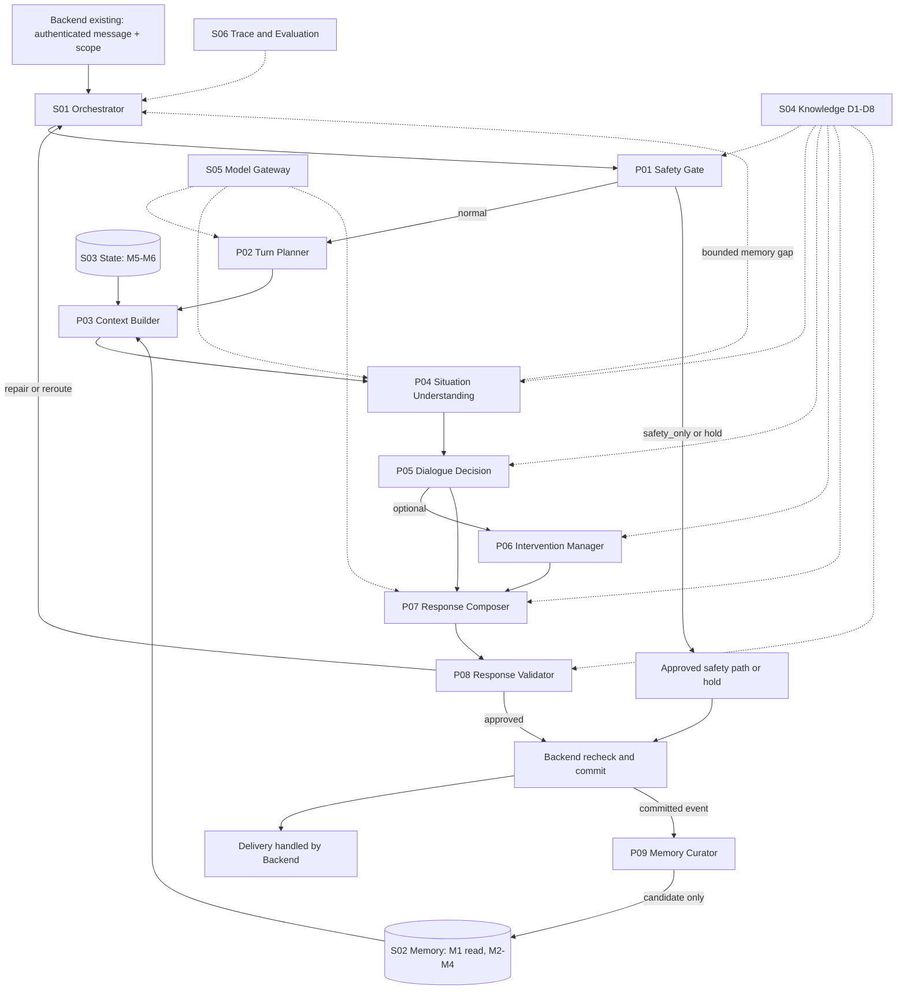

# Theia AI Core — معماری مرجع v1.3

**وضعیت:** `ARCHITECTURE BASELINE — CONDITIONAL` · **مستقل از استقرار و Backend**

## ۱. هدف و خط مرز

تیا یک دستیار گفت‌وگویی با پشتیبانی روان‌شناختی است؛ AI Core باید برای هر پیام با شواهد مجاز تصمیم بگیرد **چه اطلاعاتی لازم است، اکنون چه می‌دانیم، قدم گفت‌وگویی مناسب چیست، آیا مداخله مجاز است، پاسخ چگونه نوشته و کنترل شود و چه چیزی بعداً در حافظه/State ثبت شود**. این طراحی به معنای درمانگر انسانی، تشخیص بالینی یا جایگزین خدمات حرفه‌ای نیست.

**خارج از scope:** طراحی UI، API عمومی، احراز هویت جدید، اسکیمای DB جدید، صف/زیرساخت جدید، Go package layout، کدنویسی، متن دقیق D1–D8، انتخاب قطعی LLM/Jev، آزمایش اثربخشی بالینی. Backend فعلی مالک هویت، حقوق دسترسی، پیام معتبر، رضایت، حذف، رویدادهای عملیاتی و delivery است.

## ۲. مدل ذهنی معماری

| لایه | چه چیزی دارد؟ | چه چیزی **ندارد**؟ |
|---|---|---|
| Processing `P01–P09` | وظایف تحلیل، تصمیم، ساخت/کنترل پاسخ و پیشنهاد حافظه | اختیار واقعی تغییر DB/رضایت/تحویل |
| Orchestrator `S01` | ترتیب و branch، budget، نسخه، recheck و handoff | تشخیص مستقل مسئله یا انتخاب خودسرانه تکنیک |
| Memory `S02/M1–M4` | جست‌وجو و تغییر داده بلندمدت با کنترل معتبر | مالک State فعال یا permission |
| State `S03/M5–M6` | Thread و وضعیت عملیاتی نسخه‌دار، transition با precondition | تبدیل خودکار پیشنهاد مدل به رویداد |
| Knowledge `S04/D1–D8` | بخش‌های تأییدشده دانش وظیفه‌محور و نسخه‌ها | اطلاعات شخصی کاربر یا اجازه عملیاتی |
| Model Gateway `S05` | فراخوانی مدل با payload محدود و خروجی کنترل‌شده | تضمین کیفیت بالینی یا حق ارسال پاسخ |
| Trace/Evaluation `S06` | metadata لازم برای ممیزی و سنجش | منبع حقیقت پیام، رضایت یا محتوای درمانی |
| Backend موجود | هویت، canonical M1، event/commit/delivery، scope/consent/deletion | لزوم بازطراحی کل Backend طبق این سند |

**نمودار بیان‌کننده وابستگی منطقی است**؛ هر فلش یک API call مجزا نیست. S01 همچنین بسته ایمنی و دانش لازم را به هر مرحله می‌رساند. مسیری برای stop/revoke/delete مستقل از P09 و پاسخ عادی وجود دارد (جزئیات در `WORKFLOW.md`).

## ۳. نام‌ها و مرزهای ثابت

### ۹ مسئولیت پردازشی

| شناسه | مسئولیت | خروجی اصلی | گیرنده |
|---|---|---|---|
| P01 | Safety Gate: route/constraint | C02 SafetyResult | S01 و مراحل پاسخ |
| P02 | Turn Planner: intent و درخواست شواهد | C04 TurnPlan | P03/P04/P05 |
| P03 | Context Builder: retrieval محدود با provenance | C06 ContextBundle | P04/P05/P07/P08 |
| P04 | Situation Understanding: observations / hypotheses / gaps / sufficiency | C07 CurrentUnderstanding | P05/P06/P09 |
| P05 | Dialogue Decision: action هدف و thread intent | C09 DialogueDecision | P06/P07/P08/S01 |
| P06 | Intervention Manager: eligibility و مرحله تکنیک | C10 InterventionPlan | P07/P08/S01 |
| P07 | Response Composer: متن و annotation قابل کنترل | C12 ResponseDraft | P08 |
| P08 | Response Validator: approval محدود به نسخه مشخص | C13 ValidationResult | S01 |
| P09 | Memory Curator: پیشنهاد اصلاح حافظه | C15 MemoryChanges | S02 |

### ۶ نقش پشتیبان

`S01` Orchestrator · `S02` Memory Service · `S03` State Manager · `S04` Psychology Knowledge Provider · `S05` Model & Prompt Gateway · `S06` Trace & Evaluation. شرح کامل در `MODULE_SPECIFICATIONS.md`.

### مالکیت داده

- **M1** تاریخچه خام و شناسه‌های واقعی پیام: Backend canonical؛ S02 می‌تواند *read projection* ارائه دهد.
- **M2** حقایق و ترجیحات گزارش‌شده، **M3** رویداد/خلاصه منبع‌دار، **M4** فرضیه و برداشت قابل‌اعتراض: S02 logical owner.
- **M5** موضوع/تمرین/هدف فعال، **M6** state اجرایی و نسخه: S03 logical owner.
- `ContextBundle` داده مشتق موقت برای یک run است؛ منبع حقیقت جدید نیست.

## ۴. آنچه عمداً **جدا** می‌ماند

1. **P02 vs P03:** تعیین نیاز اطلاعاتی در برابر *انجام* retrieval.
2. **P04 vs P05:** درک وضعیت در برابر انتخاب قدم بعد؛ می‌توانند یک مدل call داشته باشند، اما خروجی‌های جدا با ارجاع نسخه‌دار حفظ شوند.
3. **P05 vs P06:** «مداخله را بررسی کن» در برابر بررسی registry و گیت تکنیک خاص.
4. **P05 vs P07:** هدف/Action در برابر کلمات و سبک پاسخ.
5. **P07 vs P08:** تولید محتوا در برابر ارزیابی مستقل متن و شواهد؛ self-annotation جای کنترل نیست.
6. **P09 vs S03:** نوشتن دانش بلندمدت در برابر به‌روزرسانی وضعیت فعال Thread/تمرین.
7. **S02/S03 vs Backend:** مالکیت منطقی داده/transition در مقابل منبع authoritative هویت، مجوز و رویداد.

ادغام **اجرایی** فقط وقتی مجاز است که outputs، gates و امکان ارزیابی مستقل همچنان حفظ شود. به‌ویژه «یک API Call برای همه چیز» یک تصمیم پذیرفته‌شده معماری نیست.

## ۵. ناوردایی‌های اجباری

1. **Identity:** `user_message_id` ≠ `response_message_id`؛ هر artifact به run و conversation درست متصل باشد.
2. **Freshness:** `contract_version`, `context_revision`, `state_version`, `thread_version`, `scope_version`, `knowledge_version` محورهای جداگانه‌اند؛ recheck پیش از side effect حساس.
3. **Provenance:** هیچ claim شخصی بدون source/ref معتبر به fact تبدیل نشود؛ M4 یک hypothesis است، حتی اگر تکرار شود.
4. **Recall:** بازگویی لفظی فقط از M1 `verbatim` مجاز؛ خطای جست‌وجو یا عدم مجوز را «کاربر هرگز نگفته» تعبیر نکنیم.
5. **Authority:** LLM و module output مجوز، رضایت، event، delivery یا commit واقعی تولید نمی‌کنند.
6. **Intervention:** `eligible_to_offer` ≠ `explicitly_agreed` ≠ `started`؛ D5 approved، D7 و consent/State معتبر لازم است.
7. **Validation:** تأیید P08 برای همان draft+decision+context+scope/state است، نه همه پاسخ‌ها و نه مجوز ارسال draft دیگر.
8. **Output status:** drafted، approved، committed، delivered متفاوت‌اند. Timeout نتیجه نامعلوم، شکست قطعی نیست.
9. **Control priority:** stop/revoke/delete بر جریان عادی و حافظه پس از نوبت مقدم است؛ invalidation به تمام مشتقات باید برسد.
10. **Bounded recovery:** supplementary retrieval، retry، repair و redecision نامحدود نیستند و fallback صریح دارند.
11. **Trust boundary:** پیام و حافظه، هرچند درباره کاربر مفید باشند، «دستور سیستم» نیستند.
12. **Knowledge gating:** D5/D7 حساس فاقد تأیید یا revoked نباید به‌صورت فعال اجرا شود.

## ۶. سیاست حالت ناقص و قابلیت حساس

- **Unknown data:** وضعیت missing/partial مشخص است؛ پاسخ محدود می‌شود یا سؤال دقیق انتخاب می‌شود، نه اینکه جای خالی با تخیل پر شود.
- **Unknown approval:** در قابلیت حساس `fail-closed`؛ فقط مسیر جایگزین از پیش مصوب یا hold، نه پروتکل بحران ساختگی.
- **Privacy:** دسترسی/retention برای هر مورد با policy و رویداد Backend؛ حق delete/revoke مستقل از مدل اجرا می‌شود.
- **Clinical scope:** فهرست تکنیک‌ها، شرایط کاربرد و متن D7 هنوز لازم است توسط صاحبان تخصص تأیید شود. معماری بدون آن‌ها محصول کامل نیست.

## ۷. تصمیم درباره شکل اجرا (هنوز باز)

- `S01` به‌صورت workflow کنترل‌شده پیشنهاد می‌شود، نه agent آزاد با side effects؛ شیوه تحقق آن در Go موجود تصمیم Backend owner است.
- مدل/تعداد فراخوانی‌ها/Jev ثابت نشده‌اند. P04+P05 ممکن است مشترک باشند، اما ابتدا کیفیت و سازگاری artifacts ارزیابی شود.
- Fast/Standard/Extended توصیف **عمق اجرا**ست؛ نیازی به سه سامانه مستقل نیست.
- تراکنش، DB، queue، embedding و observability به انتخاب Backend موجود وابسته‌اند؛ تنها **خواص رفتاری** مورد انتظار در `WORKFLOW.md` تعریف شده‌اند.

## ۸. مرجع عملیاتی

برای شناسنامه هر ماژول `MODULE_SPECIFICATIONS.md`، برای قرارداد معنایی `DATA_CONTRACTS.md`، برای چگونگی اجرا `WORKFLOW.md`، برای داده `MEMORY_ARCHITECTURE.md`، و برای محدودیت‌های انتشار `OPEN_DECISIONS.md` را بخوانید. فهرست سناریوهای پذیرش در `SCENARIO_ACCEPTANCE.md` است.
