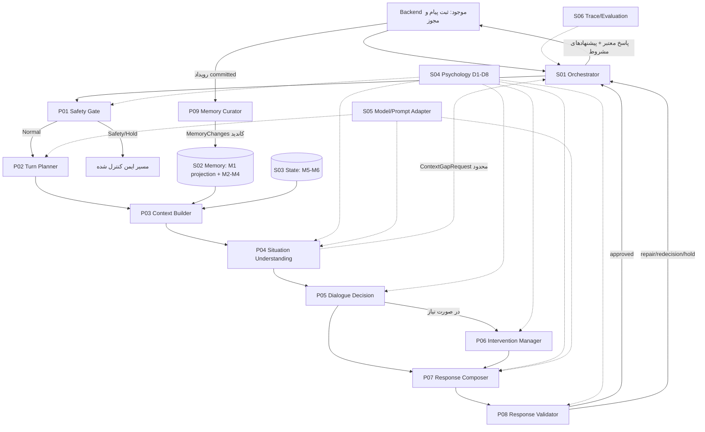

# Theia AI Core — Module Specifications

**مرجع تخصصی بسته نهایی v1.3 / برگرفته از طراحی عملیاتی گام دوم / ۲۰۲۶-۱۱-۱۲**  
**دامنه:** رفتار و قرارداد منطقی AI Core؛ نه ساخت Backend جدید، کد Go، انتخاب مدل یا نگارش متن پرامپت‌ها.  
**مرجع بالادستی جاری:** `AI_CORE_ARCHITECTURE.md`؛ مبنای تبادل داده `DATA_CONTRACTS.md` و مرجع جریان `WORKFLOW.md` است. اسناد قبلی A/B/C/D و Phase5 صرفاً منابع تاریخی/سازگاری‌اند؛ اختلاف‌ها در `CONTRACT_COMPATIBILITY.md` یا `OPEN_DECISIONS.md` ثبت می‌شوند.

## ۱. راهنمای خواندن

- **MUST:** داده/رفتار لازم برای کارکرد منطقی؛ اگر موجود نیست، وضعیت نقص باید آشکار شود. MUST الزاماً یعنی «باید برای هر turn از همه داده‌های کاربر پر شود» نیست.
- **IF:** فقط در صورت تحقق شرط. **MAY:** افزوده اختیاری با مصرف‌کننده معلوم. **MUST NOT:** استفاده/رفتار ممنوع.
- ماژول **مسئولیت منطقی** است؛ لزوماً Agent، سرویس یا فراخوانی مدل مستقل نیست.
- همه شناسه‌ها و مجوزهای authoritative از Backend/سرور می‌آیند. مدل می‌تواند درخواست/پیشنهاد بسازد، نه رویداد معتبر، اجازه یا تغییر دیتابیس.
- `ContextBundle` و `CurrentUnderstanding` در صورت ایجاد داده جدید باید همراه `context_revision` سازگار بازتولید شوند.
- داده‌های M1–M6: M1 تاریخچه canonical در Backend؛ M2 حقایق/ترجیحات گزارش‌شده؛ M3 اپیزودها؛ M4 فرضیه‌ها؛ M5 Thread فعال؛ M6 State اجرایی.

## ۲. نقشه اصلی ارتباطات

**یادداشت:** S01 داده معتبر را به هر مرحله منتقل می‌کند؛ اتصال مستقیم در نمودار فقط وابستگی اطلاعاتی است، نه مجوز خواندن مخزن. S04/S05 برای سایر ماژول‌های وابسته نیز فراخوانی می‌شوند؛ برای خوانایی تمام فلش‌ها رسم نشده‌اند. درخواست کنترل حریم/حذف/توقف مسیر اولویت‌دار Backend است، نه شاخه عادی P09.

## ۳. P01 — Safety Gate

| وجه | قرارداد |
|---|---|
| **مالکیت** | تعیین مسیر ایمنی اولیه و درخواست بازبینی ایمنی در میانه run؛ بدون تشخیص بالینی قطعی. |
| **MUST input** | `TurnContextSeed` (پیام ثبت‌شده، scope معتبر، locale، run IDs)، حداقل policy تأییدشده D7. |
| **IF input** | بخش بسیار محدود و مجاز از زمینه ایمنی/State اگر برای بررسی لازم باشد؛ سیگنال escalation جدید از P04/P05/P08. |
| **MUST output** | `SafetyResult` شامل route، قیود عملیات/پاسخ، وضعیت ارزیابی، نسخه policy، source/ref علائم قابل استناد. |
| **Downstream** | S01 (route)، P02 (فقط مسیر normal)، P07/P08 (محدودیت‌ها). |
| **Triggers** | همه نوبت‌های ورودی؛ تکرار محدود هنگام سیگنال خطر جدید یا تغییر موثر D7/scope. |
| **Fallback** | در نبود D7 معتبر یا خطای critical: مسیر ایمن تأییدشده یا hold، نه عبور به مسیر مداخله. |
| **MUST NOT** | استفاده خودکار از تمام سابقه، افشای محتوای restricted، تبدیل متن کاربر به diagnosis، صدور خودکار رویداد ارجاع واقعی. |
| **Knowledge** | D7 اصلی؛ D6 تنها در صورت نیاز و با مجوز. |

## ۴. P02 — Turn Planner

| وجه | قرارداد |
|---|---|
| **مالکیت** | تشخیص درخواست فعلی و برنامه درخواست شواهد؛ نه انتخاب نوع پاسخ. |
| **MUST input** | `TurnContext` پس از P01: message، recent_messages محدود (ممکن است خالی)، locale، brief نسخه‌دار M6، `SafetyResult`; scope token فقط در سمت سرور. |
| **IF input** | brief M5 و essential preferences M2 به شرط مجوز و ارتباط. |
| **MUST output** | `TurnPlan {run_id, primary_intent, topic_hints[], reference_hints[], retrieval_mode, retrieval_requests[], unresolved_reference}`؛ `secondary_intents[]` مجاز و دارای مصرف‌کننده است. |
| **Downstream** | P03 درخواست‌های بازیابی؛ P04/P05 intent و نشانه‌های ارجاع؛ S01 بودجه و routing. |
| **Triggers** | پیام مجاز در مسیر normal؛ برای پیام ساده اجرای هم‌زمان با ماژول دیگر فقط با حفظ قرارداد. |
| **Fallback** | اگر خروجی ناقص/نامعتبر بود، S01 از مسیر حداقلی کنترل‌شده یا retry محدود استفاده می‌کند؛ retrieval آزاد شروع نمی‌شود. |
| **MUST NOT** | فراخوانی بدون سقف تمام M1، اعلام اینکه واقعاً چه مشکل روان‌شناختی وجود دارد، انتخاب Action نهایی، صدور دسترسی جدید. |
| **Knowledge** | D2 اصلی؛ برش محدود D4 برای taxonomy درخواست، D6 برای ارجاع و تداوم. |

**قانون تطبیق:** `retrieval_mode=none` مستلزم `retrieval_requests=[]` است. `expanded` به معنی «بازیابی محدودتر در گستره معنایی بیشتر» است، نه دسترسی نامحدود. درخواستی برای `exact_quote` باید `allow_summary=false` و اشاره به M1 داشته باشد.

## ۵. P03 — Context Builder

| وجه | قرارداد |
|---|---|
| **مالکیت** | اجرای retrieval تحت scope و ساخت بسته شواهدِ قابل ردیابی؛ نه تفسیر علّی. |
| **MUST input** | TurnPlan معتبر، message_id/run_id، snapshot نسخه‌دار State و authorization/scope معتبر؛ پاسخ‌های S02/S03 یا وضعیت شکست آن‌ها. |
| **IF input** | `ContextGapRequest` تکمیلی P04 با تصمیم S01، سقف و منبع تعیین‌شده. |
| **MUST output** | `ContextBundle {context_revision, context_items[], retrieval_coverage[], retrieval_gaps[], state_snapshot_ref}`. هر item دارای source/representation/epistemic/status/version و evidence pointer معتبر باشد. |
| **Downstream** | P04، P05، برش شواهد P07 و index مستقل P08. |
| **Triggers** | ساخت حداقل کانتکست در مسیر normal حتی بدون retrieval؛ بازیابی بلندمدت فقط با درخواست مشخص و مجوز. |
| **Fallback** | `partial`, `not_found`, `restricted`, `error`, `unavailable` از هم جدا؛ بودجه/قطع ارتباط مشخص. |
| **MUST NOT** | تبدیل M4 به fact، نقل‌قول «دقیق» از M3/M4، حذف تعارض منبع‌ها به‌صورت خاموش، اجرای دستور داخل حافظه. |
| **Knowledge** | D2 قواعد relevance/source؛ D6 تداوم و چرخه حافظه؛ D7 قواعد مجوز سروری (خود ماژول مرجع permission نیست). |

**قاعده:** هر round تکمیلی که شواهد را تغییر دهد `context_revision` را زیاد می‌کند و خروجی‌های P04/P05/P07/P08 وابسته به نسخه قبلی را منسوخ می‌سازد.

## ۶. P04 — Situation Understanding

| وجه | قرارداد |
|---|---|
| **مالکیت** | شکل‌دادن به فهم توصیفی و فرضیه‌های محتاطانه؛ نه تصمیم درباره کنش بعدی. |
| **MUST input** | پیام فعلی، TurnPlan، ContextBundle، SafetyResult و snapshot State منطبق با context_revision. |
| **IF input** | brief یک مسیر فعال، هدف/بازخورد قبلی، ترجیحات مرتبط؛ فقط اطلاعات مجاز. |
| **MUST output** | `CurrentUnderstanding` با `focus`، `observations[]`, `hypotheses[]`, `information_gaps[]`, `sufficiency_assessment`, `thread_alignment`, `retrieval_quality`, `context_revision`, `understanding_id`. |
| **Optional output** | `ContextGapRequest` برای «داده‌ای که احتمالاً در حافظه موجود است»، نه داده‌ای که فقط کاربر می‌داند؛ `safety_escalation_hint`. |
| **Downstream** | P05، P06 (برش لازم)، P09 (برش مستند و غیرقطعی)، S01 (بازیابی تکمیلی/ایمنی). |
| **Triggers** | مسیر normal؛ عمق تحلیل وابسته به پیام و شواهد. در refresh کانتکست باید دوباره تولید شود. |
| **Fallback** | مشاهده محدود با بیان unknown؛ اگر خطر جدید دید، ارجاع P01/S01؛ اگر نیاز به حافظه، `ContextGapRequest` محدود. |
| **MUST NOT** | diagnosis قطعی، جعل observation، تبدیل M4 به user_reported، انتخاب Action یا تکنیک و تغییر حافظه. |
| **Knowledge** | D2 + D3 اصلی (با عمق شرطی)، D6/D7 در صورت کاربرد. |

**قانون کفایت:** ارزیابی جدا برای reflection، clarification، general guidance و intervention evaluation؛ یک فیلد `enough_information: true/false` جای این را نمی‌گیرد.

## ۷. P05 — Dialogue Decision Engine

| وجه | قرارداد |
|---|---|
| **مالکیت** | انتخاب کنش اصلی همین نوبت، هدف پاسخ و نیت Thread؛ نه ساخت متن یا انتخاب تکنیک نهایی. |
| **MUST input** | پیام و TurnPlan، CurrentUnderstanding هم‌نسخه ContextBundle، SafetyResult، brief معتبر State. |
| **IF input** | ترجیح ارتباطی، محدودیت‌های مربوط به موضوع فعال، capability index محدود D5 (نه کتابخانه کامل). |
| **MUST output** | `DialogueDecision` شامل `decision_id`, `understanding_ref`, `primary_action`, `response_goal`, `focus_gap_ids[]`, `response_constraints`, `thread_intent`, `intervention_request|null`. |
| **Optional output** | `secondary_actions[]`, `decision_rationale` خلاصه قابل‌ممیزی، `StateChangeProposal[]`, `needs_safety_reroute`, `fallback_intent`. برای حفظ سازگاری با گروه B، `secondary_actions`, `decision_rationale`, `state_change_proposals`, `needs_safety_reroute` در wire contract legacy همچنان الزامی‌اند؛ در interface مفهومی می‌توان مقدار پیش‌فرض تهی داد. |
| **Downstream** | P06 شرطی، P07، P08، S01، S03 فقط با پیشنهادهای تأییدشده در S01. |
| **Triggers** | پاسخ‌های normal. اگر P06 blocked شد یا P08 requires_redecision داد، بازتصمیم محدود. |
| **Fallback** | برگزیدن پاسخ محدود/clarify/defer در چارچوب سیاست، بدون ساخت تمرین بی‌مبنای D5. |
| **MUST NOT** | اجرای مستقیم ابزار/تمرین، جعل consent، تغییر persistent State، تعیین policy جدید، تولید پاسخ نهایی. |
| **Knowledge** | D4 اصلی، D6/D7 به فراخور؛ D1 hints محدود. |

**مرز:** P04 می‌گوید «چه چیزی کم است؟» و P05 تصمیم می‌گیرد «آیا همین حالا برای روشن‌شدن آن سؤال بپرسیم؟». `thread_intent` صرفاً نیت است.

## ۸. P06 — Intervention Manager

| وجه | قرارداد |
|---|---|
| **مالکیت** | بررسی قابلیت پیشنهاد/ادامه/بازبینی یک تکنیک مشخص از رجیستری تأییدشده. |
| **MUST input** | intervention_request معتبر P05، CurrentUnderstanding محدود، SafetyResult، D5 entry معتبر، D7 و داده‌های state/consent authoritative مرتبط. |
| **IF input** | feedback قبلی یا هدف Thread، preference و D3/D6 موردنیاز. |
| **MUST output** | `InterventionPlan` شامل `plan_id`, `decision_id`, `mode`, `feasibility_status`, `selected_intervention|null`, `goal`, `prerequisite_assessment[]`, `consent_state`, `next_intervention_step|null`, `blocking_reasons[]`. |
| **Optional output** | `state_change_proposals[]`, `recommended_dialogue_fallback`, `consent_evidence_refs[]`, `rationale_evidence_refs[]`; اما consent evidence برای status صریح `explicitly_agreed` الزامی است. |
| **Downstream** | P07/P08، S01؛ S03 فقط proposal منطبق با event. |
| **Triggers** | فقط وقتی P05 درخواست داده یا Thread مداخله معتبر نیازمند بازبینی است. |
| **Fallback** | `blocked`, `defer`, `needs_information` بدون تکنیک جدید؛ اجازه fallback محدود به P05/S01، نه تغییر خودسرانه primary_action. |
| **MUST NOT** | ساخت تکنیک دلخواه، نتیجه‌گیری از سکوت به رضایت، فعال‌سازی تمرین صرفاً با انتخاب، اجرای درمان تأییدنشده. |
| **Knowledge** | D5 اصلی و D7، D6 برای پیگیری؛ D3 شرطی. |

**گیت محتوایی:** تا تصویب D5/D7 و دامنه قابلیت محصول، این ماژول باید بتواند به شکل `defer/blocked` کار کند؛ هیچ گزینه تأییدنشده‌ای به عنوان intervention اجرایی عرضه نشود.

## ۹. P07 — Response Composer

| وجه | قرارداد |
|---|---|
| **مالکیت** | تبدیل تصمیم و شواهد به متن طبیعی؛ نه تغییر تصمیم و State. |
| **MUST input** | پیام، آخرین DialogueDecision معتبر، برش مجاز CurrentUnderstanding/ContextBundle، safety constraints، communication profile و pinned D1/D7. |
| **IF input** | InterventionPlan مجاز، مرحله مشخص D5، سؤال هدف، سوابق exact recall از M1 مجاز. |
| **MUST output** | `ResponseDraft` با `draft_id`, `response_text`, `decision_ref` (decision_id, understanding_id, context_revision, state_version)، `questions[]`, `claims[]`, `intervention_usage`, `language`. |
| **Downstream** | P08 و S01؛ هرگز مستقیم به delivery. |
| **Triggers** | تصمیم معتبر/مسیر vetted safety. |
| **Fallback** | گزارش نقص داده/ناتوانی در تأمین الزامات؛ بازگرداندن به S01. |
| **MUST NOT** | ساخت شاهد/نقل دقیق از خلاصه، معرفی تکنیک مسدود، تغییر خاموش Action، ادعای اجرای عملیاتی بدون event معتبر، ثبت Memory/State. |
| **Knowledge** | D1 اصلی، D4 محدود برای وفاداری action، D7 اصلی؛ D5 فقط stage مجاز. |

**یک تفاوت مهم:** ادعای `claims[]` یا `communication_declarations` که خود P07 گزارش می‌کند سند تأیید نیست؛ P08 متن کامل را مستقل با evidence می‌سنجد. برش شواهد به معنی مجوز جدید از طرف LLM نیست.

## ۱۰. P08 — Response Validator

| وجه | قرارداد |
|---|---|
| **مالکیت** | تصمیم درباره معتبر/قابل‌ثبت‌بودن همان نسخه Draft، با کنترل ایمنی، شواهد و سازگاری با Decision/Intervention. |
| **MUST input** | ResponseDraft، authoritative DialogueDecision/P06، independent evidence index، SafetyResult، constraints، context_revision و State snapshot معتبر، D7 و قواعد بررسی. |
| **IF input** | D1/D4/D5 policy slices برای بررسی موضوعی/مداخله. |
| **MUST output** | `ValidationResult` شامل `validation_id, draft_id, decision_id, context_revision, status`, مسائل/بایدها، و approved_draft_id فقط در حالت تأیید. |
| **Downstream** | S01: approve → recheck+commit؛ repairable → P07؛ requires_redecision → P05؛ safety_fallback/hold → مسیر ایمن. |
| **Triggers** | هر پیش‌نویس نهایی پیش از ثبت/ارسال. |
| **Fallback** | خطا/عدم دسترسی validator ≠ approved؛ S01 hold یا fallback محدود معتبر را بررسی می‌کند. |
| **MUST NOT** | خودتأییدی صرفاً با annotation P07، اصلاح مخفی decision، ارسال مستقیم پاسخ، تفسیر latency/خطای مدل به approval. |
| **Knowledge** | D7 اصلی؛ D1 و D4/D5 محدود به checkهای لازم. |

**گیت:** validation فقط برای **همان** `draft_id`, `decision_id`, `context_revision` و state/scope اعتبار دارد. نسخه منسوخ نتیجه `approved` قابل reuse نمی‌دهد.

## ۱۱. P09 — Memory Curator

| وجه | قرارداد |
|---|---|
| **مالکیت** | پیشنهاد ایجاد/اصلاح/ادغام/رد اطلاعات بلندمدت M2/M3/M4 بر پایه شواهد معتبر. |
| **MUST input** | رخداد persisted پیام و در mode post_response رخداد committed پاسخ، برش evidence از P04 و M2–M4 نسخه‌دار، scope و retention policy معتبر. |
| **IF input** | Feedback/Intervention refs، mode user_event_only در صورت مجاز بودن و بدون response committed. |
| **MUST output** | `MemoryChanges` با `change_set_id`, `source_event_ids[]`, `candidate_changes[]`, هر مورد حاوی type/operation/evidence/version/uncertainty و در صورت خالی بودن علت no-write. |
| **Downstream** | S02 write side (فقط بعد از کنترل permission/version)، S06 metadata trace. |
| **Triggers** | به‌صورت جدا پس از رخداد معتبر، یا event-only محدود اگر مجوز دارد؛ مسیر فوری توقف/حذف از این ماژول نمی‌گذرد. |
| **Fallback** | `candidate_changes=[]`, defer، یا job failure قابل ثبت/رسیدگی؛ شکست P09 نباید پاسخ committed را rollback کند. |
| **MUST NOT** | تغییر M1 یا M5/M6، auto-diagnosis، تبدیل inference به fact، پنهان‌کردن provenance، تأیید حذف با ادعای مدل. |
| **Knowledge** | D2، D6 اصلی؛ D3 برای فرضیه؛ D7 برای حریم و منع ثبت نامناسب. |

## ۱۲. درگاه‌های منطقی و سرویس‌های مشترک S01–S06

| ID | نقش / ورودی ضروری | خروجی/وظیفه ضروری | مجاز نیست / وضعیت خطا |
|---|---|---|---|
| **S01 Orchestrator** | `TurnContextSeed` و artifactهای نسخه‌دار، safety/knowledge/scope، محدودیت بودجه | شاخه‌بندی و ترتیب اجرا، artifact routing، کنترل سقف/خطا، `TurnExecutionResult` و پیشنهاد commit معتبر به Backend | تصمیم روان‌شناختی خام یا side effect از متن مدل؛ `unknown` را شکست قطعی حساب نکند؛ retry بدون idempotency ممنوع. |
| **S02 Memory Service** | `MemoryQuery` scoped یا `MemoryWriteRequest` معتبر؛ M1 projection + M2–M4 | `MemoryReadResult`, `MemoryWriteResult` با وضعیت و version، CAS و provenance | مالک canonical M1، M5/M6 یا permission مستقل نیست؛ restricted و not_found را یکی نکند. |
| **S03 State Manager** | `StateReadRequest` یا `StateCommitRequest` با proposal/versions/events/consent | `StateReadResult`, `StateCommitResult` و transitions معتبر M5/M6 | پیشنهاد مدل را مستقیم commit نکند؛ outcome نامعلوم را موفق اعلام نکند؛ approval plan ≠ موافقت. |
| **S04 Knowledge Provider** | module/task, domain section, locale, workflow/contract version | `KnowledgeSliceResult` همراه pack_id/version/approval/digest و constraints | draft/revoked D5/D7 را active نکند؛ متن حافظه را به دستور system ارتقا ندهد. |
| **S05 Model/Prompt Gateway** | task-specific bounded inputs, knowledge slices, expected output shape, budget و scope | `ModelTaskResult`، نسخه مدل و token/latency/error، خروجی parseable | موفقیت API را معادل ایمنی/مجوز ارسال نداند؛ مجوز را از prompt نخواند. |
| **S06 Trace & Evaluation** | metadata و رویدادهای مجاز، policy/contract versions، نتیجه stageها | trace قابل‌ممیزی، input برای ارزیابی D8 | log پیش‌فرض متن حساس یا ادعای اثربخشی بدون آزمون؛ trace ≠ event authoritative. |

### ۱۲.۱. مرزهای Backend موجود

| Capability از Backend | تعهدی که AI Core به آن وابسته است | اگر فعلاً فراهم نبود |
|---|---|---|
| احراز هویت + permission/scope | subject_ref سروری، scope_version معتبر، recheck | محدودکردن حافظه/قابلیت؛ هیچ اختراع permission از مدل. |
| Message Store و delivery | persist idempotent user/assistant messages، `response_committed` و `delivered` مستقل | عدم ادعای تحویل؛ commit نامعلوم را reconcile. |
| رویداد consent/stop/delete | مسیر اولویت‌دار مستقل و امکان invalidation | مداخله حساس و retention ممنوع تا روشن‌شدن کنترل. |
| persistence هماهنگ State | atomicity یا ضمانت معادل برای پاسخ و transition حساس | hold transition حساس؛ بدون ادعای «شروع شد». |
| clock/event/identity/trace | timestamp و ID و event refs قابل‌استناد | عدم جعل تاریخ/رخداد. |

## ۱۳. الگوهای اجرای منطقی

**مسیر ساده:** P01 → (P02/P03 حداقل) → (P04/P05 به شکل مشترک مجاز) → P07 → P08 → S01/Backend commit → P09 در صورت trigger. *ادغام مدل از این ترتیب منطقی و گیت‌ها چیزی کم نمی‌کند.*

**مسیر استاندارد:** P01 → P02 → P03/S02/S03 → P04 → P05 → P06 در صورت نیاز → P07 → P08 → recheck → commit → delivery و curation مستقل.

**مسیر کنترل داده:** درخواست stop/revoke/delete از Backend/permission به S03/S02 و invalidation می‌رود؛ منتظر P09 و «جواب خوب مدل» نمی‌ماند.

**خطا:** retrieval ناموفق → gap قابل ردیابی؛ P04 missing user-only → P05 می‌تواند clarify کند؛ P06 blocked → P05 limited redecision؛ P08 repairable → P07 فقط repair محلی؛ stale context → invalidation؛ persist unknown → query by idempotency key.

## ۱۴. گزینه‌های اجرای باز در بسته نهایی

1. **پیشنهادی:** برای V0، S01 یک workflow کنترل‌شده باشد، نه autonomous agent؛ این تصمیم مرز منطقی است نه زبان پیاده‌سازی.
2. **پیشنهادی:** P04/P05 در صورت مشاهده سازگاری خروجی و کیفیت، در یک API Call اجرا شوند؛ **قراردادها جدا**.
3. **باز:** انتخاب provider/model، Jev، تعداد call، latency/cost budget، عدد نهایی retry/retrieval/repair.
4. **باز:** نسخه‌های واقعی D1–D8، میزان تأیید تخصصی D5/D7، scope قابلیت بالینی.
5. **باز:** retention/consent policy و رفتار اجرای داده حساس با Backend Go موجود.
6. **باز:** شکل فیزیکی transaction/outbox، پیاده‌سازی storage، برش‌های دقیق prompt و طبقه‌بندی حساسیت.
7. **باز:** اصلاحات کوچک wire contract legacy؛ حداقل‌ها در این سند تعهد *معنایی* هستند، نه API/JSON Schema نسخه 1.2 اجباری.

**منطق اولویت:** هیچ مرحله‌ای اجازه ندارد به دلیل بازبودن گزینه فنی، محدودیت‌های قطعی شواهد، مجوز، رضایت یا استناد به منبع را حذف کند.

*پایان MODULE_SPECIFICATIONS — مرجع تخصصی v1.3.*

