# The Path — 61-Screen Design Reference Audit (English)

**Source:** 61 original JPG screenshots, numbered `photo_61` down to `photo_1`, each 1080 × 2400. Their names and descending order are retained. This is a visual analysis of a third-party product, **not** a confirmation of its functional or clinical behavior. Screen numbers are the submitted file order, not proven application navigation order. Images contain UI states such as keyboard-open, scrolled lists and transient operating-system notices; do not mistake these for default page composition.

## Executive visual findings

The Path uses a deliberate visual rhythm: **dark brand narrative → nearly blank light onboarding → centered emotional reflection → selective atmospheric color interruptions → consistent full-image AI guide cards → immersive dark chat → softly curved, light dashboard**.

The transferable value is the hierarchy and rhythm, not direct imitation: one primary job per page; generous negative space; expressive serif headlines with light functional text; restrained neutral canvases; thin borders and minimal controls; occasional blurred gradients; consistent bottom pill CTAs; and repeating high-quality card primitives. Each screen below distinguishes observation from proposed implementation guidance.

## Confidence and originality boundaries

- **Direct observation:** visible layout, color family, text hierarchy, static affordances, icon placement, and apparent selected/disabled states.
- **Approximation:** sampled-looking HEX values, CSS pixel values, corner radii, fonts and animation assumptions are **not official exported The Path design tokens**.
- **Not verifiable from images:** true branching logic, tests and scoring, AI behavior, memory logic, animation curves, permission behavior, accessibility, confidentiality, licensing, real clinician involvement or security guarantees.
- **Original MVP:** do not copy The Path's trademark/logo, photography of people, original named AI guides, testimonials, metrics, illustrations, copy, or screen-for-screen copyrighted artwork. Use the source screenshots only as product-design reference material.
- **Our product's latest requirements:** five behavior-based communication styles with abstract identities, independent unlimited chat threads with selectively contextual shared memory, self-understanding profile, assessments and modular mock data. Not timed therapy appointments, camera emotion recognition or compulsory long onboarding.

## Index (every screenshot, descending as supplied)

| Reference | Screen | Reuse decision |
|---|---|---|
| [photo_61](#61-photo_61) | Progress-oriented brand statement | ADAPT |
| [photo_60](#60-photo_60) | Always-available support proposition | ADAPT |
| [photo_59](#59-photo_59) | Guided method / how it works | ADOPT |
| [photo_58](#58-photo_58) | Boundaries and urgent-help notice | ADAPT |
| [photo_57](#57-photo_57) | Atmospheric splash / start | ADOPT |
| [photo_56](#56-photo_56) | Preferred name question | ADOPT |
| [photo_55](#55-photo_55) | Language picker / scrolled state | REFERENCE |
| [photo_54](#54-photo_54) | Introduction to the onboarding journey | ADAPT |
| [photo_53](#53-photo_53) | Personalized welcome pause | ADOPT |
| [photo_52](#52-photo_52) | Gender preference question | ADAPT |
| [photo_51](#51-photo_51) | Age question / numeric keyboard | ADAPT |
| [photo_50](#50-photo_50) | Account creation / save progress | ADAPT |
| [photo_49](#49-photo_49) | Orange quantified testimonial moment | REFERENCE |
| [photo_48](#48-photo_48) | Country of residence selector | REFERENCE |
| [photo_47](#47-photo_47) | Open-ended personal background | ADOPT |
| [photo_46](#46-photo_46) | First reflective interlude | ADAPT |
| [photo_45](#45-photo_45) | Prior therapy / coaching experience | REFERENCE |
| [photo_44](#44-photo_44) | Main reason for visiting / free response | ADOPT |
| [photo_43](#43-photo_43) | Reassurance interlude | ADAPT |
| [photo_42](#42-photo_42) | First-time concerns / open question | REFERENCE |
| [photo_41](#41-photo_41) | Identify a hard-to-name feeling | ADAPT |
| [photo_40](#40-photo_40) | Motivation-to-change slider | REFERENCE |
| [photo_39](#39-photo_39) | Reflection about unanswered message | ADAPT |
| [photo_38](#38-photo_38) | Blue-violet quantified testimonial | REFERENCE |
| [photo_37](#37-photo_37) | Desired emotional outcome | ADAPT |
| [photo_36](#36-photo_36) | Session pacing interlude | REFERENCE |
| [photo_35](#35-photo_35) | Recent lighter moment | REFERENCE |
| [photo_34](#34-photo_34) | Small helpful next step | ADAPT |
| [photo_33](#33-photo_33) | Forest-green quantified testimonial | REFERENCE |
| [photo_32](#32-photo_32) | A moment of feeling authentic | REFERENCE |
| [photo_31](#31-photo_31) | Values under difficulty | REFERENCE |
| [photo_30](#30-photo_30) | Private, unhurried space interlude | ADAPT |
| [photo_29](#29-photo_29) | Second forest testimonial | REFERENCE |
| [photo_28](#28-photo_28) | Two-week mood frequency item 1 | REFERENCE |
| [photo_27](#27-photo_27) | Two-week mood frequency item 2 | ADOPT |
| [photo_26](#26-photo_26) | Referral / acquisition source | AVOID |
| [photo_25](#25-photo_25) | Two-week worry control item 2 | REFERENCE |
| [photo_24](#24-photo_24) | Two-week anxiety frequency item 1 | REFERENCE |
| [photo_23](#23-photo_23) | Conditional AI referral detail | AVOID |
| [photo_22](#22-photo_22) | Empty home / first focus area | ADOPT |
| [photo_21](#21-photo_21) | Guide catalog / Tony locked | ADAPT |
| [photo_20](#20-photo_20) | Guide catalog / Jade | ADAPT |
| [photo_19](#19-photo_19) | Guide catalog / Sophie | ADAPT |
| [photo_18](#18-photo_18) | Guide catalog / Barbara | ADAPT |
| [photo_17](#17-photo_17) | Guide catalog / Ellen | ADAPT |
| [photo_16](#16-photo_16) | Guide catalog / Rosa | ADAPT |
| [photo_15](#15-photo_15) | Guide catalog / Randall | ADAPT |
| [photo_14](#14-photo_14) | Guide catalog / Jay | ADAPT |
| [photo_13](#13-photo_13) | Guide catalog / Theo | ADAPT |
| [photo_12](#12-photo_12) | Guide catalog / Vivian | ADAPT |
| [photo_11](#11-photo_11) | Guide catalog / Marcus | ADAPT |
| [photo_10](#10-photo_10) | Guide catalog / Ty last card | ADAPT |
| [photo_9](#9-photo_9) | Selected guide detail / audio preview | ADAPT |
| [photo_8](#8-photo_8) | Optional facial-expression permission | AVOID |
| [photo_7](#7-photo_7) | Timed session length picker | AVOID |
| [photo_6](#6-photo_6) | Long guide biography continuation | ADAPT |
| [photo_5](#5-photo_5) | First personalized conversation | ADOPT |
| [photo_4](#4-photo_4) | Active chat and waiting feedback | ADOPT |
| [photo_3](#3-photo_3) | Populated home with recent focus | ADOPT |
| [photo_2](#2-photo_2) | Focus-area detail and report processing | ADAPT |
| [photo_1](#1-photo_1) | Open navigation drawer | REFERENCE |

## Detailed screen-by-screen notes

### 61. `photo_61` — Progress-oriented brand statement

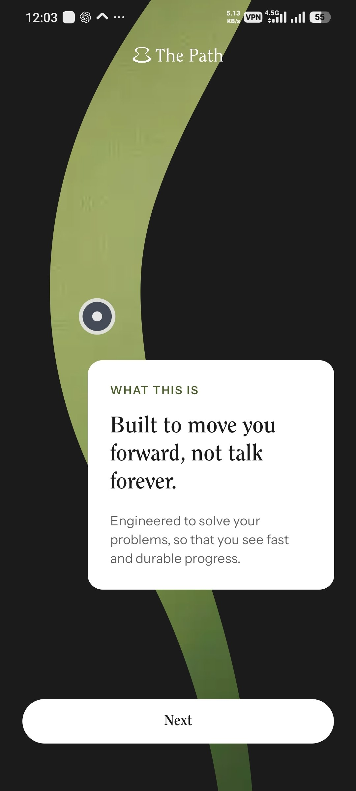

**What the screen shows:** Introduces The Path's promise of forward movement rather than endless conversation, using a short statement inside a narrative card.

**Direct visual observations:** Charcoal full-screen background, broad curving olive ribbon, concentric route marker, centered white brand mark near top, floating white card with tiny green eyebrow, expressive black serif heading, muted sans description, and full-width white pill CTA anchored near bottom. Generous black negative space separates the marker from the card.

**Figma/component guidance (proposed, not verified behavior):** Create NarrativeIntroSlide using a reusable ribbon path, independently positioned route marker and 3-level content card. Support positional variants rather than swapping only the words. Motion is unverified.

**Relevance to our MVP:** ADAPT: editorial brand opening and path metaphor are useful; do not copy the brand mark or exact path geometry.

---

### 60. `photo_60` — Always-available support proposition

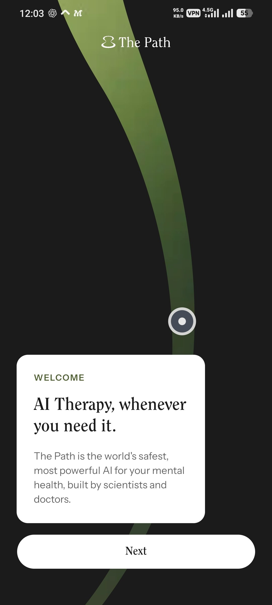

**What the screen shows:** Presents an AI therapy availability claim and brief explanation inside a branded slide.

**Direct visual observations:** Same very dark stage and olive route motif as screen 61, but the ribbon curves rightward, route marker appears lower and the white text card is positioned lower with a large empty area above it. White pill Next button stays consistent.

**Figma/component guidance (proposed, not verified behavior):** Reuse IntroSlide with cardPlacement=low and routeVariant=right; preserve the disciplined spatial rhythm. Avoid asserting licensed therapy or always-available service without substantiation.

**Relevance to our MVP:** ADAPT: short value proposition; communicate an AI companion rather than a human therapist.

---

### 59. `photo_59` — Guided method / how it works

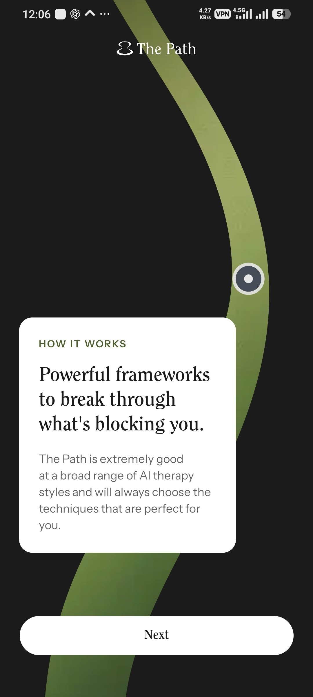

**What the screen shows:** Describes frameworks for addressing issues, rather than merely talking.

**Direct visual observations:** Narrower slanted olive ribbon on right, route marker at mid-height, floating white narrative card toward left upper-middle, black serif headline, short gray sans explanation, top white wordmark, and bottom white Next pill.

**Figma/component guidance (proposed, not verified behavior):** Use a third IntroSlide variant. Give cards safe text width and keep ornamental ribbon separate from tap targets; accommodate compact Persian headlines.

**Relevance to our MVP:** ADOPT: reuse visual narrative rhythm, not claims about scientifically proven methods.

---

### 58. `photo_58` — Boundaries and urgent-help notice

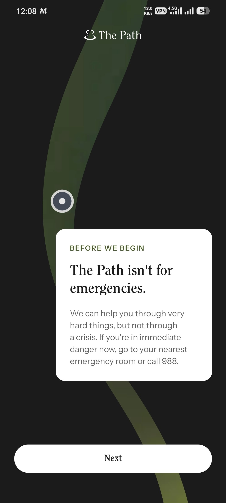

**What the screen shows:** States that the reference product is not for emergencies and mentions US support number 988.

**Direct visual observations:** Nearly black background with darkened olive ribbon, small route marker near left side, white safety message card toward lower half, editorial warning headline rather than red emergency banner, white bottom CTA.

**Figma/component guidance (proposed, not verified behavior):** Create a branded SafetyBoundary screen with a clear accessible route to help; emergency support must be localized to the user's country. Do not copy 988 as universally applicable.

**Relevance to our MVP:** ADAPT: respectful, visible safety boundary; no US-only number in a Persian-only product without localization.

---

### 57. `photo_57` — Atmospheric splash / start

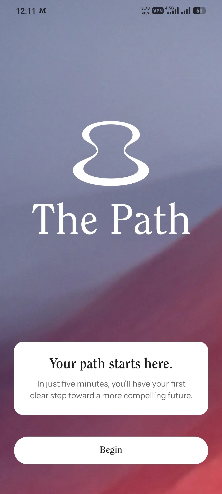

**What the screen shows:** Introduces the product identity and invitation to begin.

**Direct visual observations:** Large white organic emblem above oversized serif brand name, lavender/slate-blue/coral blurred atmospheric backdrop, white low-positioned message card with centered serif title and short body, white pill Begin button at bottom. Image feels spacious and cinematic.

**Figma/component guidance (proposed, not verified behavior):** Build SplashHero with independently layered artwork, low-contrast atmospheric background, message card and fixed CTA. Make logo and composition original.

**Relevance to our MVP:** ADOPT: memorable minimalist welcome, organic visual texture.

---

### 56. `photo_56` — Preferred name question

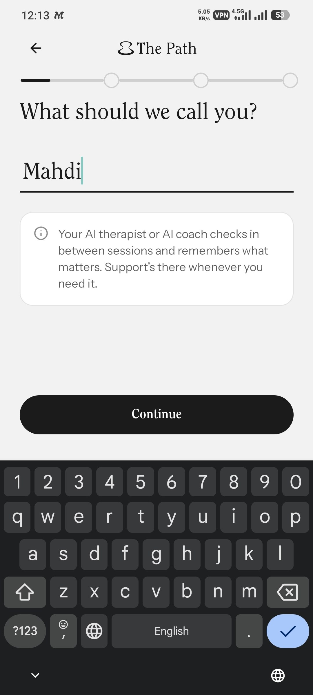

**What the screen shows:** Asks the user what they should be called; an example name is being typed.

**Direct visual observations:** Pale gray canvas, compact header with back arrow and brand, thin dot/line progress, oversized serif prompt, simple underlined text field with active cursor, white info card with small info icon, dark CTA placed directly above visible mobile keyboard.

**Figma/component guidance (proposed, not verified behavior):** Design QuestionTextInput with empty, focused, filled, error and keyboard-open states. Reposition CTA above keyboard; do not hide the explanation behind it.

**Relevance to our MVP:** ADOPT: optional name capture, simple text entry, keyboard-safe bottom button.

---

### 55. `photo_55` — Language picker / scrolled state

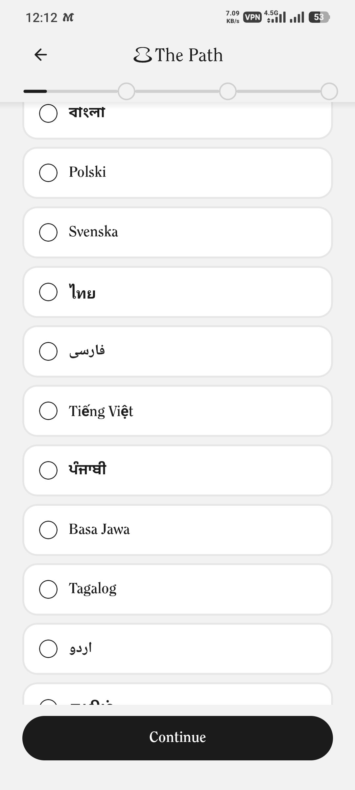

**What the screen shows:** Displays a long scrolling single-choice language list that includes Persian, with heading currently scrolled off-screen.

**Direct visual observations:** Repeated low-contrast outlined white rounded option rows; unselected small circular controls to left of English labels. Header, slim progress system and dark bottom CTA remain visible; this is a scrolled viewport rather than an initial layout.

**Figma/component guidance (proposed, not verified behavior):** Define ScrollableRadioList plus sticky header/footer and content bottom inset. Mirror logical radio placement for RTL. In a Persian-only MVP this step may not be needed.

**Relevance to our MVP:** REFERENCE: selection-row design; language selection probably unnecessary for initial Persian-only release.

---

### 54. `photo_54` — Introduction to the onboarding journey

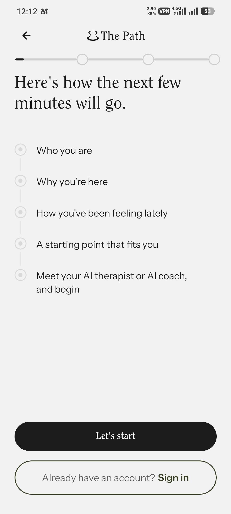

**What the screen shows:** Explains five upcoming steps: personal background, reason for coming, recent feelings, starting point, and guide.

**Direct visual observations:** Large serif heading above an unusually airy vertical timeline of fine connectors and small circular markers. Compact progress top; filled black Let's start CTA and outline Sign in secondary action at bottom.

**Figma/component guidance (proposed, not verified behavior):** Build JourneyTimeline with connectors/markers that can switch to the right in RTL. Keep primary and secondary actions visually distinct.

**Relevance to our MVP:** ADAPT: short onboarding orientation; not necessarily the original five-step sequence.

---

### 53. `photo_53` — Personalized welcome pause

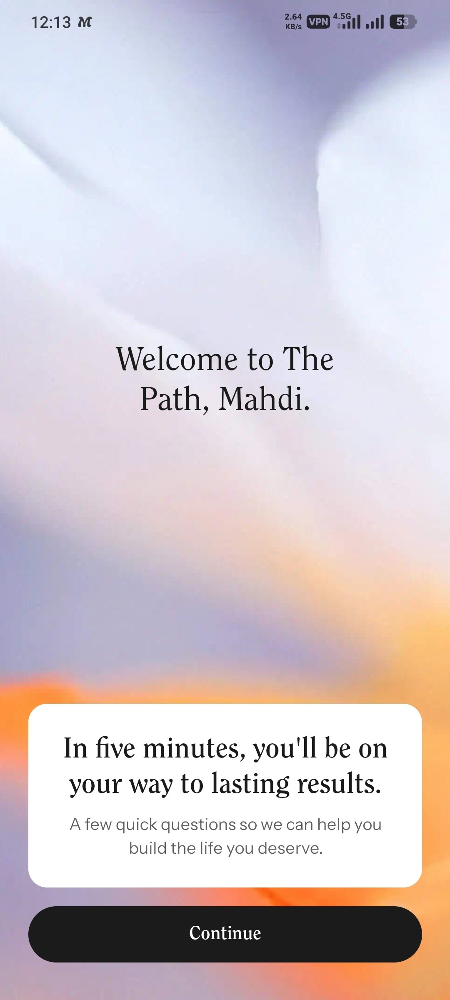

**What the screen shows:** Greets the user by name and signals a short onboarding process.

**Direct visual observations:** Misty blue-lavender background with warm peach/orange glow near lower area; centered serif greeting; white message card near bottom with larger black serif heading and quiet sans subcopy; black pill Continue button.

**Figma/component guidance (proposed, not verified behavior):** Create PersonalizedInterlude with name-safe wrapping, smooth soft gradients and card within safe area. Test longer Persian names at 360px width.

**Relevance to our MVP:** ADOPT: personalized breathing space between onboarding stages.

---

### 52. `photo_52` — Gender preference question

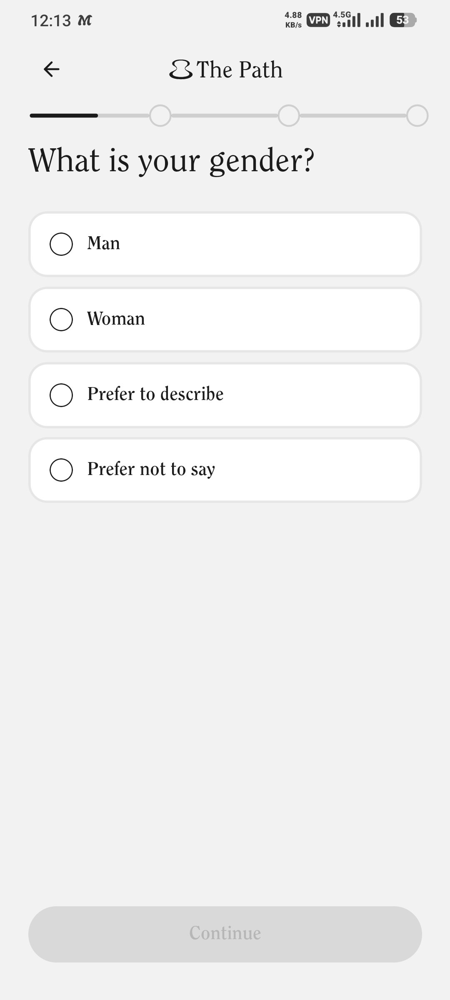

**What the screen shows:** Asks gender with man, woman, self-description and prefer not to say options.

**Direct visual observations:** Very light neutral page, serif title, four stacked white outlined radio cards, rounded corners and subtle shadows/borders, inactive gray Continue button until selected.

**Figma/component guidance (proposed, not verified behavior):** Use SingleChoiceQuestion with optional self-description and explicit prefer-not-to-answer. Branching text input is suggested, not evidenced. Keep sensitive disclosure optional.

**Relevance to our MVP:** ADAPT: question only if there is clear product need and user consent.

---

### 51. `photo_51` — Age question / numeric keyboard

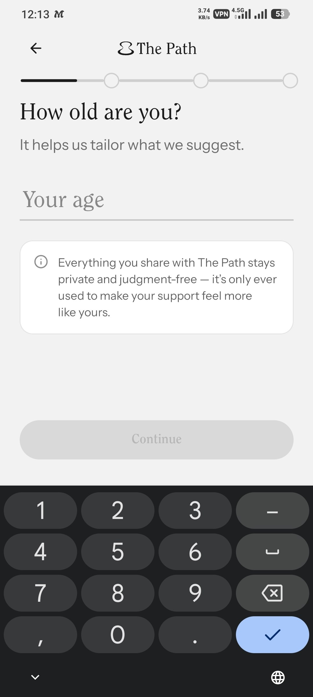

**What the screen shows:** Asks age with short rationale and a privacy reassurance card.

**Direct visual observations:** Minimal light canvas, editorial serif prompt, single underline numeric field, white information card and dark numeric mobile keyboard; light disabled CTA moves above keyboard.

**Figma/component guidance (proposed, not verified behavior):** Add NumericInputQuestion with validation, keyboard-aware footer and honest privacy copy. The original claims of confidentiality must not be duplicated without technical backing.

**Relevance to our MVP:** ADAPT: collect age only if necessary; consider age gating and handling.

---

### 50. `photo_50` — Account creation / save progress

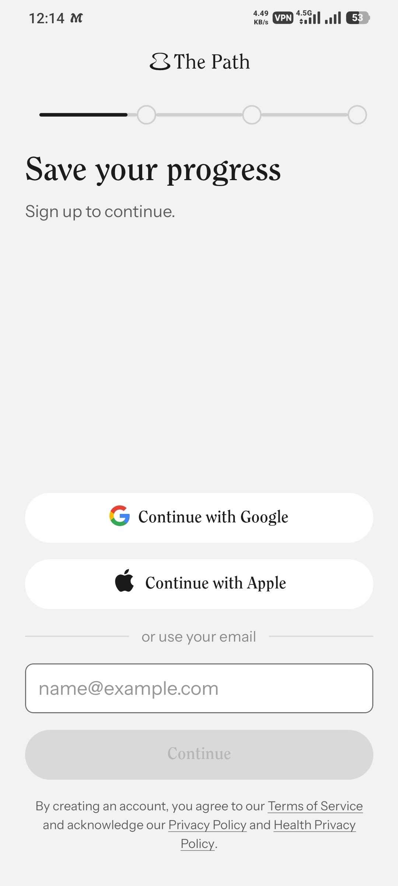

**What the screen shows:** Offers Google, Apple and email methods for preserving progress.

**Direct visual observations:** High light canvas, serif title at top, large unused center area, two white rounded SSO buttons with service logos, subdued separator for email, thin outlined email field, disabled pill CTA and tiny legal links at bottom.

**Figma/component guidance (proposed, not verified behavior):** Build AuthenticationChoice/EmailEntry variants with validation. Do not claim working OAuth in a mock prototype; consider when to ask for an account to reduce friction.

**Relevance to our MVP:** ADAPT: defer or mock account flow; authentication is not required for a frontend-only MVP demo.

---

### 49. `photo_49` — Orange quantified testimonial moment

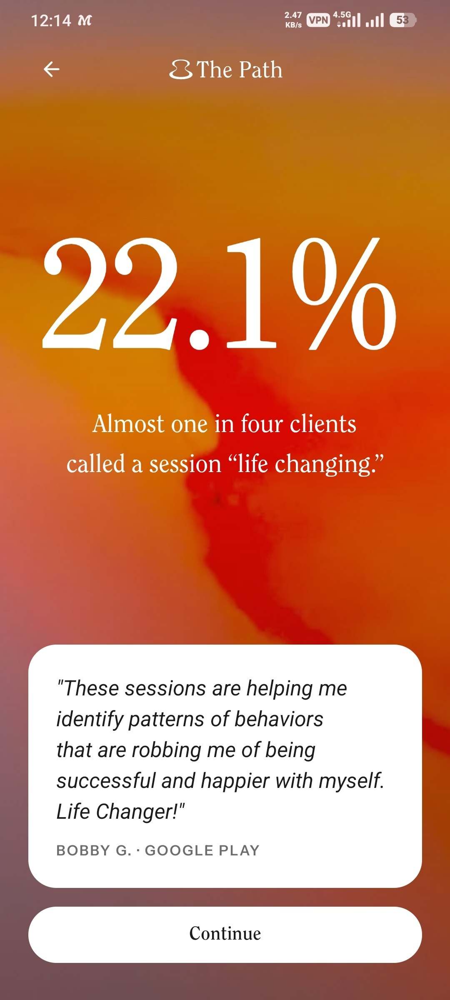

**What the screen shows:** Displays a large 22.1% figure, a client outcome claim and a review card.

**Direct visual observations:** Bright grainy orange-to-red atmosphere, very large white serif percentage at center, short centered white explanation, white testimonial card with italic black text and tiny attribution, white bottom pill CTA.

**Figma/component guidance (proposed, not verified behavior):** Create MetricInterstitial / theme=orange; add original design treatments but do not reproduce testimonials, statistics or attribution without verification and rights.

**Relevance to our MVP:** REFERENCE: gradient, storytelling and visual pacing only; avoid unsourced percentages.

---

### 48. `photo_48` — Country of residence selector

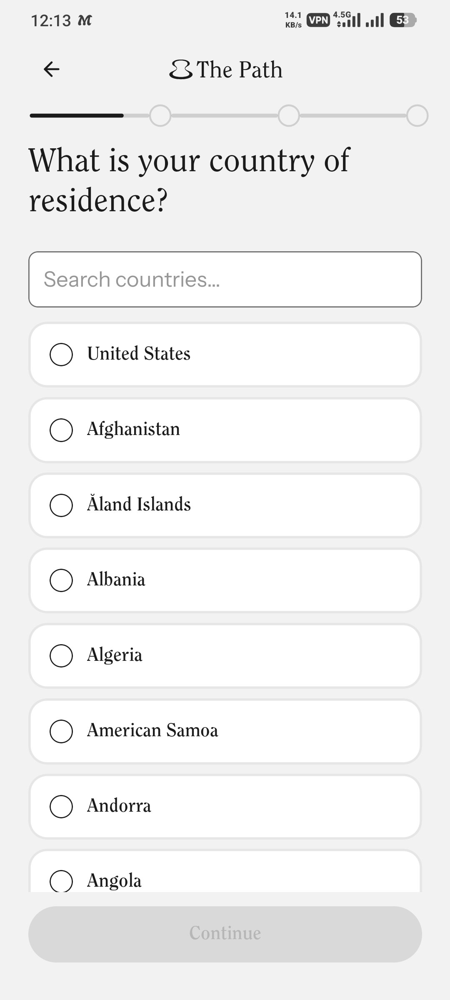

**What the screen shows:** Shows country-search input and a long country radio list.

**Direct visual observations:** Minimal serif heading, search field with thin border, many bordered white selectable country rows, small radio indicators, slim progress header and fixed disabled footer; long scroll area.

**Figma/component guidance (proposed, not verified behavior):** Build SearchableSingleSelect, including keyboard, filtering, empty and loading states and enough scroll padding below footer. Do not infer user's country from IP.

**Relevance to our MVP:** REFERENCE: searchable options and scrolling behavior; collect country only where needed for safety/legal localization.

---

### 47. `photo_47` — Open-ended personal background

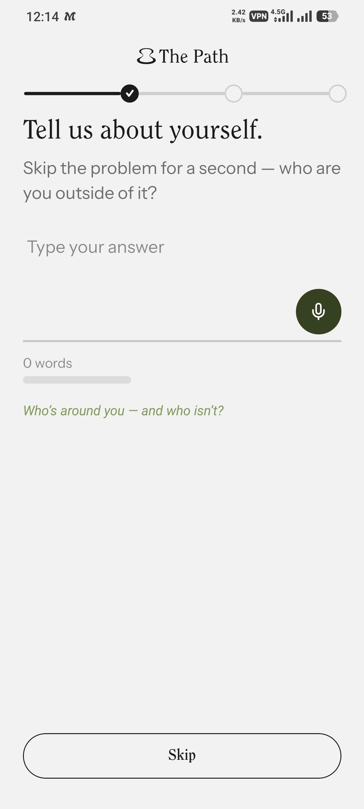

**What the screen shows:** Invites user to describe who they are outside the problem, with optional text or microphone entry.

**Direct visual observations:** Serif question and short gray supporting text; borderless generous writing area, olive circular mic on the baseline, word count, tiny gray meter and italic olive hint; outline Skip CTA at bottom.

**Figma/component guidance (proposed, not verified behavior):** Implement FreeTextQuestion with optional prompt hints, word count, keyboard-safe composer and a nonfunctional audio affordance only if clearly marked mock. Avoid pressuring personal disclosure.

**Relevance to our MVP:** ADOPT: short optional free response; prefer text-first in MVP.

---

### 46. `photo_46` — First reflective interlude

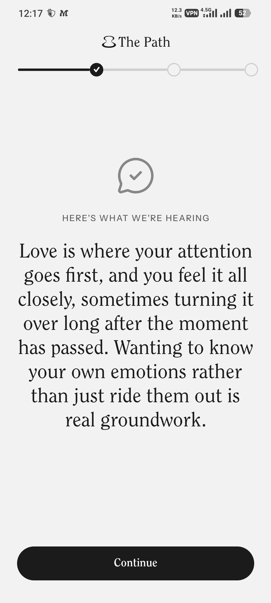

**What the screen shows:** Summarizes the user's answers in a personal sounding emotional reflection.

**Direct visual observations:** Simple central icon of chat bubble with tick, tiny uppercase gray eyebrow, large centered multiline black serif reflection text, vast empty light canvas, solid black bottom Continue pill.

**Figma/component guidance (proposed, not verified behavior):** Create ReflectionInterlude with eyebrow, icon, main observation and CTA. Reflections must be tentative and traceable to available inputs; do not present diagnosis as fact.

**Relevance to our MVP:** ADAPT: short feedback moments; optional in an abbreviated onboarding.

---

### 45. `photo_45` — Prior therapy / coaching experience

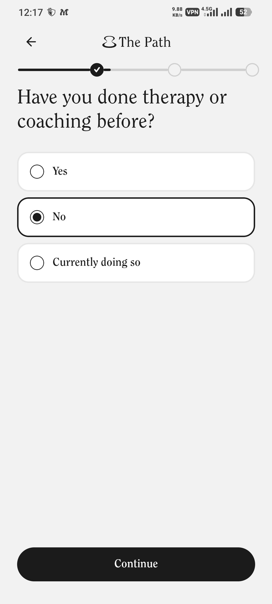

**What the screen shows:** Asks whether the user has tried therapy/coaching before; No is selected.

**Direct visual observations:** Three white radio cards on neutral background. Selected row has stronger black outline and filled radio; other rows have soft strokes. Dark Continue CTA active, compact header/step progress.

**Figma/component guidance (proposed, not verified behavior):** Use clear selected/idle states with both radio and border. If retaining, differentiate therapy, counseling and coaching in Persian wording.

**Relevance to our MVP:** REFERENCE: selected option state; not a necessary first-release question.

---

### 44. `photo_44` — Main reason for visiting / free response

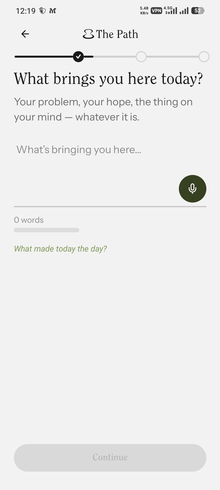

**What the screen shows:** Asks what brings user here today and offers a reflective writing hint.

**Direct visual observations:** Large serif heading, a couple lines of gray body copy, borderless input zone with gray placeholder, olive round microphone, underlined baseline, zero words, subtle gray counter bar, olive italic example hint; disabled bottom CTA.

**Figma/component guidance (proposed, not verified behavior):** Reuse FreeTextQuestion, support skip/continue semantics and long text. Unanswered text shouldn't imply the user has failed the step.

**Relevance to our MVP:** ADOPT: ask primary goal in a concise, optional form.

---

### 43. `photo_43` — Reassurance interlude

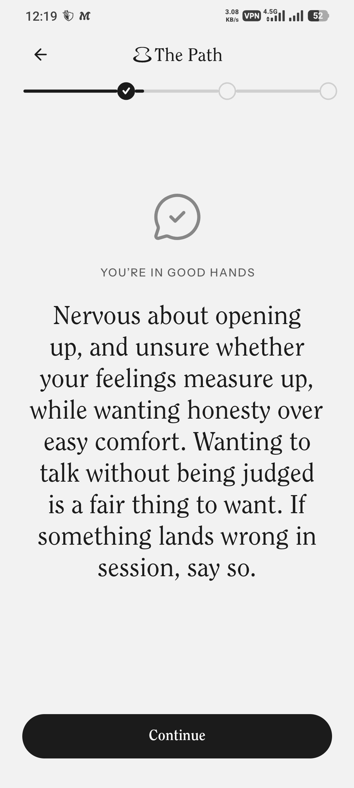

**What the screen shows:** Normalizes nervousness about speaking openly without judgment.

**Direct visual observations:** Same chat-check glyph as screen 46, uppercase gray eyebrow, unusually tall centered serif paragraph, large negative space, black bottom pill. No decorative card.

**Figma/component guidance (proposed, not verified behavior):** ReflectionInterlude/theme=reassurance; shorten the Persian version and avoid unqualified promises of total safety or complete confidentiality.

**Relevance to our MVP:** ADAPT: reassuring tone, not the full length of the original text.

---

### 42. `photo_42` — First-time concerns / open question

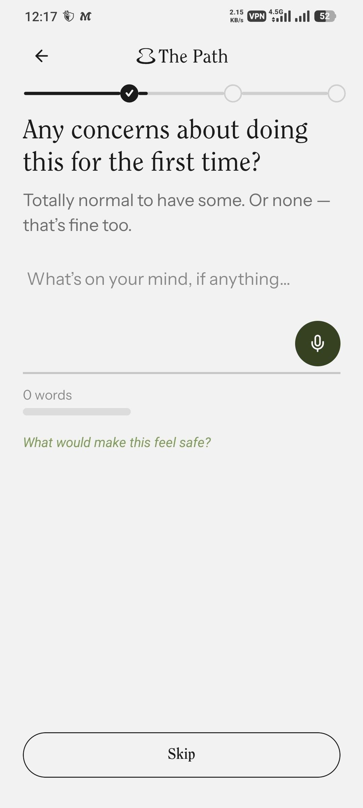

**What the screen shows:** Invites concerns about first-time usage and offers an optional response.

**Direct visual observations:** Free-text layout with short reassurance subtitle, blank generous writing area, olive circular mic, subtle underline, word count, italic suggestion and outline Skip action at bottom.

**Figma/component guidance (proposed, not verified behavior):** Use FreeTextQuestion/optional; supply easy Skip, optional mic permission only if voice becomes implemented.

**Relevance to our MVP:** REFERENCE: a good pattern for optional qualitative input.

---

### 41. `photo_41` — Identify a hard-to-name feeling

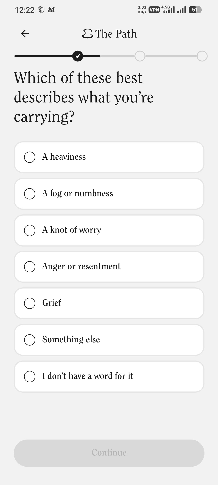

**What the screen shows:** Asks which feeling is most present, offering heaviness, numbness, worry, anger, grief, other and no word.

**Direct visual observations:** Seven short rounded white radio rows under a large editorial serif title; subtle borders, small radio controls, high whitespace and disabled bottom Continue button.

**Figma/component guidance (proposed, not verified behavior):** LongRadioQuestion with scrolling and explicit single-select behavior. Include nonjudgmental 'I don't have a word for it' option.

**Relevance to our MVP:** ADAPT: optional emotional check-in; avoid assuming users can label feelings.

---

### 40. `photo_40` — Motivation-to-change slider

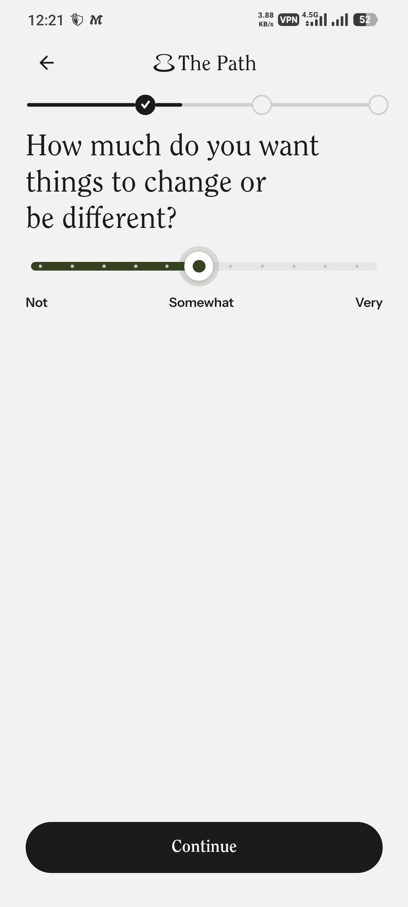

**What the screen shows:** Asks how strongly user wants things to be different.

**Direct visual observations:** Short serif question and extremely minimal horizontal stepped scale; olive filled track, tiny tick dots, pale remaining track, white circular thumb with green center, low/medium/high labels, active black bottom CTA.

**Figma/component guidance (proposed, not verified behavior):** Define DiscreteScaleQuestion accessible by touch and keyboard/screen reader, including clear selected states and mirrored semantic direction for RTL. Tick count inferred visually; exact scale logic unknown.

**Relevance to our MVP:** REFERENCE: elegant progressive scale; only if the onboarding research supports it.

---

### 39. `photo_39` — Reflection about unanswered message

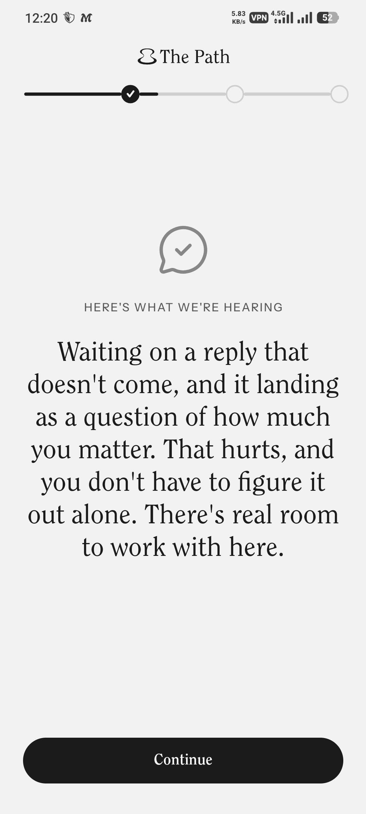

**What the screen shows:** Shows another personalized reflection describing waiting for a reply and emotional significance.

**Direct visual observations:** Quiet light background, central chat-check icon and gray eyebrow, centered oversized serif reflection with short multiline paragraph, black pill bottom CTA.

**Figma/component guidance (proposed, not verified behavior):** Build ReflectionInterlude with data-driven observation and cautious phrasing; never attribute third-party intentions as certain facts.

**Relevance to our MVP:** ADAPT: empathetic personalization with uncertainty.

---

### 38. `photo_38` — Blue-violet quantified testimonial

**What the screen shows:** Shows 68% insight claim and a white quoted review.

**Direct visual observations:** Electric blue upper gradient blending to purple/slate, large white serif 68% number, centered white explanatory sentence, white round testimonial block and white bottom CTA.

**Figma/component guidance (proposed, not verified behavior):** Reuse MetricInterstitial theme=blueViolet; sourced claims only. Keep contrast on brightest part of the gradient.

**Relevance to our MVP:** REFERENCE: ambient color and hierarchy; do not transplant unverified metric.

---

### 37. `photo_37` — Desired emotional outcome

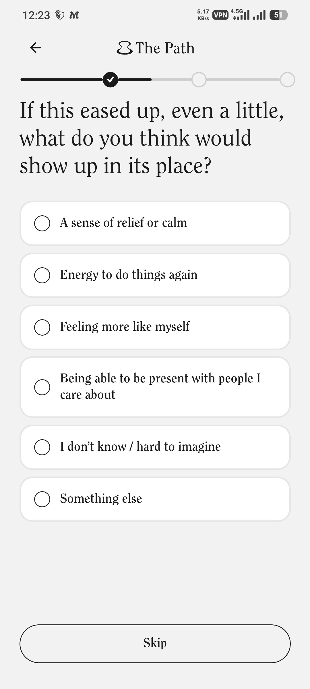

**What the screen shows:** Asks what the user would feel if the difficulty eased, with relief, energy, feeling like oneself, presence with loved ones and uncertain answers.

**Direct visual observations:** Tall serif multi-line prompt, six selectable white rows with natural 1–2 line label wrapping, outline Skip CTA and calm white space.

**Figma/component guidance (proposed, not verified behavior):** RadioQuestion/optional with auto-height labels and no forced truncation; support 'not sure'.

**Relevance to our MVP:** ADAPT: goal-related option set, after research and content review.

---

### 36. `photo_36` — Session pacing interlude

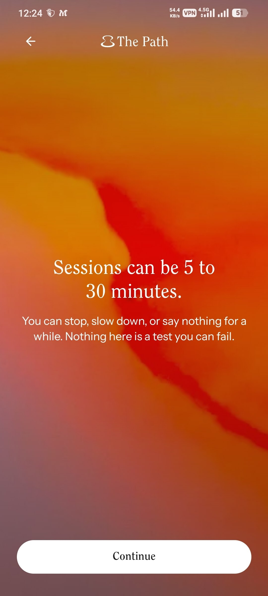

**What the screen shows:** Says sessions can last 5–30 minutes and can end early; emphasizes no exam or pressure.

**Direct visual observations:** Full-bleed molten orange/coral blurred gradient with centered white serif statement, short sans supporting copy, bottom white pill, otherwise empty.

**Figma/component guidance (proposed, not verified behavior):** ColorInterlude variant with controlled contrast. Do not adopt session length restrictions if the MVP provides continuous chat threads.

**Relevance to our MVP:** REFERENCE: emotional pacing, not timed sessions.

---

### 35. `photo_35` — Recent lighter moment

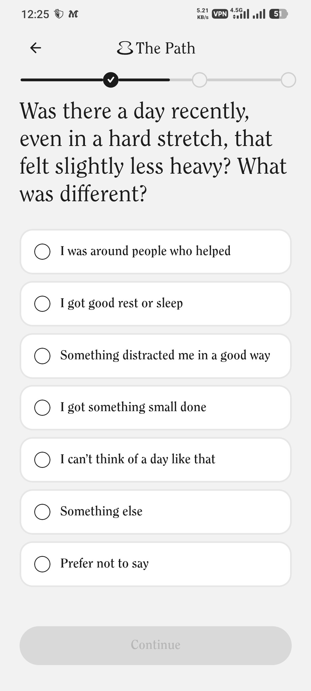

**What the screen shows:** Asks whether a recent day felt a little easier, with possible reasons including people, sleep, distraction and small accomplishments.

**Direct visual observations:** Seven white outlined radio options, some long prompts, gray disabled bottom CTA, serif top heading and generous breathing room.

**Figma/component guidance (proposed, not verified behavior):** LongRadioQuestion with scroll behavior and a way to skip or say none.

**Relevance to our MVP:** REFERENCE: optional reflective prompt, not required in first-pass onboarding.

---

### 34. `photo_34` — Small helpful next step

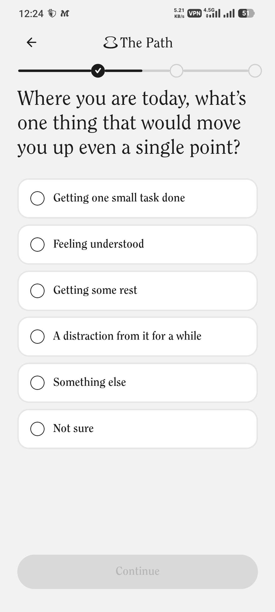

**What the screen shows:** Asks what could improve today by one point, with choices such as finishing a small task, being understood, rest or distraction.

**Direct visual observations:** Six white rounded single-select rows, subtle dividers, multiline labels where necessary, large empty bottom area and gray disabled CTA.

**Figma/component guidance (proposed, not verified behavior):** Use ActionPreferenceChoice built from RadioQuestion, allowing 'not sure'.

**Relevance to our MVP:** ADAPT: useful low-friction personalization question if clinically reviewed.

---

### 33. `photo_33` — Forest-green quantified testimonial

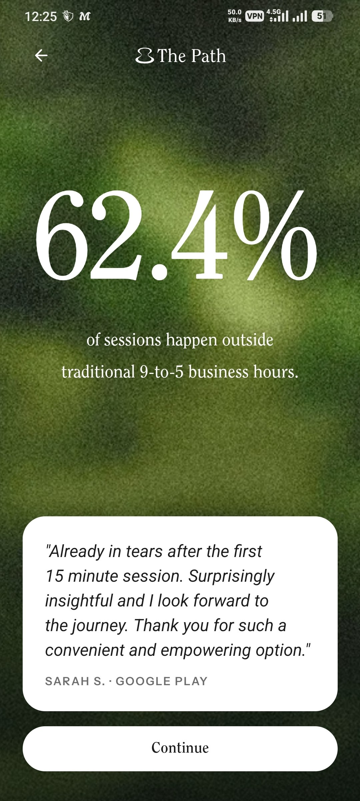

**What the screen shows:** Shows 62.4% of sessions happening outside business hours plus a review.

**Direct visual observations:** Organic forest green textured/soft-noise backdrop, giant white serif percentage, centered white supporting copy, rounded white testimonial card and white bottom CTA.

**Figma/component guidance (proposed, not verified behavior):** MetricInterstitial theme=forest with very subtle noise layer; never use the figure or testimonial as ours.

**Relevance to our MVP:** REFERENCE: low-light palette and typographic contrast only.

---

### 32. `photo_32` — A moment of feeling authentic

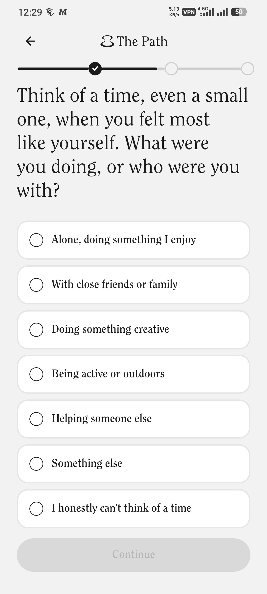

**What the screen shows:** Asks about a time the user felt most like themselves: solitude, friends/family, creativity, activity, helping others, etc.

**Direct visual observations:** Long serif question at top, seven outlined white radio cards, light canvas, compact stepper, inactive bottom Continue.

**Figma/component guidance (proposed, not verified behavior):** LongRadioQuestion supports skip / can't recall and label wrapping; can inspire later assessments, but avoid onboarding overload.

**Relevance to our MVP:** REFERENCE: optional assessment/reflective prompt, not necessarily onboarding.

---

### 31. `photo_31` — Values under difficulty

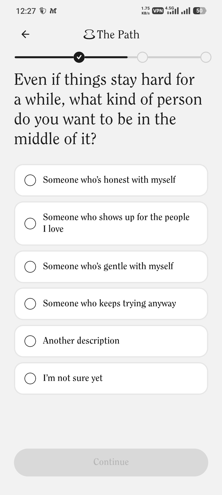

**What the screen shows:** Asks what kind of person the user wants to be during difficult times, offering honesty, care, perseverance and more.

**Direct visual observations:** Six rounded white option rows with 1–2 line labels, restrained borders, serif question and gray inactive CTA.

**Figma/component guidance (proposed, not verified behavior):** Make ValuesQuestion a RadioQuestion variant. Treat the answers as preferences or aspirations, not personality diagnosis.

**Relevance to our MVP:** REFERENCE: promising self-discovery assessment material, pending research.

---

### 30. `photo_30` — Private, unhurried space interlude

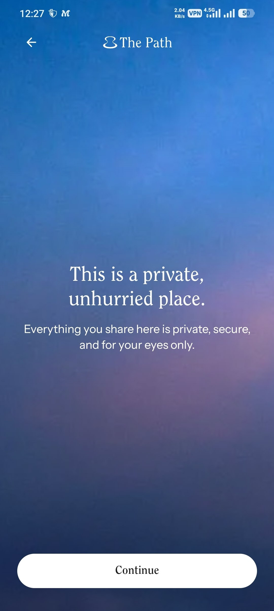

**What the screen shows:** Reassures the user about privacy and pacing.

**Direct visual observations:** Deep blue to navy-violet atmospheric full-screen backdrop, centered white serif headline, short white subtitle and white bottom pill, no cards or secondary decoration.

**Figma/component guidance (proposed, not verified behavior):** TrustInterlude variant. Security and privacy promises must match the actual future implementation; avoid absolute guarantees.

**Relevance to our MVP:** ADAPT: tone of calm and control, not unsupported security claims.

---

### 29. `photo_29` — Second forest testimonial

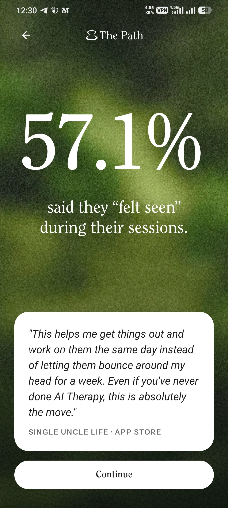

**What the screen shows:** Displays 57.1% feeling-seen claim and user quote.

**Direct visual observations:** Same forest green noisy atmosphere as screen 33, giant white serif percentage, small central copy, rounded white review card at bottom, white pill CTA.

**Figma/component guidance (proposed, not verified behavior):** Reuse MetricInterstitial/forest with configurable copy; do not present original customer quote or percentage as app evidence.

**Relevance to our MVP:** REFERENCE: rhythm and compositional template only.

---

### 28. `photo_28` — Two-week mood frequency item 1

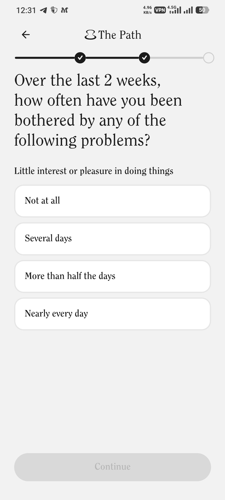

**What the screen shows:** Prompts frequency of reduced interest or pleasure over the last two weeks.

**Direct visual observations:** Three-step progress header with first stages marked complete; shared large serif section heading, a smaller serif item heading, four white rectangular rounded answer cards with no visible radio circles, gray inactive bottom CTA.

**Figma/component guidance (proposed, not verified behavior):** Build FrequencyQuestion with four-choice states. The content resembles known screening patterns; screenshots alone do not establish scoring rights, validation or instrument suitability.

**Relevance to our MVP:** REFERENCE: question component only; do not treat screenshot as validated medical content.

---

### 27. `photo_27` — Two-week mood frequency item 2

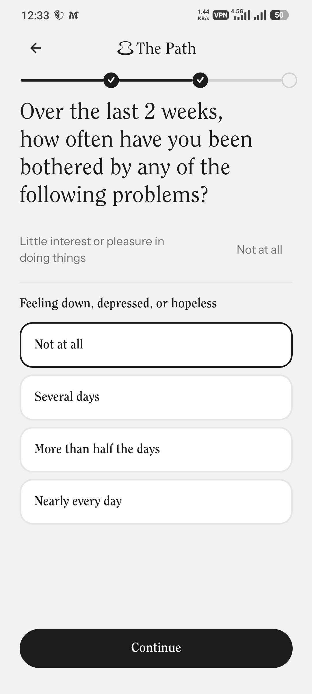

**What the screen shows:** Asks about feeling down or hopeless while the previous item and its answer collapse into a compact summary line.

**Direct visual observations:** Light canvas, top serif section title, previous question summary in gray with thin divider, current item title and four white options; selected row gets strong black border, dark Continue CTA active.

**Figma/component guidance (proposed, not verified behavior):** Create FrequencyQuestion with answeredSummary and currentQuestion states; allow answer correction in future implementation.

**Relevance to our MVP:** ADOPT: compact answered-question summary pattern; assessment content needs expert review.

---

### 26. `photo_26` — Referral / acquisition source

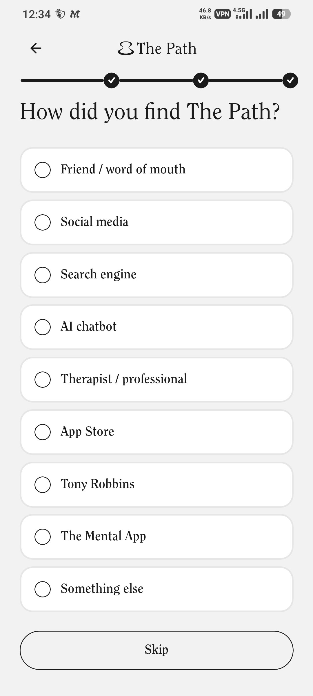

**What the screen shows:** Asks how the user found The Path, with word-of-mouth, social, search, AI chatbots, professionals, store and branded entries.

**Direct visual observations:** Nine outlined white radio rows under serif title, progress almost complete, optional bottom Skip.

**Figma/component guidance (proposed, not verified behavior):** LongRadioQuestion; this is acquisition instrumentation, not relevant to core psychological personalization.

**Relevance to our MVP:** AVOID: optional analytics question, not part of user value proposition.

---

### 25. `photo_25` — Two-week worry control item 2

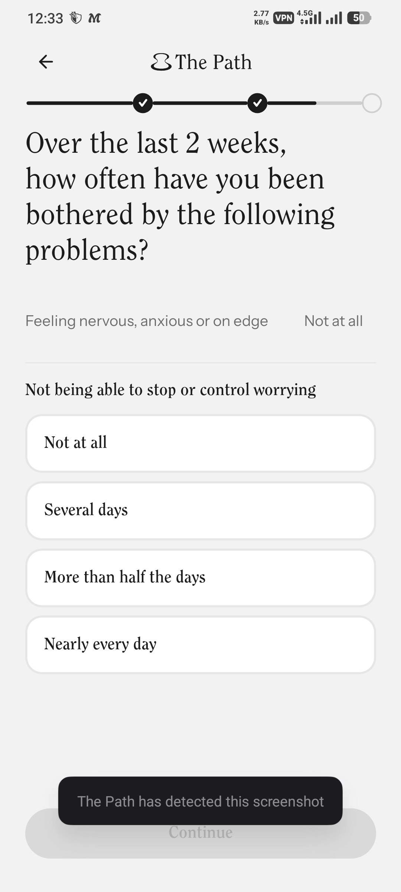

**What the screen shows:** Asks inability to stop or control worrying; previous anxious-on-edge item is collapsed with its response.

**Direct visual observations:** Same FrequencyQuestion stack as screen 27, compact gray completed-answer line, divider, current item, four white frequency rows, inactive CTA; a temporary system screenshot-detection toast overlays the footer.

**Figma/component guidance (proposed, not verified behavior):** Build answeredSummary state; recognize screenshot notification as transient external UI, not permanent navigation or security control.

**Relevance to our MVP:** REFERENCE: assessment summary and transient-state caveat; do not imitate toast.

---

### 24. `photo_24` — Two-week anxiety frequency item 1

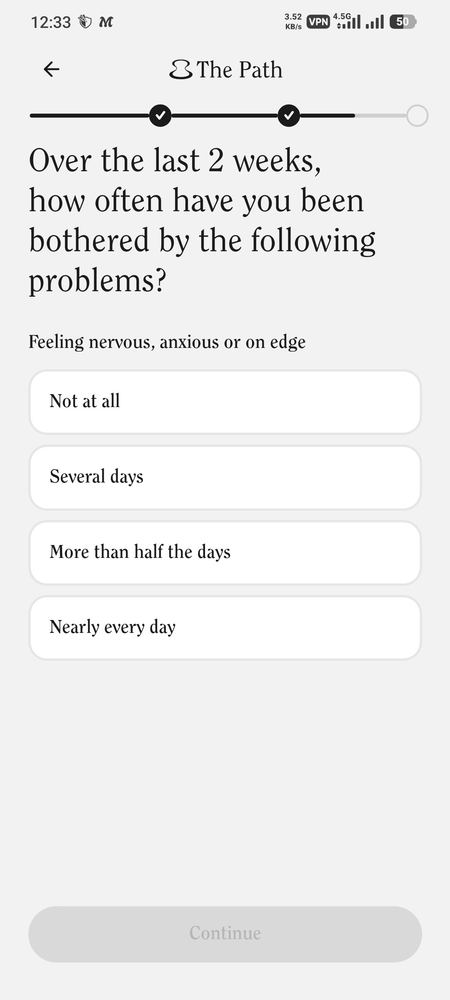

**What the screen shows:** Asks how often the user felt nervous, anxious or on edge over the last two weeks.

**Direct visual observations:** Large repeated serif section heading, small specific item label, four white rounded answer rows with plain text, no radio circles, gray disabled Continue, compact stage stepper.

**Figma/component guidance (proposed, not verified behavior):** Reuse FrequencyQuestion/initial, with selectable/tappable full rows; ordering with screen 25 is conceptual, not necessarily capture order.

**Relevance to our MVP:** REFERENCE: assessment interaction; exact instrument and scoring must be researched.

---

### 23. `photo_23` — Conditional AI referral detail

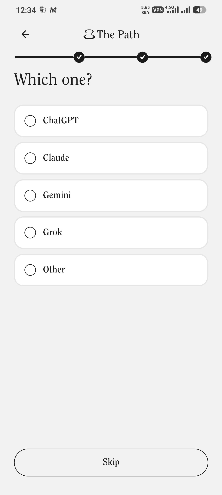

**What the screen shows:** Asks which AI chatbot referred the user; options include ChatGPT, Claude, Gemini, Grok and Other.

**Direct visual observations:** Short serif heading, five white rounded radio rows, unusually large open space in lower portion, compact progress, outline Skip at bottom.

**Figma/component guidance (proposed, not verified behavior):** ConditionalQuestion only when referral=AI chatbot. Branch is plausible based on content, but not confirmed through interaction recording.

**Relevance to our MVP:** AVOID: not needed for our core product; shows branching and reusable choice rows.

---

### 22. `photo_22` — Empty home / first focus area

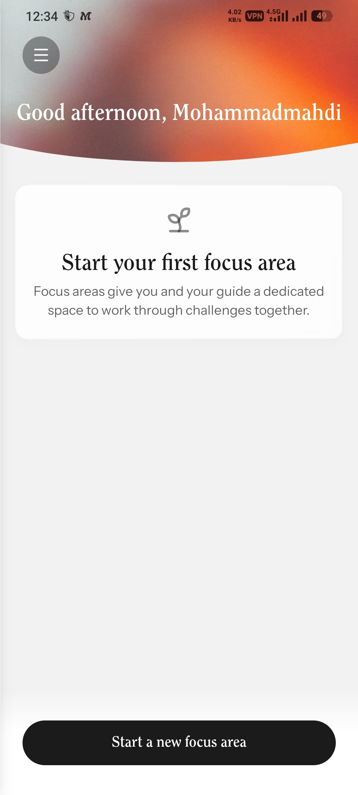

**What the screen shows:** Shows personalized afternoon greeting and a centered first-focus-area empty state.

**Direct visual observations:** Distinctive red-orange-gray blurred image header with curved lower edge, translucent circular menu action, large white serif greeting, pale gray rest-of-screen, white centered card with tiny sprout icon, serif heading + short sans explanation and black bottom CTA.

**Figma/component guidance (proposed, not verified behavior):** Use CurvedAtmosphericHeader, PersonalizedGreeting, EmptyStateCard and BottomCTA. For MVP convert focus area into first conversation/new chat.

**Relevance to our MVP:** ADOPT: expressive home composition and empty state; reframe as chat-led navigation.

---

### 21. `photo_21` — Guide catalog / Tony locked

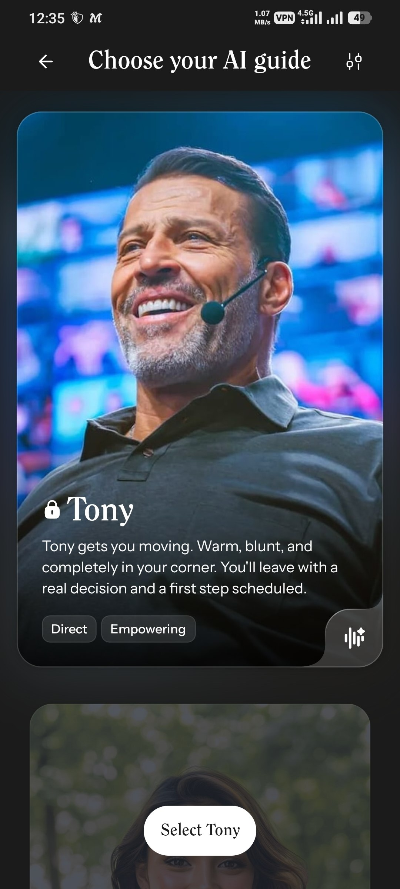

**What the screen shows:** Shows a large guide portrait, behavioral tags Direct and Empowering, a possible lock indicator and selection action.

**Direct visual observations:** Charcoal page with compact serif Choose your AI guide header, back and filter controls, tall rounded full-bleed person portrait, dark fade at bottom, large white serif name, 2-line light description, glassy dark tags, small sound-wave glyph, white select pill on neighboring card.

**Figma/component guidance (proposed, not verified behavior):** Implement data-driven CommunicationStyleCard with equivalent visual weight; do not copy portrait, real person's identity or exact brand. Lock meaning unknown.

**Relevance to our MVP:** ADAPT: replace people-based guide catalog with abstract nonhuman style identities.

---

### 20. `photo_20` — Guide catalog / Jade

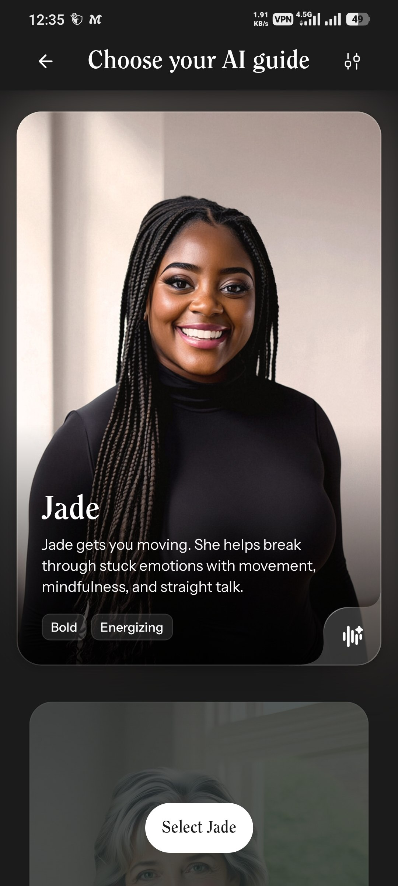

**What the screen shows:** Introduces an energizing and bold guide via portrait, description and tags.

**Direct visual observations:** Repeated tall portrait card on black canvas, bright indoor backdrop with dark-clothed person, strong bottom fade to black, white serif name, small white copy, dark translucent trait chips, small audio-wave button and white capsule select action.

**Figma/component guidance (proposed, not verified behavior):** One reusable style card schema with title, descriptors, style accent, illustration and response preview. Keep consistent crop and text safe area.

**Relevance to our MVP:** ADAPT: same premium card layout, but represent communication style not a real mentor.

---

### 19. `photo_19` — Guide catalog / Sophie

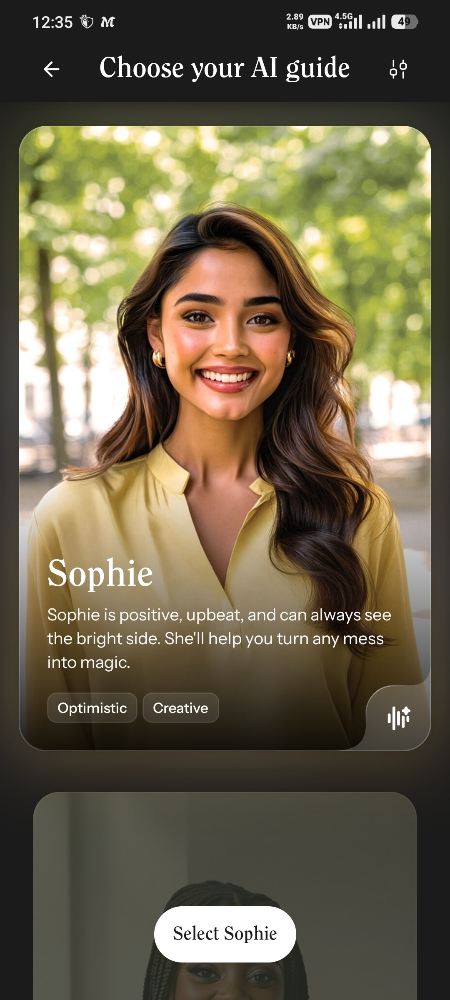

**What the screen shows:** Describes an optimistic and creative guide.

**Direct visual observations:** Portrait against sunlit outdoor green bokeh and pale yellow outfit; rounded crop, dark bottom fade stabilizing the overlaid white name and short text, smoky trait pills, wave preview icon.

**Figma/component guidance (proposed, not verified behavior):** Test contrast for a light or high-detail visual; fade overlay must be independent from image.

**Relevance to our MVP:** ADAPT: visual identity can be unique per style without implying human identity.

---

### 18. `photo_18` — Guide catalog / Barbara

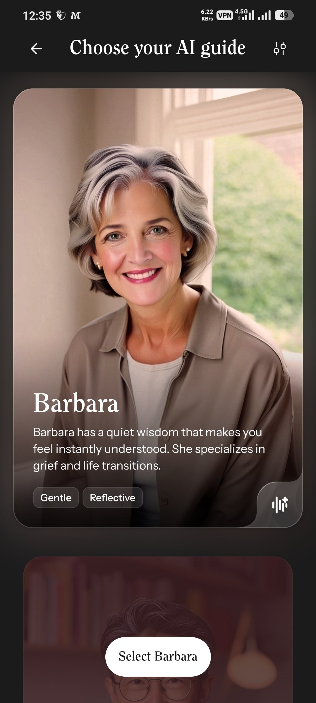

**What the screen shows:** Represents a gentle and reflective guide.

**Direct visual observations:** Soft beige/daylit indoor portrait, elegant white title at image bottom, two traits and concise description over dark fade. Card shape consistent with other entries.

**Figma/component guidance (proposed, not verified behavior):** Separate style behavior from illustration choices. Avoid suggesting clinical credentials based on age, gender or appearance.

**Relevance to our MVP:** ADAPT: translated into supportive/reflective response style.

---

### 17. `photo_17` — Guide catalog / Ellen

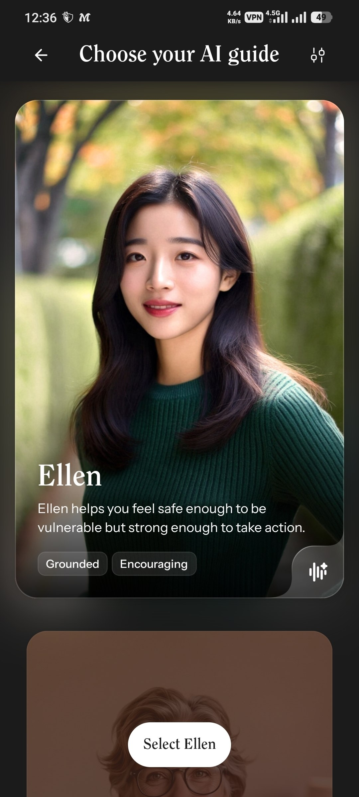

**What the screen shows:** Represents a grounded and encouraging guide.

**Direct visual observations:** Outdoor greenery, deep green clothes, same tall portrait card with text-safe gradient, bold white serif name, traits and sound glyph; next-card selection button partially visible.

**Figma/component guidance (proposed, not verified behavior):** Reuse exact structural card component with per-asset focal point. If no photography, use custom abstract motifs with comparable visual depth.

**Relevance to our MVP:** ADAPT: card repeatability and gentle tone differentiation.

---

### 16. `photo_16` — Guide catalog / Rosa

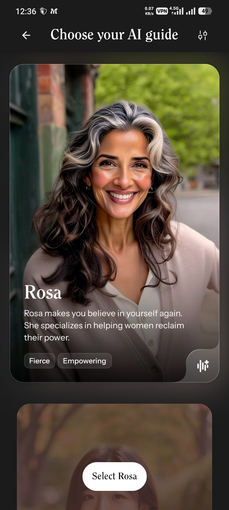

**What the screen shows:** Represents a fierce / empowering guide.

**Direct visual observations:** Warm daylight outdoor portrait, peach and brown tones, dark gradient at bottom, white name, two tags and sound preview, white select action near next card.

**Figma/component guidance (proposed, not verified behavior):** Keep gradientOverlay a separate reusable layer; style descriptors must describe real conversation behavior, not vague marketing adjectives.

**Relevance to our MVP:** ADAPT: show the difference in sample AI responses.

---

### 15. `photo_15` — Guide catalog / Randall

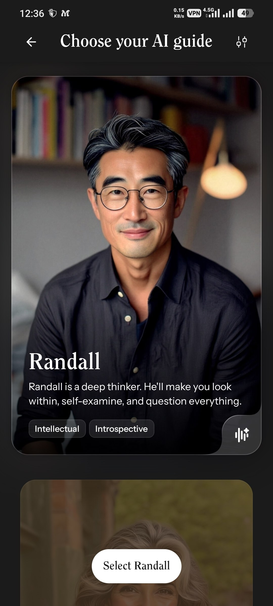

**What the screen shows:** Represents an intellectual, introspective guide.

**Direct visual observations:** Glasses-wearing portrait with books and warm indoor light; dark overlay below; identical typography, trait chips and wave control.

**Figma/component guidance (proposed, not verified behavior):** Style card should use configurable layout without bespoke screen per variant. Audio glyph should not be presented as working if audio is excluded from MVP.

**Relevance to our MVP:** ADAPT: analytical style and consistent component architecture.

---

### 14. `photo_14` — Guide catalog / Jay

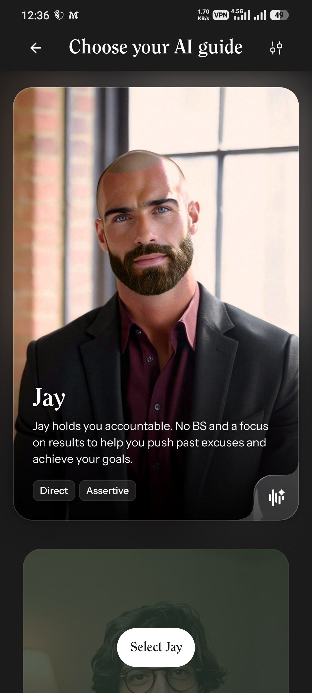

**What the screen shows:** Represents a direct, assertive guide focused on accountability.

**Direct visual observations:** Dark jacket formal portrait with bright window background, overlay white text near bottom, two translucent trait pills, identical black surrounding page.

**Figma/component guidance (proposed, not verified behavior):** Maintain visual consistency across all cards and make style behavior legible in Persian.

**Relevance to our MVP:** ADAPT: direct/concise interaction style.

---

### 13. `photo_13` — Guide catalog / Theo

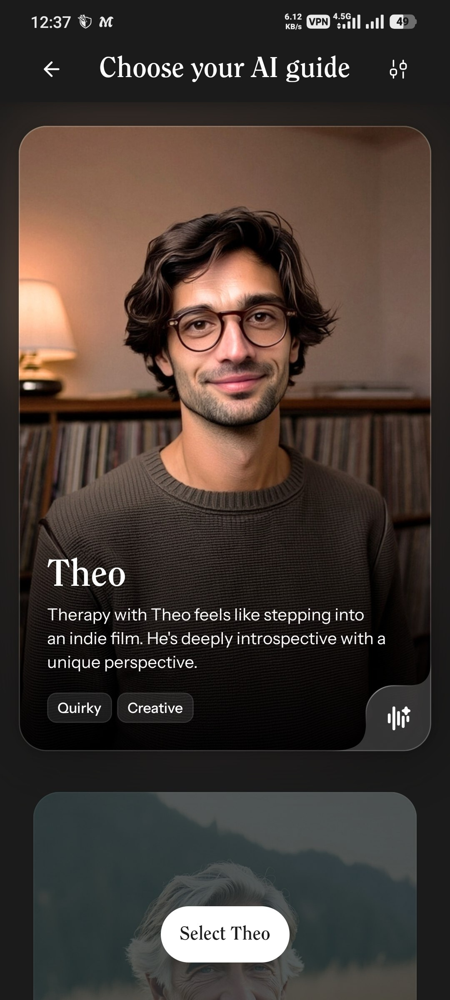

**What the screen shows:** Represents a quirky, creative and inward-looking guide.

**Direct visual observations:** Warm indoor portrait with books/music backdrop, white serif name, 2–3 line description, two trait chips and audio-preview icon anchored low.

**Figma/component guidance (proposed, not verified behavior):** Use one flexible card for all communication-style data; meaning of style should be explained through examples.

**Relevance to our MVP:** ADAPT: example-driven style can reuse visual treatment, not the named persona.

---

### 12. `photo_12` — Guide catalog / Vivian

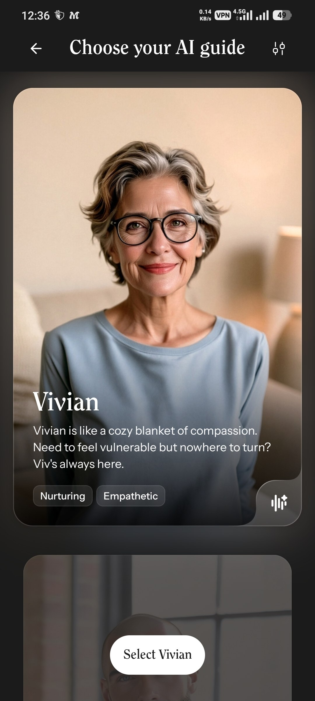

**What the screen shows:** Represents a nurturing and empathetic guide.

**Direct visual observations:** Soft cream background, blue garment, eyeglasses portrait; rounded card, subtle bottom vignette for white text, clean two-tag treatment and sound preview.

**Figma/component guidance (proposed, not verified behavior):** Avoid lengthy Persian text; a short behavior statement plus one preview response explains the style more precisely.

**Relevance to our MVP:** ADAPT: empathy-first personality profile.

---

### 11. `photo_11` — Guide catalog / Marcus

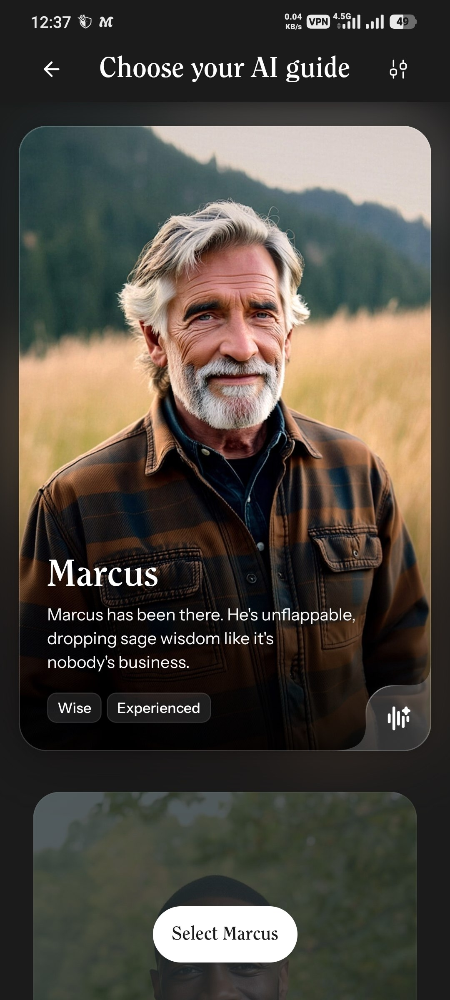

**What the screen shows:** Represents a wise, experienced guide used in subsequent screens.

**Direct visual observations:** Silver-haired outdoor portrait in brown jacket; blurred forest setting, warm backlight, lower fade, large white name, Wise / Experienced pill chips and sound glyph.

**Figma/component guidance (proposed, not verified behavior):** For a multi-screen sample flow, keep selected style name, colors and avatar/icon consistent across profile, chat and home, but avoid humans as the default asset type.

**Relevance to our MVP:** ADAPT: visual continuity of selected communication style.

---

### 10. `photo_10` — Guide catalog / Ty last card

**What the screen shows:** Represents an encouraging, motivational guide at the end of the catalog.

**Direct visual observations:** Smiling formal portrait with greenery, black canvas, rounded hero card, bottom overlay text, dark tag chips and stand-alone white Select Ty button beneath the final card.

**Figma/component guidance (proposed, not verified behavior):** Include last-card state, style filter empty state and accessible selectable action; do not infer locking/subscription policy.

**Relevance to our MVP:** ADAPT: graceful ending state and selection CTA.

---

### 9. `photo_9` — Selected guide detail / audio preview

**What the screen shows:** Opens Marcus's detailed page with large portrait, traits, Listen waveform, first-person quote, and longer bio.

**Direct visual observations:** Full-width portrait hero with close control; smooth dark gradient into charcoal content, large white serif name, two translucent traits, sound-listen pill plus waveform, oversized quote, thin divider, small bio text, fixed white select action.

**Figma/component guidance (proposed, not verified behavior):** If our MVP includes style detail, use abstract artwork and text-based response comparison instead of voice playback. Prevent long text from sitting behind fixed CTA.

**Relevance to our MVP:** ADAPT: style detail/preview; voice features optional future scope.

---

### 8. `photo_8` — Optional facial-expression permission

**What the screen shows:** Requests camera/video permission for emotional signal interpretation with a reassurance panel and Not Now.

**Direct visual observations:** Clean gray-white canvas, close X, pale ice-blue diagram with concentric rings, central eye symbol and tiny camera/video orbit icons, teal uppercase eyebrow, giant black serif headline, small gray explanation, white data card with check icon, black primary CTA and outlined Not Now.

**Figma/component guidance (proposed, not verified behavior):** PermissionExplainer template with equal-respect opt-out; camera-based emotional inference requires special scientific and privacy review and is not in current MVP.

**Relevance to our MVP:** AVOID: do not include face analysis/camera permissions in our MVP. Visual only: concentric illustration and disclosure treatment.

---

### 7. `photo_7` — Timed session length picker

**What the screen shows:** Selects a 10-to-30-minute session; 20 minutes emphasized.

**Direct visual observations:** Charcoal full-screen layout, serif white title at top, vertically centered wheel-like duration list, selected value large bright white, surrounding options subdued gray, short footer note and bottom white pill CTA.

**Figma/component guidance (proposed, not verified behavior):** Only consider a generic single-choice wheel pattern when needed. Continuous multiple chat threads do not require session length selection. Exact wheel behavior cannot be established from static screenshot.

**Relevance to our MVP:** AVOID: no timed therapy session gating in MVP.

---

### 6. `photo_6` — Long guide biography continuation

**What the screen shows:** Displays Marcus's multi-paragraph first-person background and working style, with selection CTA pinned to bottom.

**Direct visual observations:** Dark charcoal background, medium white serif section headings, lengthy light gray sans paragraphs, fine dividing line, close X, fixed white pill at bottom; content visibly extends behind the bottom CTA region.

**Figma/component guidance (proposed, not verified behavior):** LongFormDetail must reserve scroll padding above sticky actions. Our style cards should be brief, with optional expandable detail rather than fabricated mentor life stories.

**Relevance to our MVP:** ADAPT: concise style explanation, not fictional human biography.

---

### 5. `photo_5` — First personalized conversation

**What the screen shows:** Introduces the first chat with a chosen guide and references an earlier relationship concern.

**Direct visual observations:** Cropped portrait hero and seamless charcoal lower area, close X, tiny YOUR GUIDE eyebrow, oversized white serif guide name, two outlined trait chips, large white introductory heading, lighter sans context-aware first message, slim rounded dark input composer and white mic button with tooltip.

**Figma/component guidance (proposed, not verified behavior):** Build ChatEmpty/FirstMessage with mock contextual opening based on onboarding answer. Use abstract style icon; provide typed input and no misleading voice mode unless implemented.

**Relevance to our MVP:** ADOPT: smooth transition from onboarding into personalized first chat; no enforced session duration.

---

### 4. `photo_4` — Active chat and waiting feedback

**What the screen shows:** Shows a user message followed by a guide's waiting/thinking indicator, timer and menu.

**Direct visual observations:** Near-black chat canvas, small portrait avatar, compact header label, time-left icon and text, right-side ellipsis, medium-gray rounded user bubble, subdued typing caption, charcoal composer at bottom with white circular mic; transient clipboard toast appears near bottom.

**Figma/component guidance (proposed, not verified behavior):** Create ChatThread with messages, composer, thinking state and more menu. Omit countdown and clipboard monitoring, which are outside MVP. Fully mirror chat alignment for Persian RTL.

**Relevance to our MVP:** ADOPT: restrained dark chat styling and thinking affordance; AVOID timer and clipboard toast.

---

### 3. `photo_3` — Populated home with recent focus

**What the screen shows:** Shows one completed conversation focus card with title, short summary, selected guide avatar, Love category chip and relative time.

**Direct visual observations:** Curved orange-red gradient header with large white greeting, pale neutral background, white rounded information card with subtle border, serif title, gray two-line preview, small avatar, soft pink tag and clock/time metadata; bottom dark CTA to create another focus area.

**Figma/component guidance (proposed, not verified behavior):** Repurpose for recent conversations: clickable chat cards with title, short preview, relative time; avoid overcrowding. Use top greeting and atmospheric curve sparingly.

**Relevance to our MVP:** ADOPT: home after at least one conversation, focus-card visual translated to chat summaries.

---

### 2. `photo_2` — Focus-area detail and report processing

**What the screen shows:** Displays a focus topic detail, pending session-review spinner, report card with date/duration, archive button and dark next-session action.

**Direct visual observations:** Pink/peach curved gradient header with back circle, black serif title and gray subtitle, white progress card with three dark dots, uppercase reports eyebrow, white summary/report card with calendar and clock, outlined archive CTA, dark lower card with avatar and white pill Start.

**Figma/component guidance (proposed, not verified behavior):** For our MVP adapt the report-card hierarchy to optional personal insights or assessment results; do not force session reports or timed follow-ups. Provide processing/ready/error only if real features need them.

**Relevance to our MVP:** ADAPT: modular insight card and progress-state design; session report engine is not promised.

---

### 1. `photo_1` — Open navigation drawer

**What the screen shows:** Shows The Path slide-out navigation over a dimmed home screen.

**Direct visual observations:** Narrow white left drawer taking roughly half the frame, charcoal logo at top, selected item in soft gray pill, simple outline icons, small Past sessions entry, Settings pinned low, gray scrim across underlying home.

**Figma/component guidance (proposed, not verified behavior):** For RTL, mirror drawer opening to the right, support tap-away and back dismissal. Our primary navigation should be bottom four tabs; drawer is optional secondary navigation only.

**Relevance to our MVP:** REFERENCE: drawer pattern; use bottom tabs for our actual MVP.

---

