# Theia AI Core — Architecture Diagram Atlas

> **Basis:** `Theia AI Core — Final Architecture Document` (attached source).  
> **Purpose:** team review of the *proposed* architecture, not an assertion that modules have been implemented.  
> **Reading order:** system overview → turn execution → routing → module internals → persistent state/knowledge → operational controls.  
> **Diagram labels are in English** to preserve technical identifiers; explanations are in Persian.

## راهنمای مطالعه

- **LLM / purple:** فراخوانی مدل زبانی برای قضاوت یا تولید متن.
- **CODE / blue:** سرویس قطعی، قواعد Go، تراکنش یا زمان‌بندی، بدون LLM در همان ماژول.
- **HYBRID / amber:** قواعد همراه با classifier کوچک (امکان فراخوانی مدل).
- **DATA / teal:** حافظه، وضعیت یا داده پایدار.
- **KNOWLEDGE / green:** دانش نسخه‌بندی‌شده و سیاست‌ها.
- **ASYNC:** خارج از مسیر انتظار پاسخ؛ **SYNC:** در مسیر پاسخ؛ **OFFLINE:** ابزار آزمایش و ارزیابی.
- **Embeddings:** کاربرد مدل embedding در Retrieval/Memory، به معنی یک call به LLM مکالمه‌ای نیست.
- خطوط یکپارچه: جریان اصلی؛ خطوط نقطه‌چین: وابستگی داده، پیام پس‌زمینه یا مسیر اختیاری (در صورت نبود توضیح دیگر).
- برای دیدن نمودارها، فایل را در Markdown Viewer دارای پشتیبانی Mermaid (مثل GitHub یا VS Code با افزونه Mermaid) باز کنید.

### فهرست نمودارها

1. [نمای کلان و مرز سیستم](#d01--system-map)
2. [چرخه کامل یک پیام عادی](#d02--normal-turn-sequence)
3. [Router و چهار مسیر اجرا](#d03--router)
4. [Turn Gateway](#d04--gateway)
5. [Context Assembler و Retrieval Service](#d05--context-and-retrieval)
6. [Turn Brain و قرارداد تصمیم](#d06--turn-brain)
7. [Response Generator و Output Validator](#d07--response-and-validation)
8. [Protocol Engine و رضایت کاربر](#d08--protocol-engine)
9. [انواع حافظه و محل ذخیره](#d09--memory-model)
10. [چرخه Memory Writer و Memory Committer](#d10--memory-lifecycle)
11. [Reflection Worker و Case Formulation](#d11--reflection)
12. [چرخه عمر فرضیه‌های روان‌شناختی](#d12--hypothesis-fsm)
13. [State Management و انتقال وضعیت‌ها](#d13--state-management)
14. [ایمنی چندلایه و Crisis Route](#d14--safety)
15. [Knowledge Bundle و مصرف‌کنندگان دانش](#d15--knowledge)
16. [Scheduler، Async Jobs و پیگیری](#d16--async-and-proactive)
17. [Trace، Evaluation و Replay](#d17--evaluation)
18. [مرز AI Core با بک‌اند Go](#d18--backend-integration)
19. [Failure/Fallback و بودجه‌های اجرا](#d19--failure-and-budgets)
20. [ترتیب ساخت و محدوده MVP](#d20--roadmap)

---

## D01 — System map

**اول این نمودار را ببینید.** تمام حوزه‌های اصلی و جهت کلی جریان را نشان می‌دهد؛ نمودار عمداً وارد جزئیات هر گره نمی‌شود.

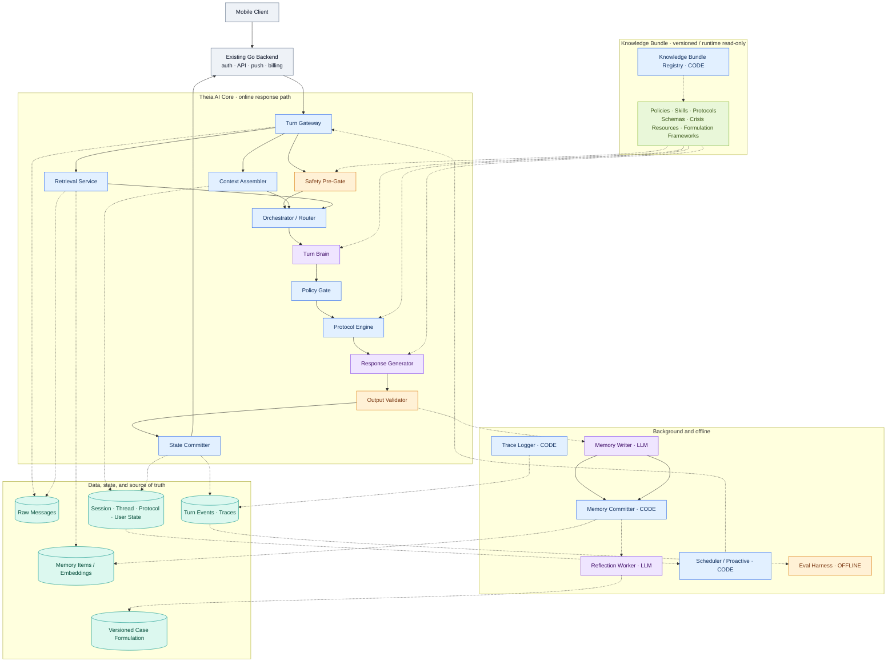

> **دقت:** نمودار D01 مسیر NORMAL را ساده‌سازی کرده است. FAST و CRISIS از Turn Brain عبور نمی‌کنند؛ مسیرهای دقیق در D03 آمده‌اند. این ۱۷ ماژول به‌معنای ۱۷ فراخوانی LLM نیست.

## D02 — Normal turn sequence

**مسیر معمول یک پیام**، با ترتیب واقعی SYNC، اجرای موازی و آغاز کارهای ASYNC.

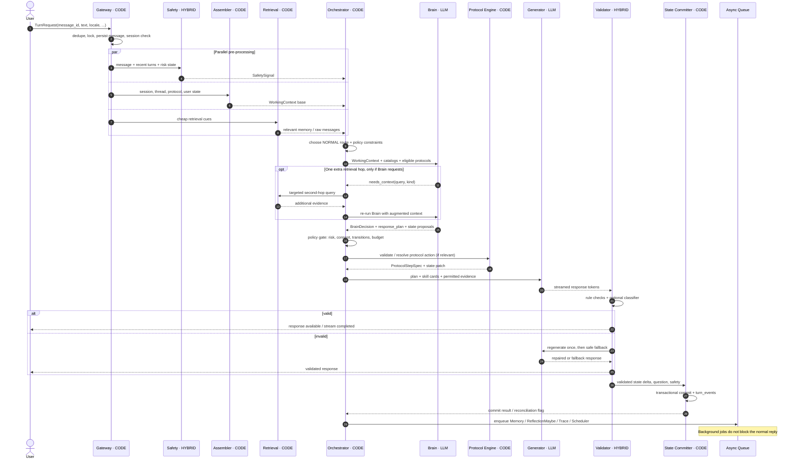

**نکته فنی مهم:** در خطر پایین، سند اجازه streaming هنگام validation را می‌دهد؛ یعنی بخشی از پاسخ ممکن است قبل از تأیید نهایی دیده شود. در `elevated` و بالاتر، متن کامل قبل از نمایش بافر می‌شود. همچنین در صورت خطای تراکنش State، سند ارسال پاسخ همراه با علامت `state_uncommitted` و reconciliation را مجاز می‌داند.

## D03 — Router

**Router = CODE**. پیچیدگی معنایی پیام را با یک LLM جداگانه طبقه‌بندی نمی‌کند؛ فقط با قواعد صریح، مسیر را انتخاب می‌کند. ترتیب شرط‌ها مهم است.

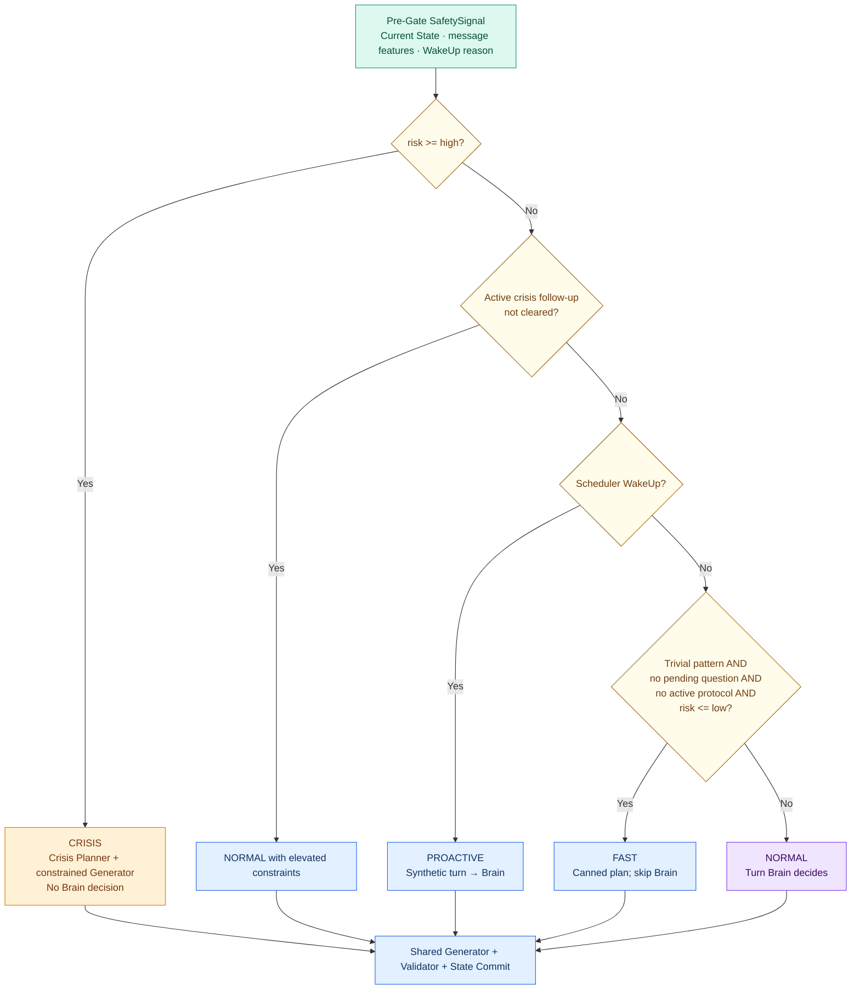

**FAST** همچنان safety و validation دارد و Generator را اجرا می‌کند. **CRISIS** پاسخ متفاوت و محدودشده دارد. **PROACTIVE** از همان pipeline با یک ورودی مصنوعی استفاده می‌کند.

## D04 — Gateway

Turn Gateway تضمین می‌کند پیام در شبکه ناپایدار یا در حالت چنددستگاهی دوبار پردازش نشود.

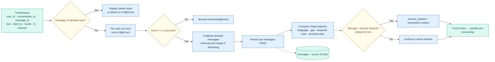

## D05 — Context and retrieval

سه منبع مستقل برای `WorkingContext`: **state ساختاریافته**، **پیام‌های اخیر**، و **حافظه بازیابی‌شده**. Retrieval یک LLM استدلالی مستقل ندارد؛ embedding lookup استفاده می‌کند.

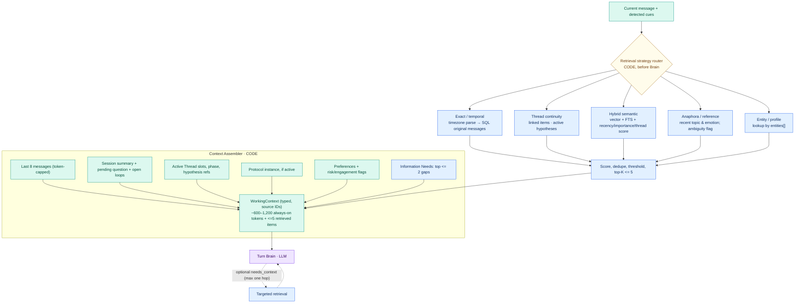

**ترتیب:** Retrieval به صورت speculative همزمان با Safety و Context شروع می‌شود. در نبود شواهد یا خطای جست‌وجو، مدل نباید وانمود کند حافظه را به یاد می‌آورد.

## D06 — Turn Brain

یک call ساختاریافته کوچک/سریع که خروجی چند تحلیل منطقی را با **یک قرارداد JSON** برمی‌گرداند؛ خودش هیچ چیز را مستقیماً ذخیره نمی‌کند.

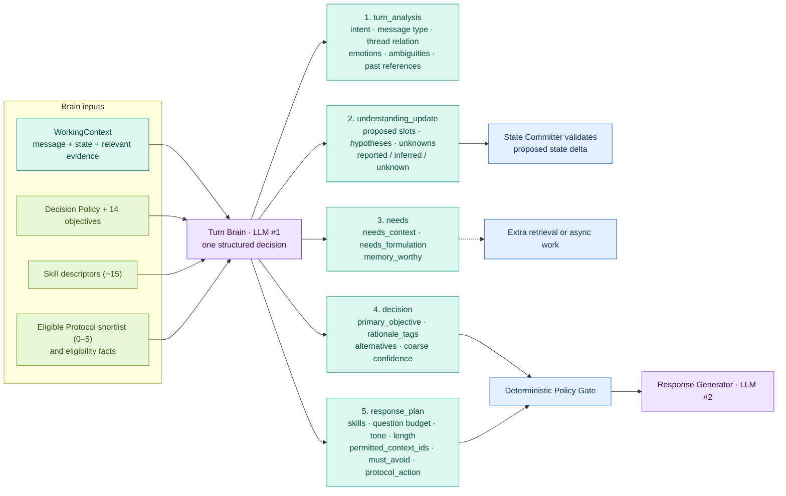

**محدودیت اختیار:** Brain می‌تواند objective و skills انتخاب کند، موضوع جدید پیشنهاد دهد، یک hop دیگر از Retrieval بخواهد و فرضیه پیشنهاد دهد؛ نمی‌تواند risk را پایین بیاورد، شناسه Skill/Protocol بسازد، Protocol را بدون رضایت شروع کند یا مستقیماً Memory را تغییر دهد.

## D07 — Response and validation

**نکته کلیدی:** Brain می‌گوید «چه کاری انجام شود»؛ Generator می‌گوید «چطور بیان شود». خروجی همچنان باید بررسی شود.

```mermaid
flowchart LR
    P["Brain response_plan<br/>objective · skills · allowed context<br/>tone · length · must_avoid"]:::data --> PG["Policy Gate · CODE<br/>consent · risk · question count<br/>valid objective / transitions"]:::code
    KS["Selected Skill Cards<br/>+ Communication Policy"]:::knowledge --> GEN["Response Generator · strong LLM<br/>natural language · streaming"]:::llm
    PG --> PE["ProtocolStepSpec<br/>(if applicable)"]:::code
    PE --> GEN
    CTX["Last 4–6 messages<br/>+ permitted evidence only"]:::data --> GEN
    GEN --> RULE["Streaming deterministic rules<br/>banned patterns · question cap<br/>length · IDs · URL/phone whitelist"]:::code
    RULE --> CL["Optional small classifier<br/>invalidating · directive · certainty<br/>dependency-encouraging"]:::hybrid
    CL --> OK{"Validation passed?"}:::decision
    OK -- Yes --> OUT["User response + ValidationReport<br/>question_text, claims_about_user"]:::data
    OK -- No --> RETRY["Regenerate ONCE with violation reasons"]:::llm
    RETRY --> CHECK{"Passed on retry?"}:::decision
    CHECK -- Yes --> OUT
    CHECK -- No --> FALL["Safe templated fallback"]:::code
    GEN -.-> UNSAFE["PLAN_UNSAFE sentinel<br/>→ reroute crisis / reflect fallback"]:::code
    FALL --> OUT
    classDef code fill:#e2f0ff,stroke:#2563eb,color:#123160;
    classDef llm fill:#efe5ff,stroke:#7c3aed,color:#3b0764;
    classDef hybrid fill:#fff1d6,stroke:#d97706,color:#78350f;
    classDef data fill:#dcf8ef,stroke:#0d9488,color:#064e3b;
    classDef knowledge fill:#e9f7d9,stroke:#65a30d,color:#365314;
    classDef decision fill:#fffceb,stroke:#a16207,color:#713f12;
```

در سند، `risk <= low` اجازه stream با پایش قواعد دارد؛ `risk >= elevated` نیازمند buffering کامل قبل از نمایش است. این قاعده باید هنگام طراحی UX بازبینی شود، چون قطع stream نمی‌تواند توکن قبلاً نمایش‌داده‌شده را پس بگیرد.

## D08 — Protocol Engine

Protocol «تعریف قابل‌اجرای تمرین» است؛ مهارت ارتباطی ساده نیست. انتخاب معنایی با Brain است؛ فیلتر کردن و اجرای انتقال مرحله‌ها با CODE.

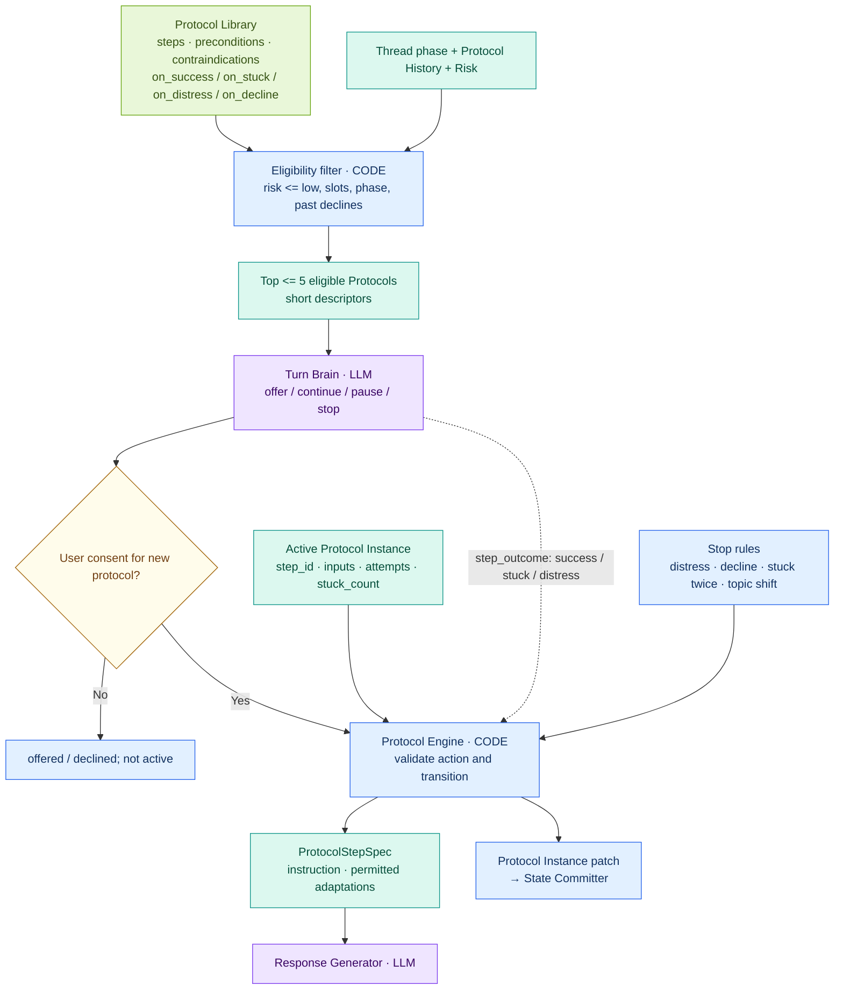

### Protocol instance FSM

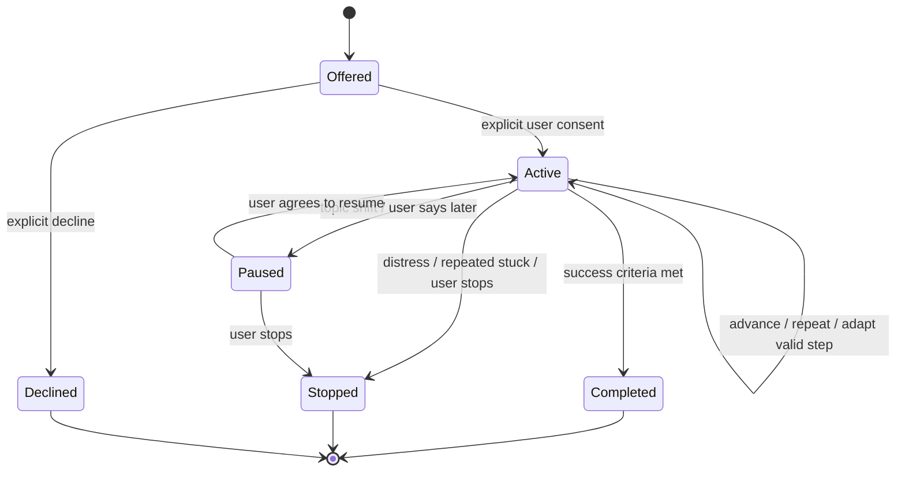

**محدودیت MVP:** فقط یک Protocol فعال برای هر کاربر؛ شروع از `offered` به `active` بدون تأیید صریح ممنوع. انتقال‌های ناشناخته اجرا نمی‌شوند و طبق سند به `repeat_step` برمی‌گردند.

## D09 — Memory model

شش دسته مفهومی، اما **سه ساختار ذخیره‌سازی اصلی**؛ Working Context پایدار نیست.

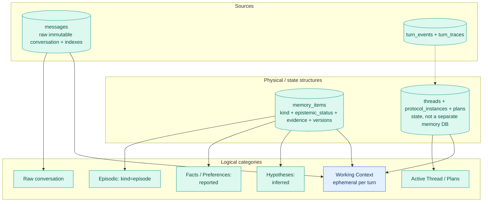

**اصل معرفتی (`epistemic_status`):** `reported` باید از گفته کاربر یا تأیید صریح او آمده باشد؛ `inferred` فرضیه مدل است و نباید بی‌صدا به fact تبدیل شود. هر آیتم حافظه باید evidence قابل‌ردیابی داشته باشد. فیلدهای مهم: `kind`, `status`, `evidence[]`, `confidence_class`, `support_count`, `contradict_count`, `thread_ids`, `sensitivity`, `valid_from/to`, `supersedes_id`, `embedding`.

## D10 — Memory lifecycle

**Memory Writer = LLM (async)** و **Memory Committer = CODE (async)**؛ تصحیح حافظه توسط کاربر استثنائاً synchronous است.

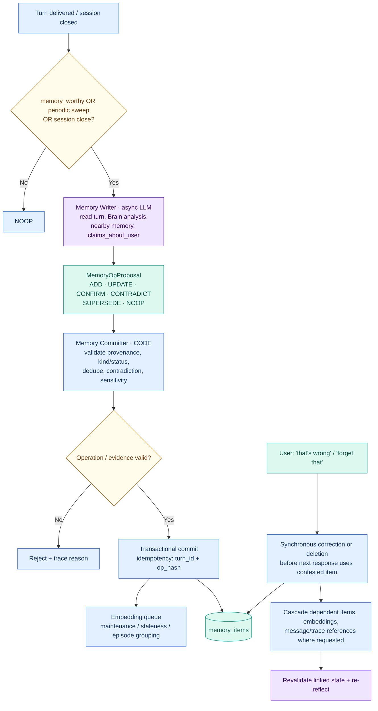

**محدودیت‌های بازیابی:** فیلتر `deleted/rejected/superseded`، `top-K`، آستانه امتیاز، حذف تکرار، و رعایت حساسیت. اطلاعات بسیار حساس از retrieval پیش‌فرض و پیام‌های proactive کنار گذاشته می‌شوند. حذف کاربر یک hard-delete cascade است، نه فقط soft flag.

## D11 — Reflection

**Reflection Worker = LLM قوی و async**. خروجی آن *Case Formulation* و پیشنهاد تغییر فرضیه/Thread است؛ خودش مستقیم در state یا memory نمی‌نویسد.

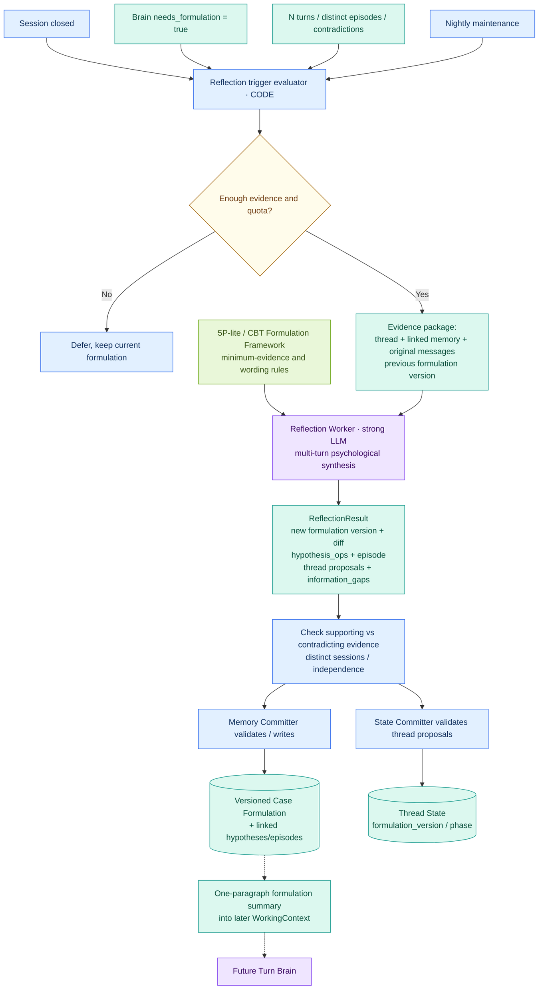

**خروجی واقعی:** صورت‌بندی نسخه‌دار و بازبینی‌پذیر، فرضیه‌ها با شمارش شواهد، خلاصه episode و gapهای شناختی. **MVP سند:** در ابتدا بیشتر روی تجمیع episode در پایان جلسه و صورت‌بندی داخلی محدود؛ ارائه بینش بر مبنای فرضیه عمدتاً در Phase 2 است.

## D12 — Hypothesis FSM

چرخه فرضیه‌ها بخشی از معماری حافظه/Reflection است؛ نباید یک inference مدل خودکار به fact تبدیل شود.

```mermaid
stateDiagram-v2
    [*] --> Proposed: Memory Writer / Reflection proposes
    Proposed --> Supported: >=2 independent episodes; no strong conflict
    Proposed --> Contested: contradictory evidence / user dispute
    Supported --> Contested: user disputes / new conflict
    Supported --> UserEndorsed: explicit user endorsement
    UserEndorsed --> ReportedFact: create separate user-reported item
    Contested --> Rejected: user rejects / sustained contradiction
    Contested --> Superseded: refined replacement hypothesis
    Proposed --> Stale: no relevant evidence over staleness window
    Supported --> Stale: no relevant evidence over staleness window
    Contested --> Stale: no relevant evidence over staleness window
    Rejected --> [*]
    Superseded --> [*]
    Stale --> [*]
    ReportedFact --> [*]
```

`confidence_class` بر اساس تعداد و استقلال شواهد و تناقض‌ها محاسبه می‌شود، نه confidence خام اعلام‌شده توسط LLM. فقط فرضیه‌های واجد شرایط با بیان محتاطانه و در objective مناسب می‌توانند به کاربر گفته شوند؛ در MVP این نمایش به کاربر به تعویق افتاده است.

## D13 — State management

**State = الان کجای فرایند هستیم؟** در مقابل **Memory = درباره کاربر چه می‌دانیم؟**.

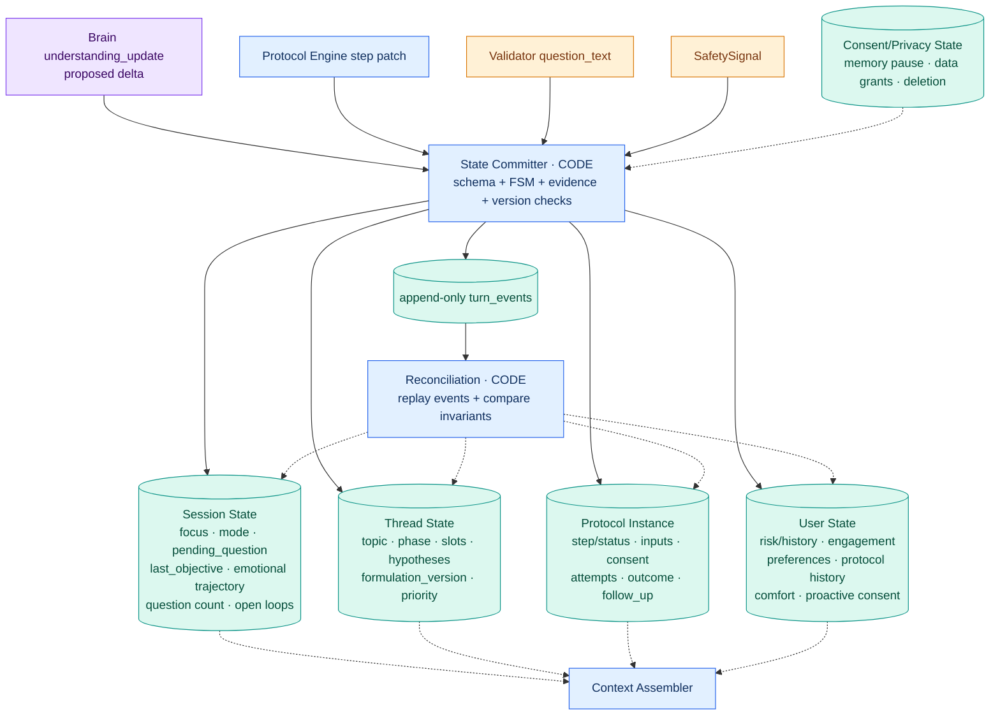

### Thread lifecycle

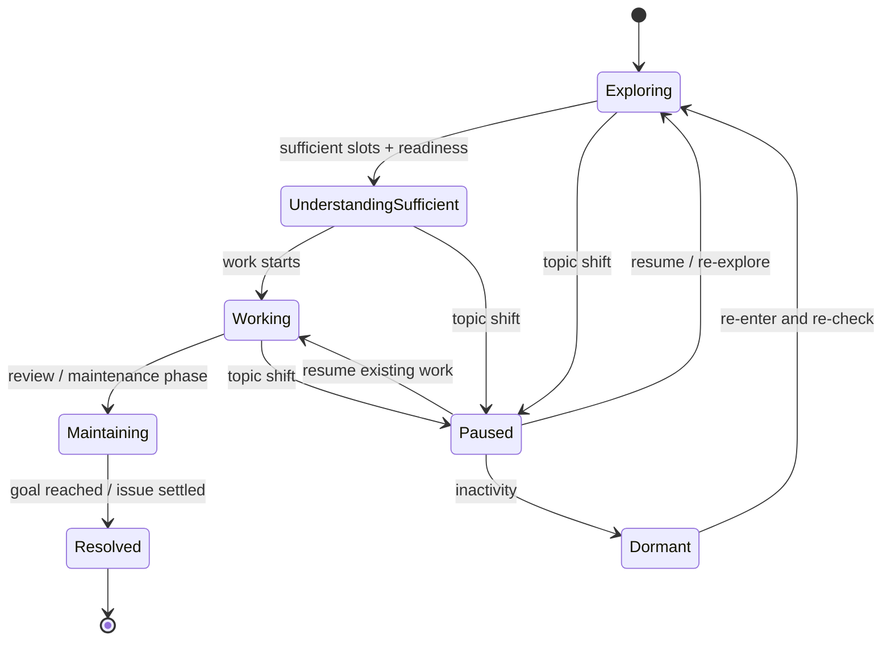

**Resume policy (initial defaults):** `<30m` همان session؛ `30m–24h` session جدید با pending context؛ `1–7d` بازکردن open loops بدون فرض تداوم احساس؛ `>7d` ورود نرم و تأیید دوباره برنامه‌ها. در بخش رویدادها dormancy بعد از ۳۰ روز پیشنهاد شده، نه اینکه هر بازگشت پس از ۷ روز الزاماً thread را dormant کند. اولویت همواره با پیام فعلی کاربر است.

**Consistency hierarchy:** `messages > turn_events > state tables > derived memory > cache`. حدود MVP: حداکثر ۳ thread فعال و فقط یک protocol فعال برای هر کاربر.

## D14 — Safety

Safety یک prompt یا یک ماژول منفرد نیست؛ چند کنترل در چند مرحله از pipeline است.

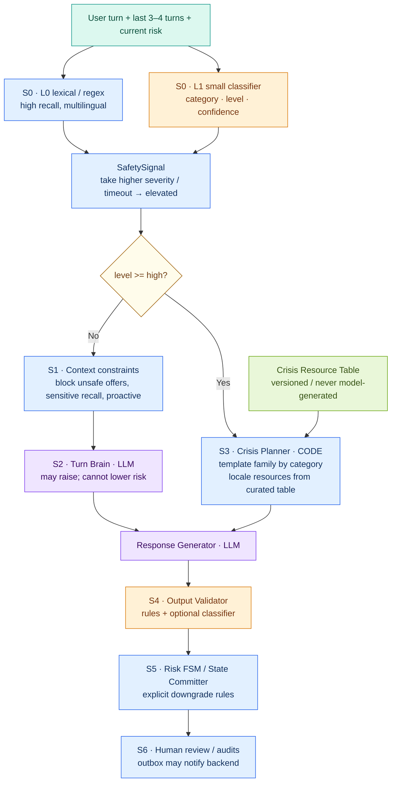

**Risk levels:** `none`, `low`, `elevated`, `high`, `imminent`. بحران می‌تواند هدف‌گذاری عادی Brain را دور بزند؛ پاسخ باید buffered، محدود و شامل عناصر اجباری باشد. کاهش risk نیازمند قاعده صریح، گذر زمان و نشانه‌های ایمنی است. اطلاع‌رسانی/ارجاع انسانی به تصمیم محصول و بک‌اند وابسته است، نه اقدام خودسرانه AI Core.

## D15 — Knowledge

**Knowledge Domain ≠ software module.** Knowledge Bundle فایل‌ها/دارایی‌های نسخه‌دار و read-only در runtime هستند؛ Loader آن‌ها را در startup بارگذاری می‌کند.

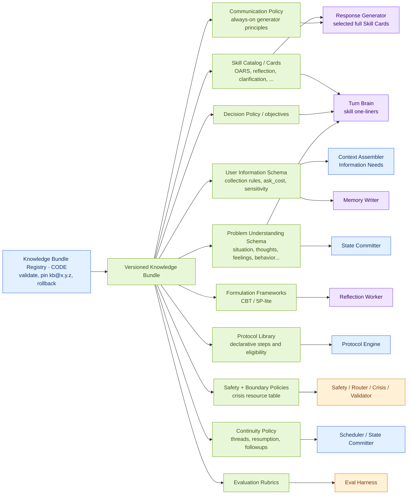

**تزریق prompt:** Brain فقط digest اصول ارتباطی و خلاصه مهارت‌ها را دارد؛ Generator اصول ارتباطی ثابت و کارت‌های *انتخاب‌شده* را دریافت می‌کند؛ Reflection فقط Framework مربوط به مسئله و package شواهد را می‌بیند. نسخه هر Knowledge Bundle در Trace ثبت می‌شود. تغییرات پرریسک Protocol/Crisis/Communication/Boundary نیازمند review متخصص هستند.

## D16 — Async and proactive

سه نوع خروجی خارج از مسیر بحرانی: حافظه، Reflection/Consolidation، و پیگیری‌های زمان‌بندی‌شده.

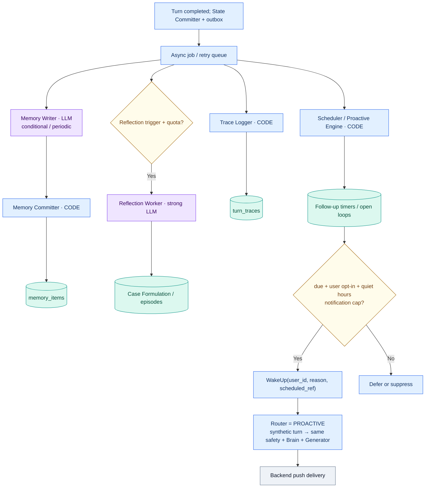

**تفاوت با Background Reflection:** Scheduler خودش تحلیل روان‌شناختی نمی‌کند؛ فقط زمان و مجوز پیگیری را کنترل می‌کند. محتوای پیگیری از pipeline مشترک تیا عبور می‌کند. ارسال push، کار بک‌اند است.

## D17 — Evaluation

Trace برای «چرا این تصمیم گرفته شد؟» و Replay برای «اگر bundle/model را عوض کنیم چه می‌شود؟» است.

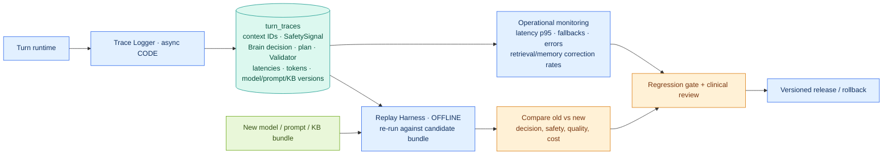

### Evaluation levels

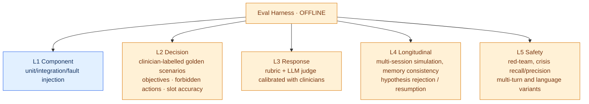

**مقیاس پیشنهادی سند:** golden scenario حدود ۲۰۰ مورد با هدف ۱۰۰۰؛ برای MVP حدود ۱۵۰–۳۰۰ سناریو. `L3` باید با ارزیابی متخصص کالیبره شود؛ پاسخ خوب ≠ اثربخشی بالینی اثبات‌شده. داده‌های trace نیز مشمول privacy، retention و deletion هستند.

## D18 — Backend integration

AI Core در یا کنار backend Go قابل پیاده‌سازی است؛ معماری سند برای MVP سرویس Python مستقل درخواست نمی‌کند. مالکیت داده و API مرز مهم طراحی است.

```mermaid
flowchart LR
    MOBILE["Theia mobile client"]:::external --> API["Existing Go Backend<br/>auth · user management · billing<br/>rate limits · push · transport"]:::external
    API --> CONTRACT["ProcessTurn(TurnRequest)<br/>stream TurnEvent:<br/>token | final | safety_banner | protocol_ui | error"]:::code
    CONTRACT --> CORE["AI Core in Go package/service<br/>Orchestrator + Services + LLM clients"]:::code
    API --> PRIV["Privacy API<br/>HandleCorrection / DeleteMemory<br/>ExportData / DeleteAccount"]:::code
    PRIV --> CORE
    SCHED["Scheduler"]:::code --> WAKE["WakeUp(user_id, reason, scheduled_ref)"]:::code
    WAKE --> CORE
    CORE --> DB[("PostgreSQL<br/>ai_* ownership + messages / vectors / FTS")]:::data
    CORE --> OUTBOX[("Transactional outbox<br/>turn_completed · risk_level_changed<br/>memory_deleted")]:::data
    OUTBOX --> API
    CORE --> PROVIDER["Provider-agnostic LLM client<br/>small/strong/classifier tiers"]:::llm
    classDef code fill:#e2f0ff,stroke:#2563eb,color:#123160;
    classDef llm fill:#efe5ff,stroke:#7c3aed,color:#3b0764;
    classDef data fill:#dcf8ef,stroke:#0d9488,color:#064e3b;
    classDef external fill:#eef2f7,stroke:#64748b,color:#0f172a;
```

**مالکیت پیشنهادی:** بک‌اند: auth، billing، push، message transport و DB instance؛ AI Core: جداول `ai_*`، prompt/policies و دسترسی به داده‌های مرتبط. رویدادها از طریق outbox به بیرون اعلام می‌شوند.

## D19 — Failure and budgets

هدف کاهش fail-stop: در هر خرابی، سیستم تا حد امکان پاسخ امن و سازگار ارائه دهد، بدون اینکه حافظه یا state نامعتبر بسازد.

```mermaid
flowchart TB
    START["Processing turn"]:::code --> PRE{"Pre-gate / retrieval result"}:::decision
    PRE -- "Safety classifier timeout" --> ELEV["Treat this turn as elevated<br/>buffer output"]:::code
    PRE -- "Retrieval fails >300ms" --> DEG["Use state-only context<br/>mark retrieval_degraded"]:::code
    PRE -- OK --> B["Brain · LLM"]:::llm
    ELEV --> B
    DEG --> B
    B --> BR{"Brain valid in budget?"}:::decision
    BR -- No --> REPAIR["One schema repair retry"]:::llm
    REPAIR --> BR2{"valid now?"}:::decision
    BR2 -- No --> DEFAULT["Default reflect plan"]:::code
    BR2 -- Yes --> GEN["Generator · LLM"]:::llm
    BR -- Yes --> GEN
    DEFAULT --> GEN
    GEN --> GV{"Generation and validation OK?"}:::decision
    GV -- No --> FALL["Retry fallback model / regeneration once;<br/>then templated safe message"]:::code
    GV -- Yes --> COMMIT["State transaction"]:::code
    FALL --> COMMIT
    COMMIT --> TX{"Commit succeeded?"}:::decision
    TX -- Yes --> OK["Complete + async work"]:::code
    TX -- No --> REC["Deliver reply, mark state_uncommitted<br/>reconcile next turn"]:::code
    classDef code fill:#e2f0ff,stroke:#2563eb,color:#123160;
    classDef llm fill:#efe5ff,stroke:#7c3aed,color:#3b0764;
    classDef decision fill:#fffceb,stroke:#a16207,color:#713f12;
```

| فراخوانی / جزء | نوع | بسامد طراحی‌شده | هدف عملکردی سند |
|---|---|---|---|
| Safety classifier | small classifier (HYBRID) | هر پیام | `<200 ms`، موازی |
| Turn Brain | small/fast LLM | اغلب NORMAL/PROACTIVE؛ حدود ۸۵٪ فرضی | `0.8–1.5 s` |
| Response Generator | strong LLM | همه مسیرها | TTFT حدود `0.8–1.5 s` |
| Output classifier | small classifier (HYBRID) | پس از پاسخ | `<150 ms` |
| Memory Writer | small LLM (ASYNC) | حدود ۳۰–۵۰٪ پیام‌ها (برآورد سند) | خارج از مسیر پاسخ |
| Reflection Worker | strong LLM (ASYNC) | پایان session / محرک‌های خاص | خارج از مسیر پاسخ |

**توجه:** «دو call اصلی هم‌زمان» یعنی یک Brain و یک Generator؛ دو classifier کوچک و embedding work می‌توانند جداگانه مصرف مدل/API داشته باشند. هدف TTFT انتهابه‌انتها `p50≈2.5–3.5s` و `p95<6s` در سند آمده، اما **اندازه‌گیری واقعی نیست**. Hop دوم Brain یک استثنای محدود است. کنترل هزینه با FAST، caching، shortlist، quota و budget اجرا می‌شود.

## D20 — Roadmap

این نمودار *برنامه پیشنهادی نویسنده* را نشان می‌دهد، نه وضعیت پیاده‌سازی واقعی تیا.

```mermaid
flowchart LR
    subgraph MVP["MVP / first release"]
      direction TB
      M1["Skeleton: Gateway + Orchestrator<br/>FAST + Generator + Trace"]:::code
      M2["Safety Pre-Gate + Crisis Route<br/>+ Output Validator"]:::hybrid
      M3["Assembler + State + Retrieval"]:::code
      M4["Brain + Decision Policy<br/>+ Skill Cards"]:::llm
      M5["Memory Writer/Committer<br/>correction + deletion"]:::hybrid
      M6["Protocol Engine + 3–5 reviewed protocols"]:::code
      M7["Reflection: session-close episodes<br/>internal limited formulations"]:::llm
      M8["Eval, replay, dashboards, clinical review<br/>fallbacks + privacy hardening"]:::hybrid
      M1 --> M2 --> M3 --> M4 --> M5 --> M6 --> M7 --> M8
    end
    subgraph PH2["Phase 2 · longitudinal quality"]
      direction TB
      P2A["Full formulation + hypothesis FSM"]:::llm
      P2B["Follow-ups, advanced memory maintenance"]:::code
      P2C["Longitudinal eval, dependency tracking,<br/>cost optimization"]:::hybrid
      P2A --> P2B --> P2C
    end
    subgraph PH3["Phase 3 · specialization/scale"]
      direction TB
      P3A["Screening protocols + specialized models"]:::llm
      P3B["Shadow mode, A/B, personalization"]:::hybrid
      P3C["Clinician workflows, voice, richer UI"]:::code
      P3A --> P3B --> P3C
    end
    M8 --> P2A
    P2C --> P3A
    classDef code fill:#e2f0ff,stroke:#2563eb,color:#123160;
    classDef llm fill:#efe5ff,stroke:#7c3aed,color:#3b0764;
    classDef hybrid fill:#fff1d6,stroke:#d97706,color:#78350f;
```

---

## فهرست تطبیقی هر ۱۷ ماژول با نمودارهای جزئی

| # | ماژول | نوع و زمان اجرا | ورودی اصلی | خروجی اصلی | نمودار |
|---|---|---|---|---|---|
| 1 | Turn Gateway | CODE · SYNC | TurnRequest | TurnContext / raw message | D02, D04 |
| 2 | Safety Pre-Gate | HYBRID · SYNC/parallel | message + last turns + risk state | SafetySignal | D02, D14 |
| 3 | Context Assembler | CODE · SYNC/parallel | session/thread/protocol/user state | WorkingContext | D05, D13 |
| 4 | Retrieval Service | CODE + embedding · SYNC/parallel | message cues + memory/index | RetrievalResult | D05, D09 |
| 5 | Turn Brain | LLM small · SYNC/NORMAL | WorkingContext + decision/skill catalogs | BrainDecision | D06 |
| 6 | Protocol Engine | CODE · SYNC/conditional | protocol definitions + Brain action + instance | ProtocolStepSpec + patch | D08 |
| 7 | Response Generator | LLM strong · SYNC/stream | response_plan + selected knowledge | user text | D07 |
| 8 | Output Validator | HYBRID · SYNC | streamed/final text + policy | ValidationReport | D07, D14 |
| 9 | State Committer | CODE · SYNC/transaction | proposals + safety + validator + protocol patch | updated state + turn_events | D13 |
| 10 | Memory Writer | LLM small · ASYNC | turns + Brain analysis + nearby memory | MemoryOpProposal[] | D10 |
| 11 | Memory Committer | CODE · ASYNC (correction SYNC) | memory ops + evidence | validated memory updates | D10 |
| 12 | Reflection Worker | LLM strong · ASYNC | evidence + previous formulation + framework | ReflectionResult | D11, D12 |
| 13 | Scheduler / Proactive Engine | CODE · ASYNC | due timers + opt-in + user state | WakeUp events | D16 |
| 14 | Turn Orchestrator | CODE · SYNC | turn + signals + contexts | chosen route, module execution | D02, D03 |
| 15 | Trace Logger | CODE · ASYNC | turn decision + runtime metadata | turn_trace | D17 |
| 16 | Knowledge Bundle Loader/Registry | CODE · STARTUP | knowledge files / versions | pinned read-only assets | D15 |
| 17 | Eval Harness | OFFLINE + LLM judges | scenario suites + traces + candidates | quality/safety comparisons | D17 |

## نکات بحث پیشنهادی جلسه تیمی

1. **Brain + Generator جدا یا ادغام؟** سند برای MVP جدا نگه می‌دارد، به‌خاطر قابلیت کنترل و ارزیابی؛ هزینه/latency باید سنجیده شود.
2. **Fast route بسیار محدود است.** صرفاً چند pattern ساده با guardهای context؛ نیاز نیست Router خودش LLM باشد.
3. **SafetyClassifier و OutputClassifier همچنان model calls محسوب می‌شوند.** شعار «دو LLM» فقط به دو فراخوانی اصلی مولد اشاره دارد.
4. **LLM فقط پیشنهاد state/memory می‌دهد.** اما validation ساختاری به‌تنهایی درستی معنایی یک استنباط را ثابت نمی‌کند.
5. **Streaming vs post-validation:** ممکن است خروجی پیش از تشخیص تخلف جزئاً دیده شود. باید در پیاده‌سازی دقیق تصمیم گرفته شود.
6. **مخاطرات حریم خصوصی:** message، memory، embedding، trace، case formulation و backup همگی باید در سیاست deletion/retention پوشش داده شوند.
7. **مدل‌سازی عمیق و مهارت‌های روان‌شناسی:** Framework، Skill Card و Protocol باید توسط متخصص بازبینی شوند؛ صرف داشتن نمودار به معنی اعتبار بالینی نیست.
8. **Go/Postgres/pgvector** پیشنهاد معماری سند است؛ تطبیق واقعی آن با ساختار فعلی backend باید قبل از ساخت انجام شود.
9. **خروجی‌های نمودارها proposal هستند.** قابلیت‌هایی مانند proactive، نمایش insight از hypotheses، screening و full formulation طبق roadmap به‌تدریج اضافه می‌شوند.

**Source-of-truth for discussion:** original uploaded architecture document. Where diagrams abstract complex steps, the original module contracts and invariants take precedence.
