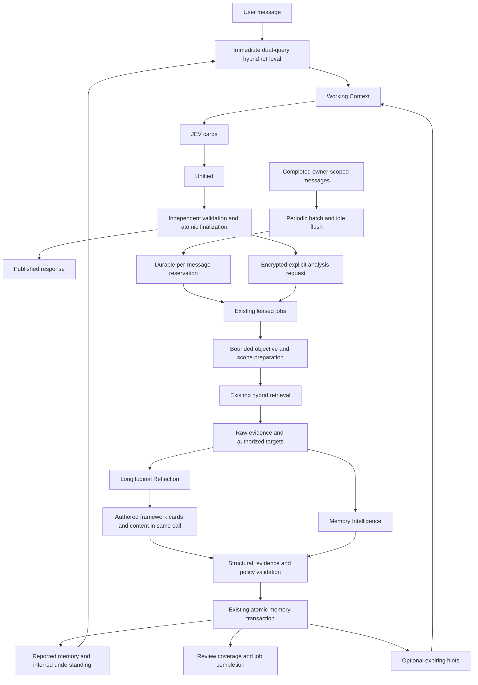
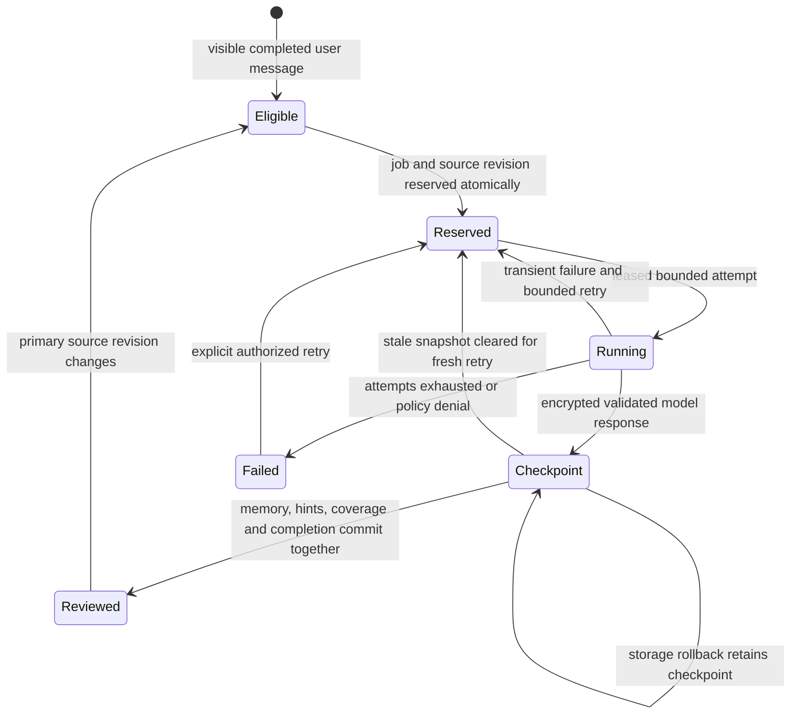

# Background Intelligence and Long-Term Memory — Phase 2

This is the active background specification after ADR 0016. Phase 1's dual-query
retrieval → Working Context → JEV → Unified → independent validation → atomic
finalization remains intact. There are still exactly two synchronous generative
calls. No response waits for background retrieval or inference. Background hint
reads are optional bounded context reads, not a model prerequisite.

## Data flow and responsibilities

`application/background` owns analytical contracts and model orchestration. Its
consumer-owned repository port is implemented by `adapters/mssql/IntelligenceRepository`,
which extends the existing MemoryRepository transaction, not a new memory store.
The same Memory Worker and Reflection Worker execute jobs. Existing lifecycle
controls, authenticated edits, embedding publishing and scheduler remain in place.
The old standalone Memory/Reflection composition factories were removed.

Memory Intelligence organizes explicitly reported facts, preferences, goals, events,
experiences and people/relationships represented by existing entity references.
Reflection examines longitudinal evidence, alternatives, contradictions, tentative
patterns, hypotheses, information gaps and optional formulations. Reflection can use
user scope or up to four explicitly owned threads; it does not require a single
focus thread. Mutation ownership prevents Reflection from rewriting reported facts
and prevents routine extraction from introducing psychological hypotheses.

## Versioned contracts

- `intelligence_job.v2` wraps pinned bundle, stable operation ID and encrypted task
  data. The encrypted request includes origin (`periodic`, `unified`, `scheduler`),
  responsibility, objective/topic, scope, queries, coverage message IDs and trigger.
- `background_input.v2` distinguishes raw role-attributed evidence, structured
  memory targets, prior derived/operational context, thread versions, knowledge
  cards/content and retrieval metadata. Raw messages retain owner, conversation,
  session, role and timestamp; source manifests retain exact revisions.
- `background_intelligence.v2` returns `operations`, `formulations`, `knowledge_ids`,
  `information_gaps`, `future_hints` and its version. The authoritative JSON Schema
  is under `contract/schema/`; strict decoding rejects unknown fields and request
  chaining. There is one structured call per attempt, no generation/selector loop.
- Unified's existing background request gains an optional scope object:
  `{"kind":"user","thread_ids":[]}` or `{"kind":"threads","thread_ids":[...]}`.
  Unknown/foreign scope fails asynchronously before disclosure. Its existing
  independently validated request/dependency envelope is preserved.

Operations are `add`, `confirm`, `revise`, `contradict`, `supersede`, `consolidate`,
`invalidate`, `noop`. Targets must be supplied, authorized memories. Every substantive
operation cites supplied raw user messages with supporting/contradicting roles.
`context_ids` records dependencies on existing memories without treating them as
independent support. Entity labels/tags, explicit temporal validity, uncertainty and
alternatives are bounded. Reflection can explicitly mark a hypothesis proposed or
supported; its epistemic label remains inferred and numeric clinical confidence is
not an output field. Distinct primary evidence counts are descriptive metadata.

Contradiction preserves the original statement and adds contrary evidence. Revision
archives the previous version. Supersession/consolidation preserve historical targets,
close validity when appropriate and link replacements. Scope/primary-lineage-aware exact identity
prevents duplicate rows and combines duplicate claims within a batch; semantic
matching and action selection belong to the model. A hidden original is retained;
new independent permitted evidence can create a separate identity rather than revive
that row. Existing explicit suppression and rejection cooldowns still apply.

## Durable coverage and recovery

Claims serialize analytical jobs per owner across both workers; embedding work can
continue independently. A short shared claim lock closes the cross-worker race,
while original lease expiry/retry rules recover crashed work.

The sweep scans owners fairly using `memory_review_checked_at`. It reserves a batch
only after ownership, pause and current use-policy checks. A message can belong to
one active reservation. The ledger records both its reserving job and the job that
successfully reviewed it. Explicit analysis can acknowledge overlapping primary
messages; an already-covered routine batch completes without another inference.
Partial overlap preserves remaining pending coverage. Reusing existing memory as
analytical context is distinct from extracting the same primary message again.

There is no 24-hour cutoff. Owners with existing AI state are scanned; the sweep
does not silently initialize AI state for accounts that have never used AI Core.
Older completed prototype turns can be reviewed without fabricating a v1 lifecycle
turn or historical session attribution. Their original data remains readable.
 A configurable idle flush processes an inactive user's
last partial batch. Deleted/hidden messages are ineligible, preserving the existing
visibility policy. Failed or exhausted jobs never acknowledge coverage. Exhausted
reservations remain visible in the ledger joined to `ai_jobs`; the existing explicit
retry API resumes them. They are not silently dropped or automatically retried forever.

Pause prevents new claims; queued reservations remain durable. Explicit correction
and deletion commands remain usable while paused. If pause occurs in flight, the
worker defers/retries and rechecks authorization. Claims defer while a foreground
lease is active; publication rechecks the lease inside the owner transaction so an
admitted turn wins without waiting for background inference.

Checkpoint recovery revalidates current source revisions, complete primary content,
user/memory versions, target versions, thread/formulation versions and policy before
publishing. An unchanged checkpoint avoids both search and inference on retry. A
stale checkpoint is cleared for a fresh bounded attempt. Every mutation and job
completion uses the existing lease token/expiry and immutable receipt boundaries.

## Preparation and limits

`knowledge/config/background.yaml` configures defaults: batch 16 messages, minimum
four, idle flush 300 seconds, sweep every 30 seconds, at most 32 owners per sweep,
16,000 estimated input tokens and 3,000 output tokens. Constructor validation caps
batch size at 32, targets at 24, raw evidence at 64, threads at four, operations at
16, formulations at two and hints at four. Existing physical-attempt, provider,
hourly/daily job and token limits still apply. The runtime Memory Writer model slot
is retained as an operational name and now permits the bounded 3,000-token response.

A periodic batch uses a deterministic bounded excerpt as its retrieval query, never
a query-generation model. Explicit analyses execute up to three Unified queries
through the existing hybrid infrastructure. Retrieved memory IDs join bounded recent
candidates as real targets. Their user-message provenance, including contrary
reports, is expanded only after authorization. Recent conversation messages preserve
roles; assistant text can aid context but cannot support a memory or hypothesis.
Thread/user scope controls candidate selection. Existing protocol inputs/outcomes,
sessions, threads and formulations are observational context where available. No
exercise UI or intervention agent was added; protocol records themselves do not
replace the original user messages as new independent proof in this phase.

Optional context shrinks to fit input bounds. Selected pending primary messages are
never silently trimmed or marked reviewed to satisfy a token budget. An unfit
mandatory batch fails visibly without acknowledging it. The preparer loads only
bounded candidate targets; it no longer depends on loading an entire memory store
or on a five-neighbor writer contract.

Reflection receives the authored framework cards and the two small full framework
resources in its same analysis call. It selects zero/one/multiple IDs and may return
no formulation. There is no ProblemTags suitability router, selector LLM or retrieval
engine for framework choice. Authored allowed fields/statuses/evidence prerequisites
are validated. This exchanges bounded static input tokens for avoiding another model
call; no live cost or latency improvement has been measured.

## Epistemics, changes and future recommendations

Raw evidence, structured reported memory and derived understanding remain separate
through storage, retrieval and model input. Hypotheses never become reported facts
through retrieval frequency, supporting-count thresholds or system repetition.
They retain inferred status, primary provenance, contradiction links, tentative text,
uncertainty/alternatives in the encrypted result and archived versions. Existing
formulations are append-only versions; threadless user-level formulations reuse the
same table with explicit scope metadata. The original Reflection elevated-risk
authorization check is preserved; no background model takes over Safety.

Corrections, invalidation, supersession and explicit memory deletion stale dependent
hypotheses/formulations and invalidate dependent recommendations through recorded
references. Original rows, evidence, content and versions remain retained. Normal
context/retrieval hides stale formulations. Conversation/raw-message hiding remains
separate from authorization to use independently retained derived information; it
does not silently revoke consent or cascade deletion.

Validated hints are encrypted, job-linked, scoped and source-version bound. They
expire after at most three accepted turns or 72 hours. The next context read loads
only live hints; carried background entries are refreshed from their authoritative
record rather than renewed indefinitely. Hint loading has a 100ms optional deadline;
source-policy filtering has a 25ms budget per model boundary. Unavailable/stale hints
are omitted without rejecting the user response. JEV/Unified still treat them as
recommendations. Background output cannot create another analytical request.

## Persistence, rollout and Inspector

Apply additive `0042_background_intelligence.sql` after 0041 before starting this
release. It adds `ai_memory_review_messages`, `ai_background_hints`, a fair-scan
metadata column and scope/status metadata on existing formulations. Existing
formulation/reflection thread/session references become nullable for user-level
analysis. Composite owner FKs, review ownership triggers, preservation guards and
filtered uniqueness indexes protect old/new records. No existing migration changed.
A code rollback may retain the additive objects; do not undo nullable-scope data or
run old code against user-level records without a compatibility review.

Old pinned jobs remain associated with their original bundle hashes and encrypted
schemas. Run their matching release to drain them. Serialized old schemas/executors
remain for that compatibility and existing isolated tests; the active composition
always uses new intelligence tasks and periodic batching. No new per-turn writer
path is configurable. The existing scheduler's owned thread tasks use the new
Reflection executor in the active composition.

Inspector remains opt-in, local-only and offline. A job attaches to its originating
turn trace when available, otherwise produces a standalone `kind: job` document.
User-level work has a real job ID and may omit turn ID. It captures origin, coverage,
objective, queries/ranks, prepared evidence/targets, frameworks, model request/output,
accepted/rejected operations, revisions, hints, actual attempts/usage/cost metadata
and commit/failure status. Ordinary logs remain metadata-only. The authoritative
`local_ai_trace.v1` envelope remains backward compatible; no backend connection or
watcher was added to the Explorer.

See `docs/quality/background-intelligence-2026-11-24.md` for executed checks and limits.

The active worker constructors do not instantiate legacy Memory Writer or
Reflection models. Legacy semantic maintenance is rejected by the new executor;
old versioned worker constructors remain only for their matching pinned releases
and isolated compatibility tests. Authenticated memory controls and index work
continue to reuse the existing operational services.
