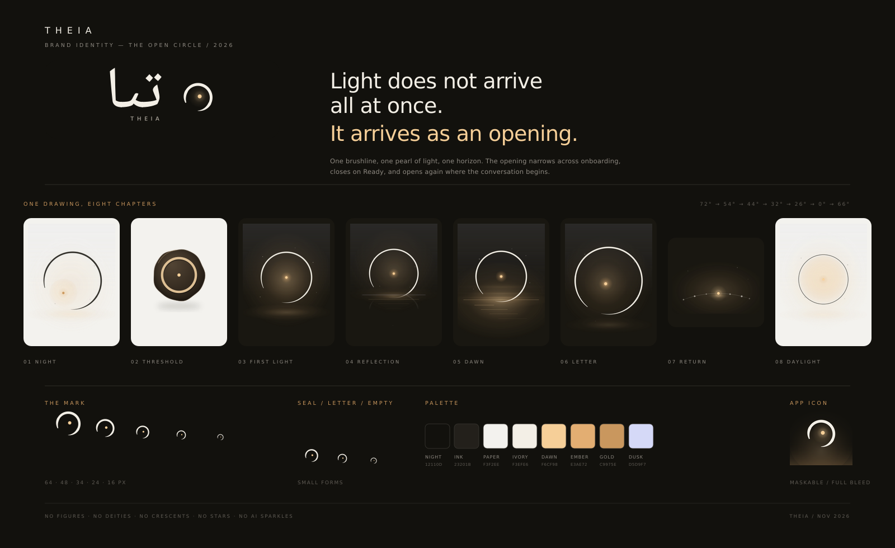

# Theia — «دایرهٔ باز»
## Brand identity and visual narrative, 2026-11

> **Light does not arrive all at once. It arrives as an opening.**

Theia is named for the Greek goddess of sight — not for a character, but for the
condition that makes seeing possible. The identity therefore never depicts the
goddess. It depicts what the name stands for: **an opening through which light reaches
what was already there.**

The whole system is one drawing.

---

## 1. The idea

A single brushline begins to describe a circle and lifts before it closes.
One small point of light rests inside it.

- **The open circle** is the self: whole, but still becoming. The gap is not a
  flaw or a loading state; it is the space the product deliberately leaves for
  the person using it.
- **The pearl** is the light one already carries. It is small, warm and quiet —
  never a glowing orb, never a sunburst, never a "spark of genius".
- **The horizon** is the second recurring mark: the line at which inner weather
  becomes visible. It is always a hairline, never a landscape.
- **The opening narrows as the story is told.** Across onboarding the gap closes
  from 72° to 0°, then opens again on Home. This is the narrative, encoded in
  geometry and covered by a test.

There are no figures, faces, hands, deities, crescents-as-religion, stars as
decoration, neural networks, sparkles or neon gradients anywhere in the identity.

The emotional register is **a quiet room at dawn**: warm paper, ink, one window,
one line of light. It should feel designed by a person, for a person.

---

## 2. One drawing, eight chapters

Every onboarding illustration is a chapter of the same drawing. Nothing is a
scene *about* Theia; everything is a study of light arriving.

| Screen | Chapter | Opening | Composition |
| --- | --- | --- | --- |
| Welcome | **شب / Night** | 72° | Ink circle on paper, light pooled off-centre toward the opening; one low horizon. |
| Privacy | **مهر / Seal** | closed | A dark wax seal stamped with a ring of light: a boundary that holds, not a cage. |
| `simple-intro` | **نخستین نور / First Light** | 54° | The luminous circle at night, pearl at centre, horizon far below. |
| `deeper-intro` | **بازتاب / Reflection** | 44° | The circle lowers into the horizon; its foot dissolves into dark water and shimmer. |
| `know-intro` | **سپیده / Dawn** | 32° | A wide low dawn behind the circle; strata of light on the horizon. |
| `almost-intro` | **نامه / Letter** | 26° | The circle at monumental scale, almost closed, light held at the centre. |
| `checkins` | **بازگشت / Return** | — | A thread of seven small lights along a horizon; one is lit today. No completion ring. |
| Ready | **روشنایی / Daylight** | 0° | The hand-drawn line resolves into a perfect closed circle around daylight. |
| Home | **گفت‌وگو / Conversation** | 66° | The circle opens again. The conversation is the next chapter. |

The gap values live in `THEIA_CHAPTERS` (`src/components/TheiaBrand.jsx`) and the
brand test asserts that they narrow strictly and that Home re-opens the circle.

The tonal rhythm is deliberate: paper (thought) → night (feeling) → dawn
(clarity) → daylight (readiness) → night again (the ongoing conversation).

---

## 3. The symbol

**Construction.** A ring with a deliberate opening, drawn as a *filled* path
whose thickness is modulated like a brush: a blunt entry, a breathing body, a
fine lift at the tail. A pearl sits inside, slightly off-centre.

- Gap: 66° centred at 124° (lower-left) in the primary mark.
- Proportions: circle Ø 40/64 of the box; pearl Ø 6/64; stroke 4.4/64.
- The mark is generative but deterministic: `brushRingPath()` in
  `src/components/TheiaBrand.jsx`.
- Never add a second dot, an arrow, a face, a crescent or a star.
- Never animate it as a progress spinner. Motion belongs to the orbit traces and
  the motes, at very low amplitude.

**Light / dark.** In the UI the ring inherits `currentColor`; the pearl is
`--theia-gold` on paper and `--theia-dawn` on ink. The luminous variant adds a
halo and is used only on dark surfaces.

**Minimum sizes.** 16px for UI, 14px for the pearl seal, 40px for standalone
brand use. Below 16px use `TheiaSealIcon` (ring + pearl, no modulation).

**Clear space.** At least the pearl diameter (≈ size/10) on every side; never
crop the opening.

**Lockups.** `public/brand/theia-logo.svg` (ink) and
`theia-logo-light.svg` (paper). The Persian wordmark is **outlined**, so the
lockup never depends on an installed font. Lockup order in RTL: symbol on the
right, wordmark to its left, `THEIA` tracked beneath.

---

## 4. Colour

| Token | Hex | Role |
| --- | --- | --- |
| `--theia-night` | `#12110d` | Ground. Almost-black warm ink; never pure #000 in brand art. |
| `--theia-ink` | `#23201b` | Text and linework on paper. |
| `--theia-paper` | `#f3f2ee` | The paper field. |
| `--theia-ivory` | `#f3efe6` | Linework and type on ink. |
| `--theia-dawn` | `#f6cf98` | Light itself. The only high-chroma colour. |
| `--theia-ember` | `#e3ae72` | Mid-tone of light, gradients and horizon warmth. |
| `--theia-gold` | `#c9975e` | The pearl on paper, seals, small accents. |
| `--theia-dusk` | `#d5d9f7` | Cool counterweight: air, water, orbit traces. |

Rules: one light source per composition; warm light is never paired with a cool
glow of equal strength; no more than ~15% of any artboard is above 60% opacity.
The existing UI tokens (`--light`, `--ink`, `--beige`, `--dark`, `--lavender`,
`--yellow`, `--green`) are untouched, so screen backgrounds and controls keep
their designed contrast.

---

## 5. Typography

- **Persian display / wordmark:** Noto Naskh Arabic (variable, weight ~500).
  Outlined in the logo assets; live text in the drawer uses the same family.
- **Interface:** Estedad (unchanged). The onboarding headings, body and buttons
  are exactly as designed.
- **Latin signature:** Estedad, uppercase, +620 tracking at 12.5px (e.g. `THEIA`).
- Nothing in the identity introduces a new UI typeface, weight scale or
  letterspacing rule.

---

## 6. Motion

| Element | Motion | Duration |
| --- | --- | --- |
| Scene entrance | 9px rise + 1.5% scale, opacity | 900ms, once |
| Circle | 6% scale settle | 1100ms, once |
| Orbit traces | linear rotation | 54s, infinite |
| Motes | 4px drift + opacity breath | 9s, staggered |
| Light dot | no motion of its own (scene glow only) | — |

All motion stops under `prefers-reduced-motion: reduce`. Motion is atmospheric,
never illustrative: no drawing-on of the line, no pulsing CTA, no typing dots.

---

## 7. Illustration principles

1. **One light, one horizon, one circle.** If a composition needs a fourth
   element, remove one instead.
2. **Hairlines and gradients, not flat shapes.** Line weight 0.8–1.2 at 360px;
   light built from layered radial gradients.
3. **Negative space is the subject.** At least 55% of any plate is quiet.
4. **Asymmetry over symmetry.** The pearl is off-centre; horizons sit low; the
   dawn is wider on one side.
5. **Paper grain at 5%.** A single tiled fractal-noise layer keeps the vectors
   from feeling clinical.
6. **No literal myth, no figures, no eyes, no hands, no celestial clip-art.**
   The moon may exist only as reflected light on water — never as an icon.
7. **Persian first.** The visual language is closer to a Persian miniature's
   *light* than to its figures: a gold horizon, a field of ink, one small
   radiant point.

---

## 8. Voice of the visuals

The art never speaks in the first person and never depicts "Theia" as a who.
The product's voice remains the existing Persian copy; the brand's visuals are
the pause before that voice. Letter signatures, seals and empty states use the
same mark at small scale, so a letter feels sealed by the same hand that drew
the onboarding.

---

## 9. Where it lives

| Touchpoint | Implementation |
| --- | --- |
| Core mark, seal, letter glyph | `TheiaMark`, `TheiaSealIcon`, `TheiaLetterEmpty` |
| Onboarding plates | `TheiaScene variant="welcome \| simple \| deeper \| know \| almost \| privacy \| checkins \| ready"` |
| Home emblem | `TheiaHomeArt` (open circle + orbits, no figure) |
| Wax seal / letters | `TheiaMark` inside `.wax-seal`, `.letter-signature-mark` |
| Logo, app icon, favicon | `public/brand/*`, `public/favicon.svg`, `public/apple-touch-icon.png` |
| Tokens & motion | `src/styles.css` → “Theia brand: «دایرهٔ باز»” |
| Narrative contract | `THEIA_CHAPTERS`, asserted in `scripts/theia-brand.test.mjs` |

## 10. What was retired, and why

The previous identity centred on an illustrated female deity holding a light,
repeated across every onboarding plate. It was beautiful but made the product
*about a character*, implied a mythology the product does not perform, and
competed with the user's own story. The figure, the crescent-and-star emblem,
the hands-and-keyhole privacy art and the person-with-a-moon check-in art are
removed — not restyled, not reused as textures. The layouts, screen order,
copy, typography, spacing and controls are unchanged.

---

### Alt-text policy

Onboarding plates are decorative (`aria-hidden`) and are described once by the
wrapping element's Persian `aria-label`, e.g. *«حلقهٔ نور در دل شب، با نخستین
نقطهٔ روشنایی»*. Descriptions name the light, the circle and the horizon; they
never name a goddess or a person.
