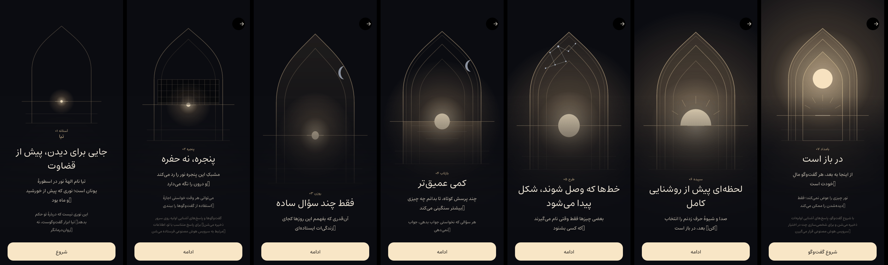
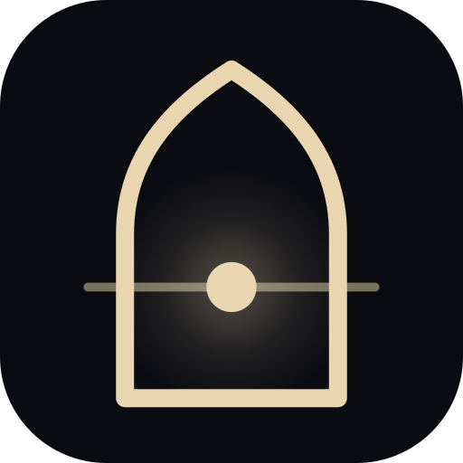

# Theia — the dawn narrative

Design record for the onboarding redesign (2026-11-26).
Supersedes the "goddess illustration" identity recorded in
`FRONTEND_DESIGN_SPEC.md` (2026-11-12 logo decision) and on the Welcome / Story
screens. Product boundaries, routes and backend behaviour are unchanged.

## 1. The problem with the old identity

The previous Theia was a young woman in a black chiton holding a globe of light,
standing under a crescent moon: a Greek goddess rendered as a portrait. Four
things went wrong for an Iranian mental-health product:

1. **It implied a person.** People confide in what looks like a therapist. A
   painted woman's face promises a clinician who is not there, and quietly
   anthropomorphises an AI tool — the exact claim `PRODUCT_CONSTITUTION.md`
   forbids.
2. **It was a stranger's body.** For users in Iran the draped female figure
   reads as Western fantasy art, not as their own visual culture; and for a
   product about the body, gender and family, a female body as the face of the
   product narrows who it is for.
3. **It was decorative, not meaningful.** The illustration carried no idea. The
   moon, the globe and the dress were aesthetic props with no relationship to
   what the product does.
4. **It looked like a storybook.** Soft line art, a smiling goddess and a star —
   warm, but closer to a children's myth collection than to a premium tool for
   adults.

## 2. Who Theia actually is, and why that matters here

Theia (Θεία) is a Titaness: daughter of Gaia and Uranus, mother of Helios (sun),
Selene (moon) and Eos (dawn). She is the **divine light** — the radiance that
lets things *be seen*, not a character who speaks or heals. Her name is bound to
the Greek *thea*, "sight", and *theaomai*, "to behold".

That is a far better metaphor for this product than a face:

- A therapist's work begins with **making something visible** — naming a feeling,
  noticing a pattern — not with advice.
- Light is **non-judgemental**. It does not rank what it reveals; it only makes
  it available. For someone afraid of being judged, that distinction is the
  whole promise.
- Light **arrives gradually**. Dawn is not an event; it is a slow accumulation.
  Therapy, and this product, work the same way.
- Crucially, Theia is **not the source of the light that matters**. In myth she
  is the condition, not the cure. The copy therefore never says "I will heal
  you"; it says seeing is possible, and the room is safe.

## 3. The visual language

No figure, no face, no deity. One architectural motif carries everything:

- **The pointed arch** — the Persian *tāq*, the shape of a doorway, a mihrab, a
  window in a courtyard house. It is instantly legible to Iranian users as
  "an opening in a built, protected space", which is exactly what the product
  claims to be. It is drawn as a hairline, twice or three times, so it reads as
  drafted architecture rather than as a cartoon doorway.
- **The horizon** — a single line, the threshold between what is inside and what
  is beyond. Light either sits on it, above it, or breaks through it.
- **One source of light** — a small disc that grows across the story. It is the
  only element with colour temperature.
- **The lattice (*mashrabiya*)** — a screen of slim openings: you can see out,
  the world cannot see in. This is the privacy chapter, and it is a real Iranian
  architectural element, not an imported padlock icon.
- **Still water** — the reflection chapter: what you see in it is what is there.
- **A constellation** — scattered points becoming a shape: the work of naming.
- **An open door** — light is no longer an event; it is the room.

Palette: night `#0b0c11`, hairline gold `#c9b48c`, dawn `#edc28d`, bright
`#f8e6c6`, moon `#c2ccdf`. Type: Estedad for speech, Noto Naskh for the
inscription-like headings (already installed for Persian; nothing new is loaded).

## 4. The story, screen by screen

Seven chapters, `src/features/onboarding/chapters.js`. The ambient light only
ever increases along `FLOW` — encoded in `assertChapterContinuity` and tested —
so the flow physically brightens as the reader tells more.

| # | Chapter | Screen | Image | Line |
|---|---------|--------|-------|------|
| ۰۱ | آستانه (threshold) | Welcome | closed arch, one point of light on the threshold | جایی برای دیدن، پیش از قضاوت |
| ۰۲ | پنجره (window) | Privacy | lattice screen | پنجره، نه حفره |
| ۰۳ | روزن (aperture) | Simple intro / intake | oculus, thin shaft, crescent | فقط چند سؤال ساده |
| ۰۴ | بازتاب (reflection) | Deeper intro / mood | light on still water | کمی عمیق‌تر |
| ۰۵ | طرح (outline) | Know intro / values | constellation over the arch | خط‌ها که وصل شوند، شکل پیدا می‌شود |
| ۰۶ | سپیده (dawn) | Almost intro → voice → check-ins | half-sun on the horizon | لحظه‌ای پیش از روشنایی کامل |
| ۰۷ | بامداد (morning) | Ready | open door, light in the room | در باز است |

Each narrative screen has exactly one inscription (title), one sentence of body
copy, an optional quiet note, the literal data-processing disclosure where the
product requires it, and one action. Intake questions keep their existing light
reading surface and only gain the small chapter mark, so long option lists stay
legible.

Copy rules used throughout (see `src/features/onboarding/story.js`):

- never speak as a deity, never promise an outcome, never name a diagnosis;
- the product says plainly that it is a tool, not a therapist;
- poetry always sits *beside* the approved privacy wording, never instead of it;
- no exclamation marks, no emoji, no "welcome to your journey" filler.

## 5. The mark

The old logo — a white profile of a woman with a star, on black — is retired
everywhere (Home, drawer, chat, letters, login, icons, manifest, favicon).
`TheiaMark` now draws the same grammar as the scenes, legible at 16px: an arch,
a horizon, and the point of light where they meet.

## 6. Composition, motion, accessibility

- Layout is **flow**, not overlay: art takes the remaining height, copy sits
  under it, the action is last. Nothing can overlap at 360/390/430 × 844/667/600;
  short screens shrink the illustration instead of pushing words onto it.
- Motion is optical only: the glow breathes on a 7.5 s cycle, the scene settles
  in over 900 ms, stars fade in by sequence. Everything stops under
  `prefers-reduced-motion`.
- All art is `aria-hidden`; meaning lives in the copy. Chapter marks are real
  `role="img"` labels. One `h1` per screen; the CTA is a native button.
- No new runtime dependency, no web font, no raster image in the app: the whole
  visual system is ~6 KB of inline SVG plus CSS custom properties.

## 7. What changed in code

| File | Change |
|------|--------|
| `src/features/onboarding/artwork.js` | new — arch/horizon geometry, 7 scenes, glyph |
| `src/features/onboarding/chapters.js` | new — chapter map, per-route dawn level, continuity assertion |
| `src/features/onboarding/story.js` | new — all narrative copy and the approved disclosures |
| `src/components/TheiaArt.jsx` | new — `TheiaScene`, `TheiaGlyph`, `ChapterMarks` |
| `src/components/TheiaBrand.jsx` | photographic logo replaced by the glyph |
| `src/screens/Onboarding.jsx` | `NarrativeScreen` shell; Welcome, Privacy, four interstitials, Check-ins, Ready rewritten |
| `src/features/devsession/DevLogin.jsx` | night surface, chapter scene, no portrait |
| `src/screens/Onboarding.jsx` (voice) | quiet dawn-line backdrop behind the selector |
| `src/styles.css` | dawn narrative system, mark, login, chapter marks on light surfaces |
| `src/features/appearance/screenSurface.js` | narrative chapters share the night surface |
| `public/favicon.svg`, `public/brand/theia-*.{svg,png}`, `index.html`, manifest | new non-figurative mark |
| removed assets | `photo_2026-11-12…jpg`, `theia-welcome/story-*/ready/privacy/checkins.png` |

Tests: `scripts/theia-brand.test.mjs` (identity, non-figurative rule, chapter
continuity, disclosure wording), `scripts/onboarding-narrative.test.mjs`
(server-render every screen), `scripts/e2e-onboarding-narrative.mjs` (opt-in
browser QA: overflow, collisions, dawn monotonicity, reduced motion).

## 8. Open product notes (unchanged by this work)

- Voice remains a **written** style preview; the screen says plainly
  «پخش صوتی نداریم» so no one expects audio.
- Intake answers stay in React memory until Ready, and only the approved
  allowlisted answers are sent — the narrative does not change that boundary.
- Sensitive intake routes keep their skip/decline paths.

## 9. Verification (2026-11-26, agent sandbox)

| Check | Result |
|-------|--------|
| `npm test` | **PASSED** — 125 tests, including the new identity, chapter-continuity, copy-boundary and server-render suites |
| `npm run build` (Vite) | **PASSED** |
| Static art proof (`docs/design/assets/*`) | Rendered from the same geometry modules used by React |
| `node scripts/e2e-onboarding-narrative.mjs` | **BLOCKED** in the sandbox — Chromium cannot start (missing `libnspr4`/`libnss3`); run it locally against `npm run preview:theia` or the Go stack |
| `npm run check:foundation` | **FAILED before and after this change** — it requires a `.agents/skills/` directory that is not present in this checkout |
| Playwright suites (`e2e-*`) | **NOT RUN** — need the Go/MSSQL stack |

The visual composition was verified against a concrete measurement model: the
art block takes `100dvh − 36px inset − copy height − CTA`, so copy and action
can never be overlapped; short viewports shrink the illustration and, below
640px, drop the optional note.
