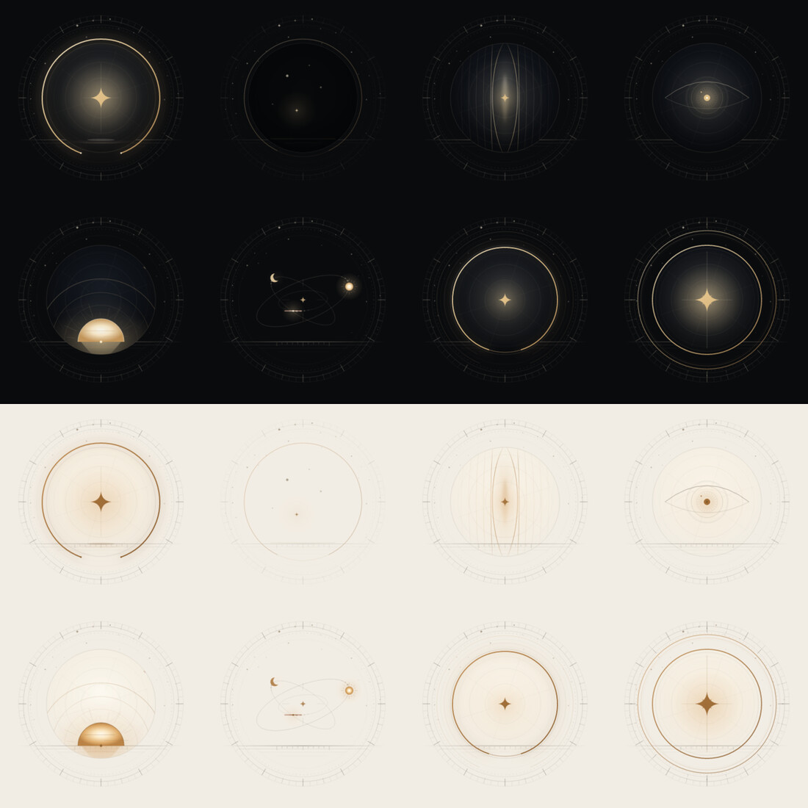

# تیا — Onboarding redesign, 2026-11

**Scope:** the entire pre-Home journey (26 routes in `FLOW`), plus the sign-in entry
that precedes it. Routing, server-owned progress, answer storage, and every
network boundary are unchanged. This document records the identity, the story,
and the reasoning behind both.

---

## 1. The problem with the old onboarding

The 2026-11 baseline presented Theia as a young woman in a black dress holding a
globe of light, repeated as four portrait "chapters", plus a female profile logo
used across Home, Letters, chat and sign-in. Three problems:

1. **It answers the wrong question.** The product is not a person and must never
   imply a human clinician. A beautiful woman makes exactly that implication,
   and it is hard to walk back later in a health product.
2. **It is culturally off for the audience.** For Iranian users, a female Greek
   deity depicted as a body — a bare-shouldered figure with flowing hair — is
   read either as foreign fantasy art or as a religiously awkward image. Iranian
   visual culture is at ease with light, geometry, instruments and calligraphy;
   it is not at ease with depicting a goddess.
3. **It was decorative rather than meaningful.** The four portraits told no
   story, carried no psychological idea, and looked like a stock mythological
   theme rather than a premium mental-health product.

## 2. What the myth actually offers

Theia is unusually well suited to a faceless identity, because the primary
sources barely give her a body at all:

- Hesiod, *Theogony* 132–136 and 371–374: Theia, with Hyperion, bears **Helios
  (sun), Selene (moon) and Eos (dawn)** — she is the mother of the three lights.
- Pindar, *Isthmian* 5.1: *"Mother of the sun, Theia of many names"* — she is
  addressed as light itself, not as a character.
- She has **no myth cycle, no cult, no temple, and no canonical statue**. Unlike
  Demeter or Athena there is no established iconography to reproduce.
- Her name is bound up with *θεά* ("goddess") and with brightness; later
  readings associate her with **sight** and with the shining substance of light.
  That reading — the far-shining, the one through whom things are seen — is the
  one the product takes.

So the honest visual answer to "who is Theia?" is: **not a woman, but an
instrument of light** — the thing that lets you see.

## 3. Why this is culturally right for Iran

- **Non-figurative is the native register.** Persian visual tradition solves
  transcendence with geometry, calligraphy, light and instrument-craft. A
  faceless symbol is not a compromise here; it is the more sophisticated choice.
- **The astrolabe is ours.** Iranian and Islamic astronomy produced the
  astrolabe and the observational instruments of Maragheh and Samarkand; the
  rete (the star lattice), the graduated rim and the horizon plate are a shared
  cultural memory of *reading the sky accurately*. "Insight" in Persian is
  بینش — literally *seeing into*. The identity is that idea, drawn.
- **Night to dawn is a shared story.** Yalda, the longest night, is the culture's
  own metaphor for waiting for light — used here as a structural rhythm across
  the flow, without pomegranates, candles or other costume.
- **Nothing religious is claimed.** No crescent-as-symbol, no shrine, no
  scripture, no human likeness of the divine. Only light, measurement and
  horizon.

Deliberately avoided: Greek columns, laurel wreaths, "temple" motifs, pastel
mysticism, floral ornament, neon gradients, and any female silhouette.

## 4. The identity

**The open ring.** A single luminous circle that does not close, with one spark
of dawn at its centre and a hairline horizon beneath it. The opening is the
promise: the product does not complete you, contain you, or close around you.

**The instrument.** The same drawing appears in eight states across the story:
night, veil, sight, dawn, orbits, pulse, seal, welcome. One object, changing
light — so the story has continuity instead of eight unrelated illustrations.
Every state is hand-authored SVG (`src/components/TheiaSigil.jsx`), so it stays
crisp, animates, and re-tones itself for dark ("ink") and light ("paper")
surfaces.

| State | Where | What it says |
| --- | --- | --- |
| `welcome` | first screen | an open ring with one spark: an invitation, not a face |
| `night` | chapter ۲ | almost nothing is visible; not-knowing is the starting point |
| `veil` | privacy | a curtain parted at the middle: the opening is chosen by you |
| `sight` | chapter ۳ | an eye drawn from two hairlines and a lit pupil |
| `dawn` | chapter ۴ | light arriving at the horizon, gradually, without announcement |
| `orbits` | chapter ۵ | Helios, Selene and Eos in three separate orbits |
| `pulse` | reminders | a ring whose light returns |
| `seal` | ready | the ring closes on its own terms; the circle becomes complete |

**Palette** — night ink `#0A0B0D`, warm ivory paper `#F2EDE4`, dawn gold
`#D9B679` → `#B1874E`, muted graphite `#A29D93` on dark and `#7B746A` on paper.
No pastels, no lavender, no beige "wellness" wash.

**Typography** — Estedad for UI and headings at a lighter, larger setting
(weight ~480 rather than 730) for a calm editorial voice; Noto Naskh Arabic for
the one-line epigraphs, borrowing the manuscript register without ornament.

**Layout** — one instrument, one heading, one paragraph, one action. The action
sits in normal flow (not floating over content), so the composition never
collides on short screens. A six-chapter seam of light at the top replaces the
implicit "where am I?" — chapters, not a percentage.

**Motion** — an instrument that fades in over 900ms, a 260-second rotation of
the astrolabe rete, and slow pulse rings. All of it is disabled under
`prefers-reduced-motion`.

## 5. The narrative

Six chapters, each naming an emotional movement rather than describing a scene:

| Chapter | Routes | Line | The idea |
| --- | --- | --- | --- |
| ۱ · آغاز | welcome, privacy | «تیا را نمی‌بینی؛ با تیا می‌بینی.» | the product is a way of seeing, not a personality to bond with |
| ۲ · شب | simple-intro, name, age, identity, therapist | «از تاریکی شروع می‌کنیم.» | not knowing yourself is the starting point, not a failure |
| ۳ · دیدن | deeper-intro, mood, concerns, focus, feelings | «تیا نور را نمی‌سازد؛ آن را می‌بیند.» | the product will not invent your feelings; it helps you see them |
| ۴ · سپیده | know-intro, faith, neurodivergent, relationships, interests, strengths, barriers, recharge | «سپیده یک‌باره نمی‌آید.» | change is gradual enough that you barely notice it starting |
| ۵ · سه نور | almost-intro, approach, voice, checkins, referral | «خورشید، ماه، سپیده.» | moods are cyclical and plural; none of them is the whole of you |
| ۶ · حلقه | ready | «حلقه کامل می‌شود.» | entering the product is a decision, not a conversion |

The myth is used in the two places where it carries real psychological weight —
never as trivia:

- **Sight, not healing.** Theia does not make light; she sees it. The app does not
  manufacture feelings or answers; it helps you see your own.
- **Three lights, not one mood.** Sun, moon and dawn are all hers, and none is
  permanent. This reframes the mood question and the entire product's stance on
  how a person changes.

## 6. Screen-level changes

- **Sign-in → welcome:** raster portrait removed; the instrument and a single
  line. Sign-in panel is now ink with a hairline card; no white "app card" look.
- **Welcome:** the identity statement, the one mythic sentence, and `شروع`.
- **Privacy:** the veil state and the exact same truthful copy as before — chats
  and intake answers are stored on the server, related data is sent to the AI
  service. The metaphor explains consent without changing a single claim.
- **Name / age / questions:** same logic, same alternatives, same limits and skip
  behaviour. Choices become ivory cards with a hairline, selected = ink with a
  gold seam; the age wheel keeps its physics with a gold-tinted marker; single
  choice still advances after the same 160ms.
- **Mood:** the contour is now the drawing — a tangled thread at the hard end and
  a near-ring at the easy end, in a dawn-to-ash gradient; slider and ticks are
  ink on paper.
- **Voice:** waveforms in gold on ink cards. Copy states plainly that audio is
  not played yet (no fake TTS).
- **Approach:** same five styles, same sample prompt, same swipe/keyboard
  behaviour; now on ink with hairline reply cards and the sigil as the assistant
  mark.
- **Reminders / referrals / ready:** the pulse and seal states carry the ending
  without adding a new promise.

Unchanged on purpose: `FLOW` order, ordinals, progress API, privacy toggle
contract, name persistence, the five style keys, and the legacy info routes
(`testimonials`, `research`, `experts`) which remain outside the active flow.

## 7. Accessibility

- Instrument SVGs are `role="img"` with Persian descriptions; decorative chrome
  is `aria-hidden`.
- Chapter progress is announced once (`فصل ۳ از ۶`) and updated politely, not per
  pixel.
- All interactive geometry keeps ≥44px targets (back 40px visual / 44px area,
  toggles 46×27 with a 17px label gap, pager dots 5px visual with padded slots).
- Contrast: paper `#F2EDE4` with ink `#1A1916`; ink `#0A0B0D` with `#EFEAE1` and
  `#A29D93` for secondary text.
- Reduced motion disables every instrument animation, the entry transition and
  smooth scrolling.
- RTL is structural (`inset-inline`, `border-end-*`); the instrument is
  direction-neutral, so it never mirrors into a different meaning.

## 8. Verification status

- `npm run build` — passes.
- `npm test` — passes except one pre-existing failure that also fails on the
  base commit (`designer routes and visual assets remain present` expects nine
  files in `public/assets/`, but only one was ever committed).
- Visual QA at 360 / 390 / 430px and desktop, keyboard and reduced-motion passes
  are **not yet recorded**: this sandbox has no browser (no Chromium/NSS), so the
  instrument states were verified by rasterising the real SVG modules, and the
  layouts by structure. Run the preview and the QA matrix before release.

## 9. Implementation map

- `src/components/TheiaSigil.jsx` — the mark and the eight instrument states.
- `src/components/TheiaBrand.jsx` — `THEIA_LOGO_SRC` now points to
  `/brand/theia-sigil.svg`; `TheiaMark` renders the vector mark.
- `src/screens/Onboarding.jsx` — new shell (chrome + seam + flow + footer), new
  copy, unchanged interaction logic.
- `src/onboarding.css` — the onboarding surface system, loaded after
  `styles.css` so the legacy sheet remains intact as history.
- `src/features/devsession/DevLogin.jsx` — sign-in entry on the same identity.
- `public/brand/theia-sigil.svg`, `public/favicon.svg`,
  `public/brand/theia-sigil-{192,512,1024}.png`, `public/apple-touch-icon.png` —
  generated by `node scripts/generate-theia-icons.mjs` (no image dependency).
- Retired portrait artwork is kept in `public/brand/` for history and referenced
  nowhere in the UI, HTML head or manifest.

## 10. Known limits

- This is still an internal, synthetic-only build. The voice preview is a design
  affordance; the AI replies in the approach preview are authored samples.
- Onboarding answers remain ephemeral in React memory until final Ready, exactly
  as before; nothing here widens data collection.
- The legacy `testimonials/research/experts` screens still contain unverified
  claims and broken expert portraits. They stay outside the active flow and out
  of scope for this redesign; they must be corrected before any external use.

---

# Art pass — 2026-11-26

**Scope:** the artwork only. Not one character of onboarding copy, not one route,
ordinal, answer key or network call changed. The pass replaces the previous
illustration drawings with a single engraved plate and a sky that warms as the
story advances.

## 11. One plate, engraved

The earlier states were concentric circles with a light event dropped inside. The
new drawings are one *instrument*, drawn the way an astrolabe plate would be
drawn, and then lit differently for each chapter:

- **Limb and graduation** — an outer ring with 72 engraved marks, longer every
  15° and doubled every 30°, plus a slowly turning dashed ring inside it.
- **Rete** — an eccentric ecliptic hairline (the star lattice), kept as a
  measurement layer rather than ornament.
- **Tympan** — a soft interior wash with three meridian circles and six radial
  hairlines, faint enough to read as engraving on ivory and as depth on ink.
- **Horizon plate** — one bright line across the plate with three diminishing
  echoes, a small graduation at its centre and a graded edge, so every light in
  the story is measured against the same horizon.
- **Star dust** — 46 specks scattered on a golden-angle spiral, so the sky looks
  accidental but is deterministic and identical on every render. A few carry a
  four-point glint that twinkles slowly.

All gradient ids are namespaced per instance (`React.useId`), so two plates can
coexist, and the whole illustration re-tones itself for ink and paper.

## 12. The light events

| State | Where | The drawing |
| --- | --- | --- |
| `welcome` | first screen | an open gold ring with a soft halo, one four-point star, a low pool of dawn light at the horizon |
| `night` | chapter ۲ | the ring is barely there, a single small star and a trace of horizon; on paper it is a bare etching |
| `veil` | privacy | two hanging curtain panels of fine folds, parted at the middle with a soft seam of light; the opening is chosen, not taken |
| `sight` | chapter ۳ | an almond eye built from two hairlines, an iris with fine fibres and a lit pupil, plus a breathing measurement ring |
| `dawn` | chapter ۴ | three quiet dawn bands, a fan of rays, the upper half of a honey sun on the horizon and its reflection below; one last star still visible |
| `orbits` | chapter ۵ | three nested, tilted paths with Helios (disc and corona), Selene (crescent) and Eos (a low pale seam), each with a fading trail of light |
| `pulse` | reminders | an open ring with two echo arcs and two slow pulse rings: a light that returns |
| `seal` | ready | the ring closes: double gold circle, 24 rays, a long flare and a two-layer star at the centre |

Each state was rasterised through the real React component (resvg) and reviewed
on both tonalities before the CSS pass, so the drawing, not the copy, carries the
chapter.

## 13. The sky follows the chapters

`Shell` now publishes `data-ob-chapter` (0–5) on the screen element — visual
metadata only. The onboarding surface reads it as a set of custom properties and
warms the sky chapter by chapter:

| Chapter | Sky |
| --- | --- |
| 1 · آغاز | a low, restrained gold tide at the bottom of night |
| 2 · شب | the coldest and darkest of the flow, a cool lift at the top |
| 3 · دیدن | a cool sight-light above, the first warmth below |
| 4 · سپیده | the warm tide rises (14%) |
| 5 · سه نور | warm and higher (21%) |
| 6 · حلقه | the horizon is fully lit (28%) |

Paper screens get the same progression as a printed warm wash rising from the
bottom edge, a lit top edge and a 5% paper-grain overlay — no flat white screen
anywhere in the flow.

## 14. Motion and frame

- The plate **develops like a photograph**: 1250 ms, opacity + a 2.8% scale with a
  short blur that resolves to `filter: none`, so the vector stays sharp.
- The graduation's dashed ring turns over 320 s; seal rays counter-rotate over
  150 s; the sight ring and the pulse rings keep their slow breathing; glints
  twinkle at 7 s with per-star delays.
- Headings, chapter line and footer rise 9 px on entry (760 ms, 90 ms stagger) so
  the composition assembles instead of snapping.
- A radial light pool sits under every plate (`.ob-art::before`), including the
  sign-in screen — a lamp held over paper.
- `prefers-reduced-motion` disables every one of these, including the reveal and
  the new twinkle.

## 15. Mood: the thread becomes the ring

The mood drawing is now a single parametric thread. At the hard end of the scale
it is a dense knot; as the scale moves it loses turns and wobble; at the easy end
it closes into a ring with one deliberate opening — the product's own open ring.
Behind it, the glow is tinted by the chosen state (slate → ash → amber → gold →
dawn), and a hairline horizon keeps it inside the same visual world as the plate.

## 16. Copy and accessibility

- **Copy is untouched.** All 110 Persian strings in `src/screens/Onboarding.jsx`
  are byte-identical to the previous commit; the only JSX changes are the new
  `data-ob-chapter` attribute and the redrawn mood SVG.
- Instrument `role="img"` labels and every `sr-only` announcement are unchanged.
- New atmosphere layers are pure CSS pseudo-elements; the new art layers are
  inside the same `aria-label`ed SVG, and decorative helpers stay `aria-hidden`.
- Contrast ratios are unchanged (no text colour changed); focus rings, hit
  targets and the age-wheel physics are untouched.

## 17. Verification status

- `npm run build` — PASSED.
- `npm test` — 114/115. The single failure is the pre-existing
  `designer routes and visual assets remain present` check (expects nine files
  in `public/assets/`; only one was ever committed) and also fails on the base
  commit.
- `npm run check:foundation` — BLOCKED in this checkout: `.agents/skills/` is not
  present in the working tree, so the script aborts before running its checks.
- Browser QA — NOT RUN in the sandbox: Chromium cannot start here (missing
  `libnspr4`/`libnss3` and no package manager access). The nine illustration
  states were rasterised from the real component through resvg and reviewed on
  ink and paper, and the CSS was verified to compile; a device pass at
  360/390/430 px, desktop, keyboard and reduced motion is still required before
  release.
