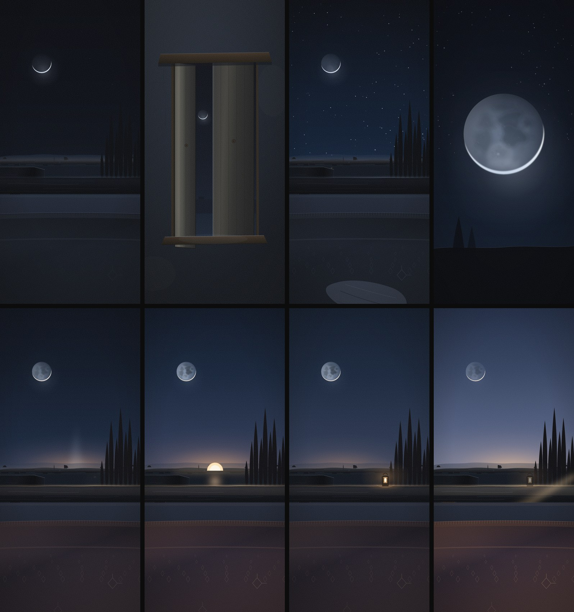

# تیا — Onboarding: Earthshine, 2026-11

**Scope:** the entire pre-Home journey (`FLOW`, 26 routes) plus the sign-in entry.
Routing, `FLOW` ordinals, server-owned progress, answer handling, the privacy
toggle contract and every network boundary are unchanged. This document records
the one idea behind the new visual world, the eight stills that carry it, and the
reasoning a future maintainer needs before touching any of it.

The redesign supersedes the faceless "open ring / astrolabe" identity of the
earlier 2026-11 pass. The ring survives only as the assistant's mark inside the
app (`TheiaSigil`), never as the story.

---

## 1. The idea: Earthshine

A waning crescent is lit by the sun on one side, so a thin bright sliver is all
you can see of it directly. But the dark part of the disc is not empty: sunlight
bounces off **Earth** — off the oceans, the forests, the deserts, the clouds of
the planet — and lands on the Moon, faintly lighting it. It is blue-grey, because
that is the colour of the Earth it came from, and it is brightest just after a
new moon, i.e. exactly when the crescent is thinnest.

That is the whole product in one optical fact:

> **The less of itself the moon shows, the more of the Earth it receives.**

Theia — the name we use for the seeing that helps — never appears. There is no
figure, no face, no light source that is her. There is a place, a sky, and the
way an eye adapts. The product does not add anything to the user; it changes what
becomes visible.

### 1.1 One camera, one place, one night

Every screen is the same view from a Persian **flat roof (بام)**, facing east,
before dawn:

| Constant | Value | What it is |
| --- | --- | --- |
| `VIEW` | 390 × 844 | one phone-shaped canvas, so nothing is ever cropped |
| `HORIZON` | y 452 | where the plain meets the sky |
| `RIDGE` | y 494 | top of the parapet (جان‌پناه) |
| `FLOOR` | y 538 | roof floor (کاه‌گل); the kilim is laid across it from y 596 |
| `MOON` | (116, 176) r 27 | the one moon, upper-left — the side away from the Persian text |

Low parapet, a rug running off the bottom of the frame (we are standing on its
edge), a stair-head hut (سرپله) at the left, a grove of cypresses (سرو) behind a
neighbour's wall at the right, one lantern, and nothing else. No rings, no
glowing circles, no geometric confetti: every mark is a thing in the place —
plaster, wool, brick, wood, leaf, air.

The moon is placed on the left because Persian copy is set flush to the right
edge; the still keeps the right two-thirds of the upper frame quiet for type.

### 1.2 The held moon (ماهِ در آغوش)

The crescent is drawn as a **lune**: the region between a disc and an identical
disc shifted up by about a tenth of the radius. Its widest part therefore sits at
the *bottom* of the disc, so the bright sliver holds the unlit face in its arms —
a waning **morning** crescent, which is what rises before dawn.

That geometry enforces the cultural care the brief asked for:

- it is never a "flag crescent" (a flat shape detached from a disc);
- it is never isolated beside a star (the starfield keeps a 96px hole around it);
- the ashen disc is **always drawn**, even at `ash = 0.05`, so the eye reads "a
  whole moon, dimly lit" and never "an icon".

The maria are real: **Serenity (آسودگی), Tranquility (آرامش), Crises
(بحران‌ها), Clouds (ابرها), Cold (سرما)**, plus Imbrium and Procellarum to frame
the near limb, with Tycho's ejecta as a soft halo rather than drawn spokes.

### 1.3 The progress bar is the disc's legibility

There is no progress bar. The **ashen disc's readability is the progress**: at
the welcome screen it is a rumour (`ash 0.055`); by the close-up of scene 4 it is
half-legible (`0.52`); at the three-lights scene it is fully readable (`1.0`).
The sky runs from near-black to first light over the same span, and the chrome's
small moon repeats the same value through `legibilityFor(route)`.

Warm light is rationed to three moments, and only three:

1. the **lantern** on the parapet, lit in the check-ins world alone;
2. the **first ray** of sun, in the final frame only, landing on the rug;
3. the **sun's crown** breaking the horizon in the three-lights frame.

Everything else is cool: the crescent is white-blue, the disc is Earth's
blue-grey, the sky is ultramarine → ash → peach only at the horizon.

---

## 2. The eight stills

`src/components/EarthshineScene.jsx` exports one scene engine. Each world is a
palette + a small set of presence flags over the same geometry, so the place is
continuous and never re-composed.

| # | Scene | Routes | The still | Copy |
| --- | --- | --- | --- | --- |
| 1 | `welcome` | welcome | deepest dark; bright sliver + barely-there disc; parapet and rug dark | «تیا را نمی‌بینی؛ با تیا می‌بینی.» |
| 2 | `privacy` | privacy | the same sky, from inside: two weathered shutter leaves parted by a vertical of sky, moon in the gap | «چه‌قدر بگویی، انتخاب توست.» |
| 3 | `night` | simple-intro, name, age, identity, therapist | more stars than first appear; one warm window far on the plain; a folded blanket on the kilim | «از تاریکی شروع می‌کنیم.» |
| 4 | `seeing` | deeper-intro, concerns, focus, feelings | the close-up: the held moon fills the frame, seas readable, cypress tips at the bottom edge | «آن‌چه تاریک به نظر می‌رسد، خالی نیست.» |
| 5 | `dawn` | know-intro, faith, neurodivergent, relationships, interests, strengths, barriers, recharge | the horizon is the event; the **false dawn (صبح کاذب)** rises as a soft zodiacal cone and fades | «سپیده یک‌باره نمی‌آید.» |
| 6 | `three` | almost-intro, approach, voice | sun crown on the horizon, dawn band, fully readable moon: three lights in one frame | «سه نور؛ و هیچ‌کدام همیشگی نیست.» |
| 7 | `checkins` | checkins, referral | the frame a little later; the **lantern** lit on the parapet, its pool on plaster and wool | «اگر بخواهی، چراغ روشن می‌ماند.» |
| 8 | `final` | ready | first light: one low beam from the sunrise side onto the rug, the stair door open and warm, the moon still up | «از این‌جا شروع می‌کنیم.» |

A ninth, `mood`, exists only as a **backdrop** for the mood scale: the same roof
with the moon taken out of the sky, because on that screen the moon comes forward
and the user answers with it.

### 2.1 The mood screen answers with the moon

The mood scale is not a slider with an emoji over it. `HeldMoonFigure` draws the
same moon large, and the five answers are **places on it**, drawn from the seas
the story already named:

| Answer | Sea |
| --- | --- |
| این روزها سخت می‌گذرد | دریای بحران‌ها |
| انرژی زیادی ندارم | دریای سرما |
| یک روز خوب، یک روز سخت | دریای ابرها |
| دارم می‌گذرونم | دریای آرامش |
| در کل حالم خوب است | دریای آسودگی |

Moving the slider moves a lit ring from sea to sea and raises the disc's
legibility (`0.24 → 1.0`), so the answer is a place and a light rather than a
number. The stored value is still `answers.mood`, an integer 0–4, exactly as
before: **no change to data collection.**

---

## 3. Surface system

Two surfaces, unchanged in spirit:

- **night** — `#05070d` base, text `#eef1f6`, secondary `#c3cad7`, gold `#d7b284`.
  Used by every story screen and every form sheet.
- **paper** — `#f3efe6` base, text `#1b1a17`, secondary `#615c53`, gold `#8e6534`.
  Used by the legacy info routes (`testimonials`, `research`, `experts`), which
  keep their own claims and stay outside the active flow.

The still is never covered by a card. A single graded wash (`.ob-wash`, and a
lighter `.ob-frame-hero` variant for interstitials) darkens the foot of the frame
so Persian text always has contrast, and the top of the frame gets only the
faintest vignette. There is no glass, no blur panel, no drop shadow around text.

Frames: `full` (welcome / final, text at the foot over the rug), `hero`
(interstitials, text lower so the sky carries), `sheet` (privacy, mood, age and
the marketing routes, content from the top), `band` (the rest).

Typography: Estedad for everything; Noto Naskh Arabic only for the one-line
epigraph on the welcome screen. Headings at weight ~470 and 27px / 1.62, ledes at
14.5px / 2.02 — a calm editorial voice, not an app.

---

## 4. Motion

Deliberately almost none:

- the still fades in over 1500ms on the two bleed screens (`ob-still-in`);
- the lantern flame breathes (`es-flicker`, 5.6s);
- the selected sea's ring breathes slowly (`ob-sea-breathe`, 4.6s).

No parallax, no scroll-jacking, no drifting stars. All of it is disabled under
`prefers-reduced-motion`.

---

## 5. Accessibility

- Every still is `role="img"` with a Persian description (`SCENE_LABELS`); the
  chrome moon and wash are `aria-hidden`.
- Chapter progress is announced once ("فصل ۳ از ۶") and updated politely.
- The mood moon has its own label naming the chosen sea; the slider keeps
  `aria-valuetext` with the Persian answer, so it is usable with a screen reader
  and with arrow keys.
- Touch targets: primary action 56px / r16, back 44px, toggle 46×27, slider thumb
  34px with a 52px track.
- Contrast (measured against the local wash, not the raw still): ink `#eef1f6` on
  the foot of any still is ≥ 7:1; secondary `#c3cad7` ≥ 4.6:1; on paper, ink
  `#1b1a17` ≥ 12:1 and secondary `#615c53` ≥ 5.6:1.
- RTL is structural (`inset-inline`, logical paddings); the scene itself is
  direction-neutral — the moon is placed to keep the *text* side clear, not to
  mirror anything.

---

## 6. Verification status

- `npm run build` — passes (dist JS ~410 kB, CSS ~106 kB).
- `npm test` — **121/121 pass**, including the new `scripts/earthshine.test.mjs`,
  which guards the single canvas, the lune geometry, the legibility ascent, the
  rationed warm light, the eight labels and the touch targets.
- `scripts/render-screens.mjs [scene…]` rasterises any still to
  `.design/screens/` for review; `scripts/qa-spec.mjs` + `scripts/qa-screens.py`
  composite the real screen markup, the real copy and the real palette into
  phone-sized stills (`.design/qa/`) using HarfBuzz for line breaking and resvg
  for Persian shaping.
- **Not recorded here:** a browser matrix at 360 / 390 / 430px. This sandbox has
  no usable Chromium (missing `libnspr4` and no network to install it), so layout
  was verified by structure plus the composited stills above. Run the preview
  (`npm run preview:theia`) and check the three widths, plus 740px-height
  short-screen rules and safe-area insets, before release.

---

## 7. Implementation map

- `src/components/EarthshineScene.jsx` — the scene engine: `EarthshineScene`,
  `HeldMoonFigure`, `MoonProgress`, `HeldMoonGlyph`, `legibilityFor`,
  `LEGIBILITY`. World palettes live in `WORLDS`; the route→still mapping lives in
  `SCENE_META`.
- `src/screens/Onboarding.jsx` — `Shell(theme, frame, scene)`, `ObHeader`,
  `StoryProgress`, the eight still routes, the redesigned `MoodScreen` and
  `MoodMoon`, and the untouched interaction logic for questions, age, voice,
  approach, privacy and check-ins.
- `src/onboarding.css` — the whole Earthshine sheet: tokens, world/wash/chrome,
  captions, footer, forms, mood stage, approach and voice stages.
- `scripts/render-screens.mjs`, `scripts/qa-spec.mjs`, `scripts/qa-screens.py`,
  `scripts/svg-to-png.py` — the design-QA toolchain described above. `.design/` is
  ignored.
- `src/components/TheiaSigil.jsx` — kept for `TheiaMark` inside the product;
  it is no longer used to tell the onboarding story.

---

## 8. Known limits

- Internal, synthetic-only build. The voice preview is a design affordance; the
  approach replies are authored samples and say so.
- Onboarding answers remain ephemeral in React memory until Ready, as before.
- The legacy `testimonials / research / experts` routes still carry unverified
  claims and two stock expert portraits. They are rethemed to paper and kept out
  of the flow, but they must be corrected before any external use.
- `src/features/devsession/DevLogin.jsx` still renders `<TheiaInstrument>` while
  `onboarding.css` styles a newer `.dev-login-*` structure; the dev-only screen
  renders correctly but the two have drifted. Align them in a follow-up.
